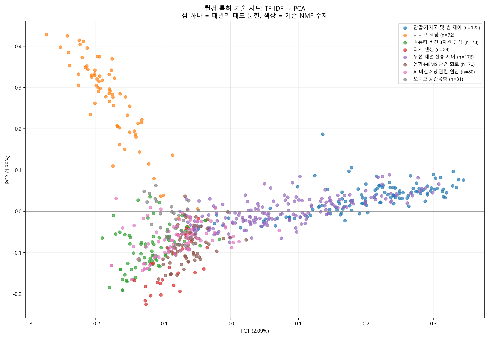
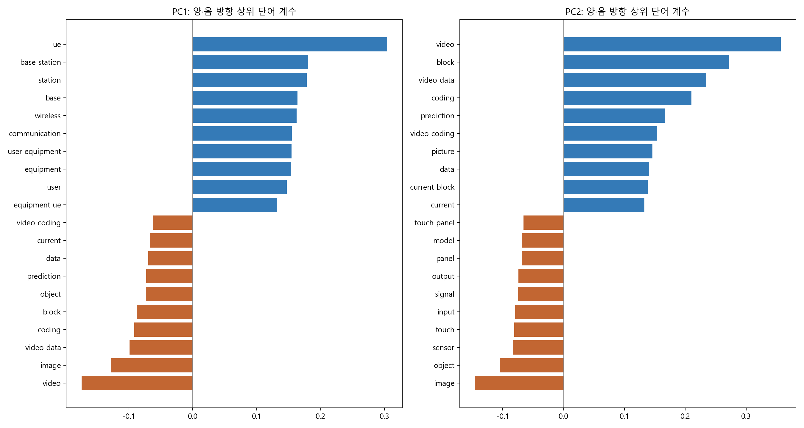

# 퀄컴 특허 PC1·PC2 기술 분석

기존 분석과 동일한 658개 패밀리 대표 문헌을 사용해 2,396개 TF-IDF 특성에 주성분분석(PCA)을 적용했다. PC1·PC2는 두 개의 특허 집단이 아니라, 각 문헌에 동시에 부여되는 두 좌표다.

## PC1·PC2 기술 지도

점 하나는 패밀리 대표 문헌 하나다. 색상은 앞서 계산한 NMF 기술 주제로, PCA 계산에는 주제 라벨을 입력하지 않았다. 가까운 점은 이 두 축에서 용어 구성이 비슷하지만 원래 고차원 공간에서도 반드시 가깝다는 뜻은 아니다.

## 두 축의 의미

| 축 | 설명분산 비율 | 양수 방향의 핵심어 | 음수 방향의 핵심어 | 해석 |
|---|---:|---|---|---|
| PC1 | 2.09% | ue, base station, wireless, communication, user equipment | video, image, video data, coding, block, object | 무선통신 용어와 영상·데이터 처리 용어의 대비 |
| PC2 | 1.38% | video, block, coding, prediction, video coding | image, object, sensor, touch, input, signal | 비디오 코딩 용어와 인식·센싱 용어의 대비 |

PC1이 큰 문헌은 단말·기지국·통신 관련 용어가 상대적으로 두드러진다. PC1이 작은 문헌은 비디오·영상·물체·모델 같은 용어가 두드러지는 경향이 있다. 음수 영역 전체가 하나의 기술 분야는 아니며 여러 비통신 분야가 함께 나타난다.

PC2가 큰 문헌은 블록 기반 영상 압축과 예측·부호화 용어가 두드러진다. PC2가 작은 영역에는 영상 인식, 터치 센싱, 트랜스듀서, 모델 관련 용어가 나타난다. 이는 비디오 코딩을 다른 인식·센싱 기술과 구분하는 경향이지, 성능이나 기술 수준의 순위가 아니다.

막대는 중심화한 TF-IDF 특성에 곱해지는 주성분 계수다. 절댓값이 큰 용어가 축의 방향을 강하게 규정한다. 양수·음수는 상대적 방향이며 우수·열위나 성장·쇠퇴를 의미하지 않는다. 축 부호 자체는 뒤집어도 동일한 PCA 해다.

## 사분면별 문헌 구성

0을 경계로 나눈 기술적 요약이며 별도 군집분석 결과가 아니다. 특히 PC2가 0 근처인 통신 문헌은 상·하 사분면 경계에 민감하다.

| 영역 | 조건 | 그룹 수 | 주요 구성 |
|---|---|---:|---|
| 오른쪽 위 | PC1 ≥ 0, PC2 ≥ 0 | 172 | 단말·기지국 97, 무선 채널·전송 75 |
| 왼쪽 위 | PC1 < 0, PC2 ≥ 0 | 93 | 비디오 코딩 68, 오디오 10 등 |
| 왼쪽 아래 | PC1 < 0, PC2 < 0 | 309 | 컴퓨터 비전 75, AI·관련 연산 70, 음향·MEMS·회로 68 등 |
| 오른쪽 아래 | PC1 ≥ 0, PC2 < 0 | 84 | 무선 채널·전송 58, 단말·기지국 20 등 |

비디오 코딩 문헌 72개 중 68개가 왼쪽 위에 위치해 이 표본에서는 비교적 뚜렷한 용어 집단을 보인다. 반면 왼쪽 아래에는 여러 비통신 기술이 겹친다. 이 겹침만으로 기술 간 융합이나 유사성을 확정할 수 없다. 추가 주성분 또는 원래 TF-IDF 공간에서의 비교가 필요하다.

## 축 양끝의 대표 문헌

다음은 각 PC 점수가 가장 큰 쪽과 작은 쪽의 문헌이다. 전체 좌표는 [문헌별 PC 점수 CSV](./pca_patent_scores.csv)에서 확인할 수 있다.

### PC1 양수 방향

- [REFERENCE SIGNAL DESIGN](https://lens.org/127-728-352-409-078): PC1 = 0.3442
- [TECHNIQUES FOR SUBBAND BASED RESOURCE ALLOCATION FOR NR-U](https://lens.org/011-360-958-349-357): PC1 = 0.3369
- [DEACTIVATING RESOURCES FOR REPETITIONS OF PERIODIC COMMUNICATIONS](https://lens.org/010-706-593-177-407): PC1 = 0.3336

### PC1 음수 방향

- [Coding affine prediction motion information for video coding](https://lens.org/063-870-489-460-269): PC1 = -0.2730
- [DERIVATION OF TEMPORAL MOTION VECTOR PREDICTION CANDIDATES IN VIDEO CODING](https://lens.org/069-311-164-530-027): PC1 = -0.2522
- [Intra BC and inter unification](https://lens.org/135-382-071-132-011): PC1 = -0.2420

### PC2 양수 방향

- [Coding affine prediction motion information for video coding](https://lens.org/063-870-489-460-269): PC2 = 0.4284
- [Intra BC and inter unification](https://lens.org/135-382-071-132-011): PC2 = 0.4255
- [Restriction on palette block size in video coding](https://lens.org/147-979-273-166-583): PC2 = 0.4146

### PC2 음수 방향

- [Touch panel controller integrated with host processor for dynamic baseline image update](https://lens.org/180-470-535-132-629): PC2 = -0.2253
- [ORTHOGONAL FREQUENCY DIVISION SCANNING METHOD FOR SENSORS](https://lens.org/006-114-861-974-004): PC2 = -0.2165
- [System and method to drive touch panel to measure hover](https://lens.org/179-712-225-453-121): PC2 = -0.2044

## 방법과 해석 한계

1. 패밀리 중복 제거, 간이 영어 판별 및 제목·초록 구성은 기존 TF-IDF 분석과 동일하다. 원본 1,000건 → 패밀리 그룹 676개 → 분석 대상 658개다.
2. TF-IDF는 단어·2단어 구문, min_df=3, max_df=0.85, sublinear_tf=True, L2 정규화를 사용했다.
3. 문서×용어 행렬의 각 열을 평균 중심화한 뒤 PCA를 계산했다. 별도의 용어별 분산 표준화는 하지 않았다. 중심화하지 않는 TruncatedSVD와 구분된다. 계산은 full SVD를 사용했다.
4. 재현 가능한 방향 표시를 위해 각 축에서 절댓값이 가장 큰 계수가 양수가 되도록 부호를 정했다.
5. PC1 2.0894%, PC2 1.3821%, 누적 3.4716%다. 나머지 약 96.53%의 분산은 이 그림에 담기지 않는다. 고차원 텍스트를 두 축만으로 충분히 요약했다고 볼 수 없다.
6. 기존 NMF 주제는 색상 및 사분면 구성 설명에만 사용했다. 주제별 분리가 눈에 보인다는 사실은 독립적인 분류 정확도 검증이 아니다.
7. 용어 선택, 초록 누락, 언어 판별 및 표본 구성에 따라 축이 달라질 수 있다. PC1·PC2 좌표는 기술 가치·매출·특허 유효성·표준필수성을 측정하지 않는다.

## 산출물

- [기술 지도](./pca_technology_map.png)
- [축별 핵심어 계수 그래프](./pca_term_directions.png)
- [문헌별 PC1·PC2 점수](./pca_patent_scores.csv)
- [전체 용어의 주성분 계수](./pca_term_coefficients.csv)
- [분석 수치 JSON](./pca_results.json)
- [재현 코드](./qualcomm_pca.py): Downloads에서 `python qualcomm_pca.py` 실행. 기존 분석이 생성한 `qualcomm_analysis/family_topics.csv`가 필요하다.
