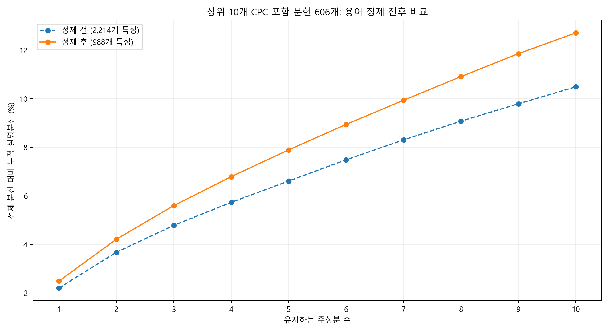
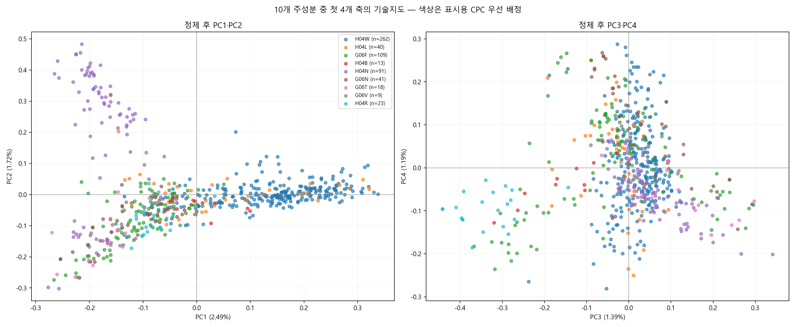

# 상위 10개 기술 분야: 용어 정제 및 PC1~PC10 분석

## 분석 결과

기존 658개 패밀리 대표 문헌에서 상위 10개 CPC 중 하나 이상을 갖는 **606개**를 선택했다. 용어 정제와 등장 빈도 기준 조정으로 TF-IDF 특성은 **2,214개 → 988개**로 줄었다.

동일한 문헌 집합에서 PC1~PC10의 누적 설명분산은 **10.49% → 12.71%**, **2.22%p 상승**했다. 다만 정제 전후에는 입력 표현 자체가 바뀌므로 같은 원본 정보량을 더 많이 보존했다고 단정할 수 없다. 정제된 표현에서도 첫 10개 축 밖의 분산이 87.29% 남는다.

## 1. 분석 대상: 상위 10개 분야

‘분야’는 기존 NMF의 8개 주제가 아니라 **CPC 앞 4자리 분류**로 정의했다. 기존 분석 대상 658개에서 CPC가 부여된 패밀리 수로 순위를 정했다. 한 패밀리에 동일 CPC가 반복돼도 한 번만 집계했다. 상위 10개 중 하나 이상에 속하면 포함하며 교집합만 선택한 것이 아니다. 52개 그룹은 분석 대상에서 제외됐다.

| 순위 | CPC | 분야 설명 | 해당 패밀리 수 |
|---|---|---|---:|
| 1 | H04W | 무선 통신 네트워크 | 262 |
| 2 | H04L | 디지털 정보 전송 | 223 |
| 3 | G06F | 전기적 디지털 데이터 처리 | 124 |
| 4 | H04B | 전송 | 116 |
| 5 | H04N | 영상 통신 | 103 |
| 6 | G06N | 특정 계산 모델 기반 컴퓨팅 | 67 |
| 7 | G06T | 영상 데이터 처리·생성 | 66 |
| 8 | G06V | 영상·비디오 인식 및 이해 | 55 |
| 9 | Y02D | 정보통신 에너지 사용 저감 | 45 |
| 10 | H04R | 스피커·마이크·음향 변환기 | 30 |

분야는 서로 배타적이지 않으며 Y02D처럼 다른 기술에 덧붙는 분류도 포함된다. 따라서 10개 분야별 건수를 더하면 문헌 수보다 크다. CPC 설명은 분류명을 간단히 풀어쓴 것이다.

## 2. 용어 정제

| 정제 항목 | 처리 내용 |
|---|---|
| 약어·복합 용어 | UE / user equipment → user_equipment, base station → base_station |
| 기술 구문 | neural network, machine learning, video coding, point cloud, touch panel을 복합 토큰으로 통합 |
| MEMS 표기 | MEMS와 microelectromechanical system을 통합 |
| 단복수 | images→image, objects→object, models→model 등 명시된 대응표 적용 |
| 중복 표기 | 통합 후 같은 토큰이 연속 반복되면 하나로 축소 |
| 범용·서술 용어 | 기존 특허 상투어 외 data, information, value, obtain, operation 등 추가 제거 |
| 문헌 등장 빈도 | min_df 3→5, max_df 0.85→0.70 |

제목·초록 구성, 단어 및 2단어 구문, sublinear TF와 L2 정규화는 유지했다. 신호·채널·모델처럼 기술 구분에 도움이 되는 단어는 보존했다. 범용어 제거도 의미 손실을 일으킬 수 있으며 임계값이 최적이라고 검증한 것은 아니다. 개선 수치는 이 모든 변경을 합친 효과이고 각 정제 규칙의 개별 기여는 분리하지 않았다.

## 3. 강의자료에 따른 PCA 계산

첨부 강의자료의 중심화 → 공분산 → 고유값·고유벡터 → score → 설명분산 순서를 따른다. 강의자료 예제는 원래 변수가 2개이지만, 이번 분석은 용어 특성이 여러 개라는 차이가 있다.

1. **입력**: 문헌×정제된 TF-IDF 용어 행렬 X.
2. **중심화**: 각 열 평균을 빼 Xc를 계산한다. 별도 용어별 분산 표준화는 하지 않는다.
3. **공분산**: S = XcᵀXc / (n−1).
4. **축과 분산**: S vᵢ = λᵢ vᵢ. 단위 고유벡터 vᵢ가 loading이고 λᵢ가 해당 PC score의 분산이다.
5. **문헌 좌표**: zᵢ = Xc vᵢ. 각 문헌의 PC1~PC10 score를 유지한다.
6. **계산 구현**: 중심화된 행렬에 full SVD를 적용한다. 이는 강의자료 51쪽의 공분산 고유분해와 연결되며, 중심화하지 않은 TruncatedSVD/LSI와 구분된다.

전체 분산 대비 설명분산은 **λᵢ / 모든 λ의 합**이다. λ₁/(λ₁+λ₂)는 선택한 두 축 안에서의 PC1 비중이며 원본 전체 설명분산과 다르다. 이 보고서의 그래프 축·누적 설명분산은 모두 전체 분산 기준이다. PC1~PC10 안에서의 비율은 CSV의 within_retained_10_percent에 별도 보관했다.

## 4. PC별 설명분산

| 주성분 | 고유값 = score 분산 | 정제 후 설명분산 | 정제 후 누적 | 정제 전 누적 |
|---|---:|---:|---:|---:|
| PC1 | 0.024112 | 2.49% | 2.49% | 2.21% |
| PC2 | 0.016671 | 1.72% | 4.21% | 3.68% |
| PC3 | 0.013418 | 1.39% | 5.60% | 4.79% |
| PC4 | 0.011534 | 1.19% | 6.79% | 5.73% |
| PC5 | 0.010652 | 1.10% | 7.89% | 6.61% |
| PC6 | 0.010165 | 1.05% | 8.94% | 7.49% |
| PC7 | 0.009604 | 0.99% | 9.94% | 8.30% |
| PC8 | 0.009431 | 0.97% | 10.91% | 9.08% |
| PC9 | 0.009134 | 0.94% | 11.86% | 9.79% |
| PC10 | 0.008291 | 0.86% | 12.71% | 10.49% |

기존 전체 658개·정제 전 PC1+PC2의 3.47%와 이번 결과를 직접 비교하면 대상 축소 효과도 섞인다. 용어 정제 효과를 평가할 때는 위 표의 동일한 606개 문헌에 대한 정제 전후 수치를 비교한다.

## 5. Loading으로 해석한 10개 축

각 축은 하나의 기술 카테고리가 아니라 용어 가중치의 조합이다. 아래 양·음 핵심어는 계수가 큰 순서로 표시했다. 고유벡터 부호는 임의이므로 양수·음수는 우열을 의미하지 않는다.

| 축 | 양수 방향 핵심어 | 음수 방향 핵심어 |
|---|---|---|
| PC1 | user_equipment, wireless, communication, base_station, transmission, resource | image, video, object, model, block, prediction |
| PC2 | block, video, prediction, video_coding, picture, block video | image, object, feature, model, pose, sensor |
| PC3 | image, object, feature, pose, model, user_equipment | transducer, signal, acoustic, piezoelectric, layer, coupled |
| PC4 | network, audio, model, audio stream, stream, packet | signal, image, reference, beam, reference signal, sensor |
| PC5 | audio, stream, audio stream, memory, processor, rendering | network, model, layer, machine_learning, transducer, input |
| PC6 | beam, transducer, piezoelectric, acoustic, layer, model | touch_panel, drive, electrode, drive electrode, sensor, capacitive |
| PC7 | user_equipment, beam, sidelink, base_station, touch_panel, electrode | channel, reference, reference signal, signal, frame, network |
| PC8 | signal, network, reference, beam, reference signal, synchronization | layer, uplink, control, resource, control channel, downlink |
| PC9 | model, reference, reference signal, signal, machine_learning, machine_learning model | image, transducer, camera, piezoelectric, frame, communication |
| PC10 | transmission, beam, uplink, uplink transmission, grant, packet | sidelink, communication, resource, wireless communication, sidelink communication, output |

PC1은 통신과 영상·모델 용어의 대비, PC2는 비디오 코딩과 인식·센싱 용어의 대비가 중심이다. PC3에는 영상·객체·자세 관련 용어와 음향·압전·변환기 관련 용어의 대비가 나타난다. 기존 PC1·PC2에서 겹치던 기술 차이가 추가 축에서 드러날 수 있음을 보여준다.

PC4 이후에는 네트워크·오디오·신호·터치·모델 등의 대비가 복합적으로 나타난다. 일부 상위 단어만으로 모든 축에 단일 기술명을 붙이지 않았다. 특히 서로 다른 기술 분야에서 같은 용어가 쓰일 수 있으므로 예컨대 beam을 일괄적으로 통신 빔이라고 해석하지 않는다.

## 6. Score로 표현한 기술지도

문헌 하나에 10개 좌표를 계산했지만 그림은 그중 두 쌍만 보여준다. 왼쪽 그림은 PC1·PC2, 오른쪽은 PC3·PC4다. 그림마다 표현하는 분산과 용어 대비가 다르므로 한 그림의 거리만으로 전체 기술 유사성을 판정하지 않는다.

색상은 중복 CPC를 하나로 표시하기 위해 상위 10개 CPC의 빈도 순위에서 먼저 일치한 코드를 사용했다. 이는 대표 기술 분야를 판정한 결과가 아니라 시각화를 위한 표시 규칙이다. 일부 CPC는 다른 상위 코드에 겹쳐 별도 색상이 없을 수 있다. 표의 다중 분류별 건수와 범례의 표시용 건수는 다르다.

PC 10개를 유지하는 것은 좌표 정보 10개를 사용한다는 뜻이며 10개 군집을 찾았다는 뜻은 아니다. 분석 목적에 따라 전체 10차원 좌표로 유사도를 비교할 수 있으나, 이번에는 추가 군집분석이나 분류 정확도 검증은 수행하지 않았다.

## 7. 결과와 한계

대상 범위를 상위 CPC로 제한하고 용어를 정리한 표현에서는 10개 축이 포착하는 상대적 분산이 늘었다. 그렇더라도 대부분의 분산은 10개 축 밖에 남는다. 높은 설명분산을 얻기 위해 과도하게 용어를 제거하면 기술의 세부 차이를 잃을 수 있어 수치 상승을 목표로 추가 삭제하지 않았다.

원본 1,000건의 검색·추출 방식은 확인되지 않았으며 국가·연도·언어와 초록 누락의 표본 편향도 남는다. 기존 모델과 이번 모델은 입력·축이 달라 이전 좌표와 새 좌표를 직접 이어서 해석하면 안 된다. 특허 가치·시장 우위·표준필수 여부를 측정한 분석은 아니다.

## 산출물과 검증

- [PC1~PC10 분산 표](./pc10_variance.csv)
- [정제 용어별 loading](./pc10_term_coefficients.csv)
- [상위 10개 CPC 집계](./top10_cpc_counts.csv)
- [계산 결과 및 정제 규칙](./pc10_results.json)
- [분석 코드](./qualcomm_pc10.py)

각 score 열의 평균 0, loading의 직교·단위 길이, score 표본분산과 고유값 일치를 확인했다. 문헌별 좌표는 로컬 pc10_document_scores_LOCAL_ONLY.csv로 저장하고 신규 GitHub 업로드에서는 제외했다. 코드는 기존 qualcomm_analysis/family_topics.csv가 있는 Downloads 폴더에서 실행한다.
