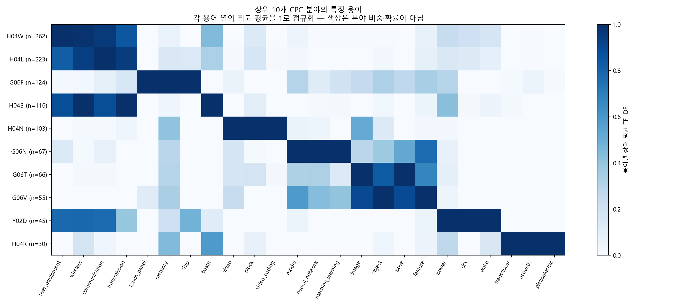
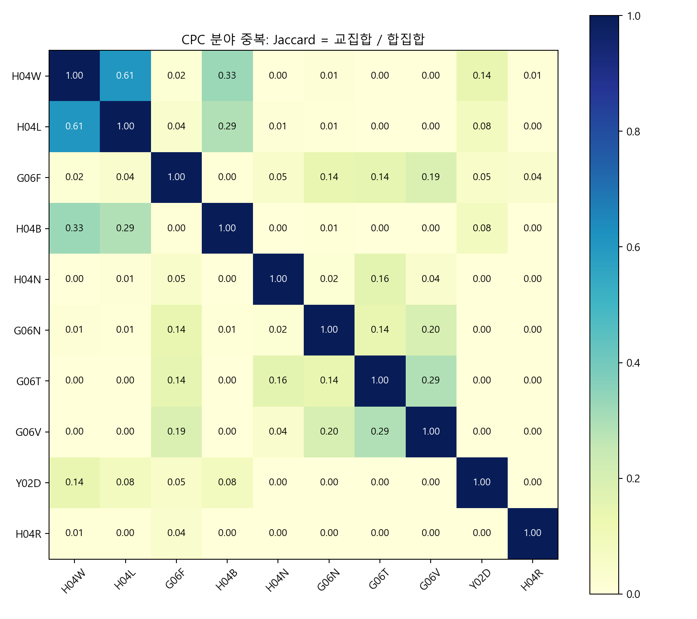
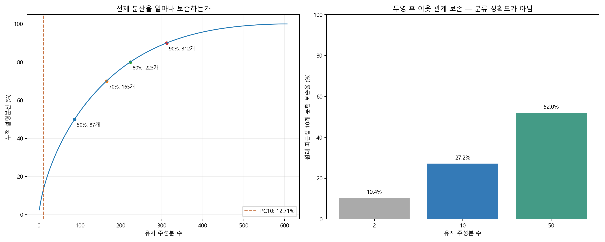

# 결과 해석 개선: 분야별 기술 특징과 PCA 검증

## 무엇이 명확해졌는가

이 표본에서는 **통신 관련 기술**, **비디오 코딩**, **AI·영상 인식**, **음향 변환기**, **통신 절전**의 용어 특성이 구별된다. 이는 기술 분야별 문헌을 직접 비교한 결과이며, 분산 보존이 낮은 2차원 PCA 그림 하나에 의존한 결론이 아니다.

기존의 606개 문헌·988개 정제 TF-IDF 특성과 PC10 분석을 유지하면서, ① 분야별 특징 용어, ② CPC 중복 관계, ③ 투영 품질, ④ 용어 빈도 기준에 대한 민감도를 추가했다. 원본 수집 편향이나 특허 가치 평가의 한계를 해결한 것은 아니다.

## 1. 분야별 핵심 결과

| CPC 분야 | 문헌 수 | 다른 문헌보다 상대적으로 두드러진 용어 |
|---|---:|---|
| H04W · 무선 통신 네트워크 | 262 | user_equipment, wireless, communication, base_station, transmission |
| H04L · 디지털 정보 전송 | 223 | user_equipment, communication, transmission, wireless, channel |
| G06F · 디지털 데이터 처리 | 124 | touch_panel, memory, chip, drive, object |
| H04B · 전송 | 116 | beam, user_equipment, wireless, transmission, signal |
| H04N · 영상 통신 | 103 | video, block, video_coding, image, prediction |
| G06N · 계산 모델·AI | 67 | model, neural_network, machine_learning, feature, generated |
| G06T · 영상 처리·생성 | 66 | image, object, pose, frame, dimensional |
| G06V · 영상 인식·이해 | 55 | image, object, feature, model, pose |
| Y02D · 정보통신 에너지 저감 | 45 | power, drx, wake, low, base_station |
| H04R · 음향 변환기 | 30 | transducer, acoustic, piezoelectric, microelectromechanical, layer |

H04W·H04L·H04B는 단말·무선·전송 관련 용어를 공유한다. H04N에서는 비디오·블록·부호화가, G06N에서는 모델·신경망·기계학습이, G06T·G06V에서는 영상·객체·자세·특징이 두드러진다. H04R은 음향·압전·변환기, Y02D는 전력·DRX·깨우기 관련 용어가 특징적이다.

G06F는 범위가 넓다. 이 표본에서는 터치·메모리·칩 등이 나타나며, 이를 G06F 전체의 정의나 회사 전체 제품 구성으로 일반화하지 않는다. AI와 영상 인식에서 공통으로 모델·특징 용어가 나타나는 것은 연결 지점이지만, 그 사실만으로 기술 융합의 인과관계를 입증하지는 않는다.

**읽는 방법:** 각 용어 열에서 가장 높은 분야 평균을 1로 맞췄다. 진한 색은 그 용어의 상대적 평균 TF-IDF가 높다는 뜻이며 기술 점유율·시장 규모·정확도가 아니다. 열마다 기준이 달라 서로 다른 열의 색으로 절대 중요도를 비교하지 않는다.

특징 용어는 ‘해당 CPC 문헌 평균 TF-IDF − 해당 CPC가 없는 문헌 평균 TF-IDF’가 큰 순서로 뽑았다. 표는 상위 5개 단일 토큰, 히트맵은 분야별 상위 3개 토큰의 합집합이다. 통합된 neural_network 등 복합 토큰은 유지했다. 통계적 유의성 검정이나 인과 분석을 한 것은 아니다.

## 2. 분야는 중복된다: 임의의 단일 색상 배정을 보완

606개 중 **341개(56.3%)**가 상위 CPC 두 개 이상에 속한다. 기존 PCA 산점도는 색상을 하나로 표시하기 위해 우선순위에 따라 CPC를 배정했지만, 이 표와 히트맵에서는 실제 다중 소속을 그대로 사용했다.

숫자는 Jaccard 중복도, 즉 두 분야의 교집합 문헌 수를 합집합 문헌 수로 나눈 값이다. 예를 들어 H04W 262개와 H04L 223개 중 183개가 겹친다. 이는 코드 부여의 중복이며 두 기술이 같다는 뜻은 아니다. 분류 간 중복을 보여주는 그림이지 특허 간 유사도 지도도 아니다.

## 3. PC10의 정보 보존 한계를 수치로 확인

### 필요한 주성분 수

| 목표 누적 설명분산 | 필요한 PC 수 |
|---|---:|
| 50% | 87개 |
| 70% | 165개 |
| 80% | 223개 |
| 90% | 312개 |

PC10은 설명과 탐색을 위한 간결한 표현으로 유지하되, 전체 분산의 대부분을 보존하는 표현으로 보지는 않는다. 필요하면 원래 정제 TF-IDF로 유사 문헌을 검색하고 PC 좌표는 보조로 제시하는 것이 적절하다. 높은 누적 설명분산 자체가 의미적 정확성을 보장하지도 않는다.

### 원래 가까운 문헌은 투영 후에도 가까운가

| 유지 PC | 누적 설명분산 | 원래 최근접 10개 문헌 평균 보존율 |
|---|---:|---:|
| 2개 | 4.21% | 10.45% |
| 10개 | 12.71% | 27.21% |
| 50개 | 36.02% | 52.03% |

정제된 원래 TF-IDF 공간에서 각 문헌의 가까운 이웃 10개를 찾고, PCA 좌표의 가까운 이웃 10개와 얼마나 겹치는지 비교했다. 동일 문헌 자신은 제외했고 문헌별 중첩 비율을 평균했다. L2 정규화된 TF-IDF에서 유클리드 거리를 사용했으며 PCA 좌표도 유클리드 거리로 비교했다. 동일 거리에는 문헌 순서로 결정되는 일관된 정렬을 적용했다.

이 수치는 정답 라벨에 대한 분류 정확도가 아니다. PC10의 27.2%는 원래 이웃 10개 중 평균 약 2.72개가 남았다는 뜻이다. 따라서 산점도의 점 사이 거리만으로 유사 특허·기술 군집을 확정하지 않는다. 50개 축은 진단용으로만 계산했으며 기본 보관 차원 10개를 변경한 것은 아니다.

## 4. 정제 기준을 바꿔도 큰 방향은 유지되는가

| 최소 등장 문헌 수 min_df | 용어 수 | PC1~PC10 누적 설명분산 | 기준 대비 10차원 부분공간 중첩도 |
|---|---:|---:|---:|
| 3 | 2053 | 10.07% | 98.16% |
| 5 | 988 | 12.71% | 100.00% |
| 8 | 528 | 15.68% | 94.71% |

같은 문헌과 같은 정제 규칙에서 min_df만 3·5·8로 바꿨다. 부호나 축 순서 변화에 영향을 덜 받도록 개별 PC 상관계수가 아니라, 문헌 공간의 첫 10개 고유벡터가 만드는 부분공간을 비교했다. 중첩도는 두 부분공간의 주각 θ에 대해 cos²(θ)의 평균×100이다. min_df=5 자체는 100%다.

다른 두 설정에서 94.7~98.2%로 큰 부분공간은 비교적 유지된다. 다만 이는 이 좁은 설정 범위에서의 민감도 점검이며 표본 재추출·동의어 사전 변경·언어 판별 변경에도 안정적이라는 보장은 아니다. 중첩도는 정확도나 신뢰확률이 아니다.

min_df=8로 올리면 누적 설명분산은 커지지만 희소한 기술 용어가 더 사라진다. **설명분산 수치만 높이기 위해 기준을 8로 바꾸지 않고, 기존 min_df=5·PC10 결과를 유지했다.**

## 5. 보고서에서 사용할 결론

> 상위 10개 CPC에 해당하는 606개 특허 패밀리 대표 문헌을 분석한 결과, 통신·비디오 코딩·AI 및 영상 인식·음향 변환기·통신 절전 관련 용어 특성이 확인됐다. 용어 등장 기준을 달리해도 주요 10차원 부분공간은 비교적 유지됐지만, PC10의 누적 설명분산은 12.71%이고 최근접 이웃 보존율은 27.21%여서 PCA 지도는 탐색용으로 해석했다. 분야별 기술 특징은 다중 CPC 소속을 유지한 평균 TF-IDF 비교로 제시했다. 결과는 제공된 표본에 대한 것이며 퀄컴 전체의 기술 투자 비중·특허 가치·전략 전환을 확정하지 않는다.

## 산출물과 재현

- [전체 분산 스펙트럼](./full_variance_spectrum.csv)
- [이웃 보존율](./neighbor_preservation.csv)
- [정제 기준 민감도](./cleaning_sensitivity.csv)
- [분야별 특징 용어](./cpc_distinctive_keywords.csv)
- [분야 중복 건수](./cpc_cooccurrence_counts.csv)
- [계산 결과 JSON](./quality_results.json)
- [개선 분석 코드](./improve_qualcomm_results.py)
- [공통 정제·대상 선택 코드](./qualcomm_pc10.py)

기존 qualcomm_analysis/family_topics.csv와 pc10_refined/pc10_results.json이 있는 Downloads에서 실행한다. 개선 분석 코드와 공통 정제 코드는 같은 폴더에 둔다. 입력 데이터나 신규 문헌별 좌표 파일은 이 폴더와 배포 ZIP에 포함하지 않았다. 전체 고유값의 합을 기준으로 설명분산을 계산했으며 기존 PC10의 분산 수치와 수치적으로 일치하는지 확인했다.
