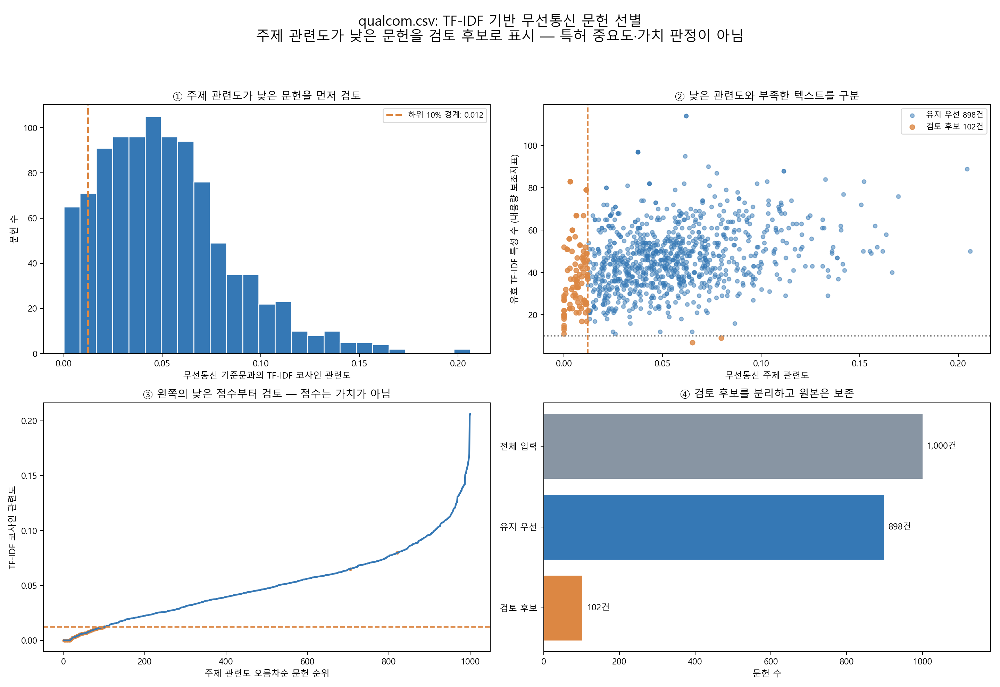

# TF-IDF를 이용한 무선통신 문헌 선별 시각화

입력은 새 파일 **qualcom.csv 1,000건**이다. 이전 lens-export.csv의 658개 또는 606개 분석과는 다른 데이터셋이다.

## 시각화



| 결과 | 문헌 수 |
|---|---:|
| 전체 | 1,000 |
| 유지 우선 | 898 |
| 검토 후보 | 102 |

검토 후보는 **무선통신 기준문과의 관련도 하위 10%인 100건**과 **유효 TF-IDF 특성이 10개 미만인 2건**의 합집합이다. 이 실행에서는 둘이 겹치지 않아 총 102건이다. 파란색은 유지 우선, 주황색은 검토 후보이며 자동 삭제하지 않았다. ‘유지 우선’도 중요 특허로 검증됐다는 뜻은 아니다.

## 그래프 읽는 법

1. **왼쪽 위 — 관련도 분포:** 오른쪽일수록 지정한 무선통신 기준문과 TF-IDF 용어 구성이 가깝다. 주황 점선 0.01214 이하를 낮은 관련도 검토 후보로 지정했다.
2. **오른쪽 위 — 관련도와 텍스트 내용량:** 점 하나가 문헌 하나다. 가로축은 주제 관련도, 세로축은 살아남은 TF-IDF 특성 수다. 세로축은 품질·가치·희귀성 점수가 아니라 내용량의 거친 보조지표다. 두 특성이 부족한 문헌은 관련도가 높아도 주황색일 수 있다.
3. **왼쪽 아래 — 점수순 검토:** 낮은 점수부터 문헌을 배열했다. 완만한 곡선이므로 ‘여기부터 무조건 노이즈’라는 자연적인 경계가 확인된 것은 아니다.
4. **오른쪽 아래 — 분리 결과:** 898건과 102건으로 나눠 검토할 수 있도록 했다. 필터링 전후의 정확도를 측정한 그래프는 아니다.

## 계산 방법

- 제목+초록을 동일 가중치로 연결하고, 소문자화·불용어 제거·일부 단복수 통합과 UE/user equipment 등의 표기 통합을 적용했다.
- TF-IDF는 단어·2단어 구문, min_df=2, max_df=0.85, sublinear_tf=True, L2 정규화다. 최종 특성은 6,945개다.
- 각 문헌 벡터와 아래 무선통신 기준문 벡터의 **코사인 유사도**를 계산했다. 기준문은 입력 문헌에 맞춰 학습한 같은 TF-IDF 어휘·IDF로 변환했다.
- 점수 = 문헌 벡터와 기준문 벡터의 내적 / 두 벡터 길이의 곱. 기술의 경제적 중요도가 아니라 기준문에 대한 상대적 주제 관련도다.
- L2 정규화된 문헌 벡터는 길이가 같으므로 그 길이나 제곱합을 문서 중요도 점수로 사용하지 않았다.
- 하위 10%는 검토 예산을 정하기 위한 탐색 설정이며 정답 라벨로 검증된 최적 임계값이 아니다. 규칙상 낮은 점수 문헌을 일정 수 분리하게 된다.

### 무선통신 기준문

```text
wireless communication radio cellular LTE NR 5G WLAN wifi bluetooth
user_equipment base_station uplink downlink sidelink channel radio resource
allocation scheduling transmission reception antenna beamforming beam MIMO OFDM
random access handover synchronization reference signal channel estimation
power control spectrum frequency carrier modulation coding network protocol
packet mesh relay DRX HARQ CQI access point
subframe frame slot paging RACH PRACH PDCCH PUCCH PUSCH RRC MAC
control information carrier aggregation bandwidth beam sweep random access
channel state information radio link cell selection reselection multicast broadcast
```

## 검토량을 바꾸면

| 관련도 하위 비율 설정 | 관련도 경계 | 전체 검토 후보 | 유지 우선 |
|---|---:|---:|---:|
| 5% | 0.00638 | 52 | 948 |
| 10% | 0.01214 | 102 | 898 |
| 15% | 0.01829 | 152 | 848 |
| 20% | 0.02250 | 202 | 798 |

전체 검토 후보에는 특성 수 10개 미만 조건도 포함된다. 기준 비율이 달라지면 해당 조건과 겹칠 수 있어 단순히 1,000×비율+2와 항상 같지는 않다.

## 해석의 한계와 실제 제외 방법

TF-IDF만으로 ‘중요하지 않은 특허’를 판정할 수는 없다. 기준문에 없는 측위·보안·서비스 응용이나 특수한 약어를 쓰는 정상 통신 문헌도 점수가 낮을 수 있다. 반대로 통신 단어를 많이 쓰는 주변 응용은 점수가 높을 수 있다. 0점도 선택된 어휘가 기준문과 겹치지 않는다는 뜻이지 가치가 없다는 뜻이 아니다.

현재 결과는 문헌 1,000건 단위다. 패밀리 중복을 먼저 제거해 학습한 결과가 아니므로 국가별·공개등록 중복이 IDF와 순위에 영향을 줄 수 있다. 영어 중심 처리이므로 다국어 데이터에는 별도 보완이 필요하다. 인용 수·권리 상태·청구항·표준필수 여부도 점수에 반영하지 않았다.

실제로 제외하려면 검토 후보에서 제외/유지 정답을 확인하고, 유지 문헌 표본도 함께 검토해 오제외와 누락을 점검해야 한다. 이후 기준문·임계값을 조정하고 다른 검증 문헌에서 성능을 평가할 수 있다. 이번 102건을 확인 없이 노이즈로 확정하지 않았다.

## 산출물

- [그래프 원본](./tfidf_document_filter.png)
- [분포 집계 CSV](./score_histogram.csv)
- [검토 비율별 집계](./threshold_sensitivity.csv)
- [요약 및 기준문](./filter_summary.json)
- [분석 코드](./visualize_wireless_filter.py)

로컬 qualcom_tfidf_filter 폴더에는 문헌별 점수, 유지 우선 문헌, 검토 후보 문헌 CSV도 저장했다. 원본 qualcom.csv와 문헌별 원문·식별자 파일은 GitHub에 추가 업로드하지 않았다. 코드는 qualcom.csv가 있는 폴더에서 실행한다.
