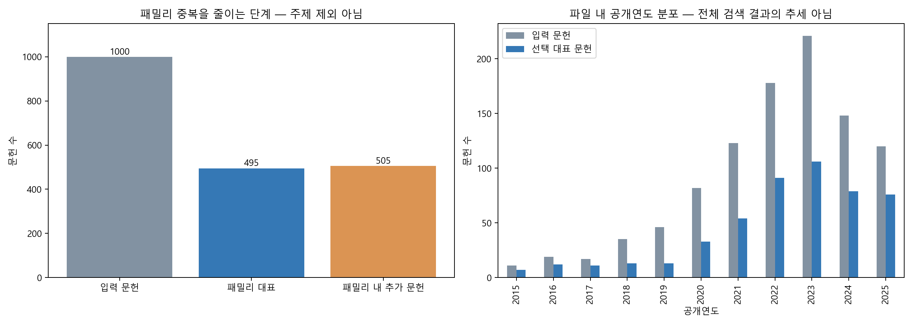

# 1단계 — 데이터 범위와 패밀리 중복 점검

## 이번 단계의 목적

토픽모델링 전에 어떤 자료를 분석하는지 확인하고, 같은 발명의 여러 문헌이 특정 주제의 비중을 부풀리지 않도록 중복을 줄인다. **이 단계에서 관련 없는 기술을 판정하거나 검색식을 변경하지는 않았다.**

## 전체 목표와 현재 파일의 차이

사용자 제공 Lens 화면에는 미국 필터에서 문헌 41,476건, Simple Families 21,900개가 표시돼 있다. 이는 화면에서 확인한 값이며 현재 직접 재검색한 수치는 아니다. 목표는 대표 5,000개를 추출하는 것이 아니라 **연구 범위를 반영한 수정 검색식으로 Lens의 Simple Families 결과 자체를 5,000개 이하로 줄이는 것**이다.

현재 입력 qualcom1.csv에는 1,000개 문헌만 있다. 이 파일의 분석은 검색식 후보를 찾는 탐색에 사용할 수 있지만 전체 21,900개 패밀리를 대표한다고 가정하지 않는다. 마지막 건수 확인은 반드시 Lens에서 해야 한다.

## 점검 결과

| 항목 | 결과 |
|---|---:|
| 입력 문헌 | 1,000건 |
| H04W 포함 문헌 | 1,000건 |
| 초록 누락 | 0건 |
| 패밀리 연결 그룹 | 495개 |
| 그룹당 한 문헌만 남기면 빠지는 추가 문헌 | 505건 |

## 어떻게 묶고 대표를 골랐는가

1. 각 행의 Lens ID와 Simple Family Members 목록을 연결한다.
2. 같은 멤버 ID를 공유하는 행들을 한 연결 그룹으로 묶는다. 가족 정보가 완전하지 않으면 실제 Lens 패밀리 구분과 차이가 있을 수 있다.
3. 그룹 안에서 초록이 가장 긴 문헌 하나를 대표로 선택한다. 길이가 같으면 Lens ID 오름차순으로 정한다. 이는 모델 입력 텍스트 확보를 위한 규칙이지 중요 특허 선정이 아니다.
4. 그룹에 속한 문헌들의 CPC는 합집합으로, 최초 우선일은 최솟값으로 별도 보존한다. 후속 텍스트 분석에는 선택한 대표 문헌의 제목·초록을 사용한다.

1,000개가 495개로 줄어든 것은 ‘505개가 노이즈여서’가 아니라 **같은 패밀리의 반복 문헌을 한 번만 분석하려는 처리**다. 분할·계속출원 등 서로 다른 simple family의 유사 문헌까지 모두 제거한 것은 아니다.

## 이번 단계의 산출물

- 로컬 `query_refinement_steps/step01_family_representatives_LOCAL_ONLY.csv`: 다음 단계에 사용할 대표 문헌 495개. 원본은 변경하지 않았다.
- [공개연도별 집계](./publication_year_counts.csv): 선택 대표 문헌의 공개연도 분포는 발명의 최초 발생연도나 전체 포트폴리오의 추세와 다르다.
- [점검 수치와 입력 해시](./audit_summary.json)
- [재현 코드](./build_query_step01.py)

문헌별 제목·초록·식별자는 신규 GitHub 업로드 대상에서 제외했다. 공개연도·초록 길이 기준 선택과 표본 추출 방식에 따른 편향은 남는다.

## 다음 단계 — 용어 정제와 TF-IDF

495개 대표 문헌의 제목·초록에서 특허 상투어, 약어·동의어, 단복수를 정리한다. 제거·통합 전후 예시와 단어 수 변화를 보여주고, 다음 토픽모델링에 쓸 TF-IDF 행렬을 만든다. **TF-IDF 점수가 낮다는 이유만으로 문서를 제외하지 않는다.**
