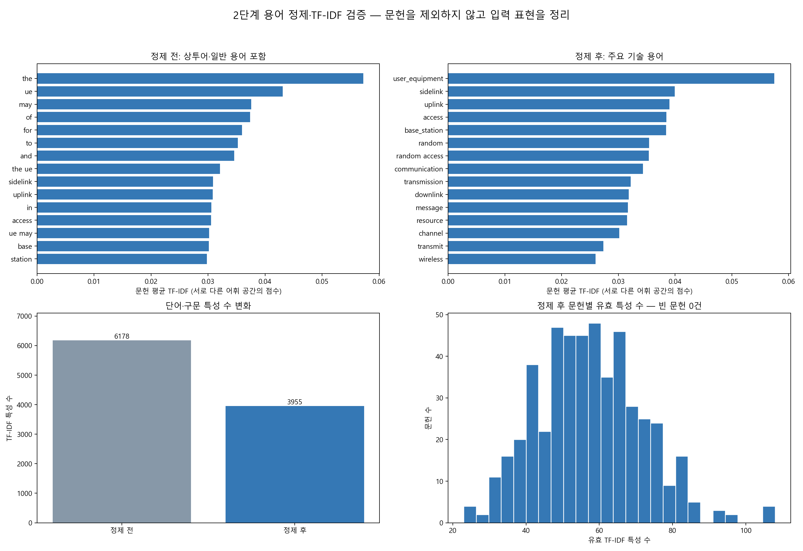

# 2단계 — 용어 정제·TF-IDF 결과 검증

## 검증 결론

**문헌 495개를 모두 유지하고, 제목·초록의 용어 표현만 정리했다.** 설정한 불용어 제거, 기술어 보존, TF-IDF 행렬의 수치 검증을 통과했다. 토픽의 품질이나 최종 검색식의 정확도를 검증한 단계는 아니다.

최종 TF-IDF 입력은 **495개 문헌 × 3,955개 단어·구문 특성**이다. 다음 3단계 토픽모델링에 사용할 수 있도록 희소행렬과 어휘 순서를 로컬에 저장했다.

## 1. 입력과 전후 비교

입력은 1단계에서 qualcom1.csv 1,000개 문헌을 패밀리 연결 정보로 묶어 선정한 대표 문헌 495개다. Lens 전체 21,900개 패밀리를 대표한다고 가정하지 않는다. 제목과 초록을 한 번씩 연결해 같은 가중치로 사용했다.

| 항목 | 정제 전 | 정제 후 |
|---|---:|---:|
| 문헌 수 | 495 | 495 |
| 단어 토큰 등장 횟수 | 62,102 | 31,874 |
| TF-IDF 단어·2단어 구문 특성 수 | 6,178 | 3,955 |
| 행렬의 0이 아닌 값 수 | 64,109 | 28,354 |

정제 전후 모두 min_df=2, max_df=1.0, 단어·2단어 구문, sublinear TF, L2 정규화를 적용했다. 전처리만 비교한 것이며 용어 수 감소를 기술 정보 손실 없음 또는 정확도 향상으로 해석하지 않는다. 토큰 감소에는 복합어 통합 효과도 포함된다.

## 2. 무엇을 제거·통합했는가

### 특허 상투어와 일반 불용어 제거

아래는 실제 제거 횟수가 많은 용어다. data, signal, channel, transmission 등 도메인 의미를 가진 용어는 단순히 흔하다는 이유로 제거하지 않았다. no, not, without와 before/after 등 일부 관계어도 기본 불용어에서 제외해 보존했다. 다만 bag-of-words가 문장의 논리를 완전히 보존하는 것은 아니다.

| 제거 용어 | 등장 횟수 | 구분 |
|---|---:|---|
| the | 4874 | english_stopword |
| of | 1688 | english_stopword |
| for | 1493 | english_stopword |
| and | 1448 | english_stopword |
| may | 1447 | english_stopword |
| to | 1435 | english_stopword |
| in | 987 | english_stopword |
| or | 854 | english_stopword |
| on | 740 | english_stopword |
| first | 655 | patent_boilerplate |
| with | 640 | english_stopword |
| an | 585 | english_stopword |

### 표기 통합

| 규칙 | 통합 토큰 | 치환 횟수 |
|---|---|---:|
| UE / user equipment | user_equipment | 2513 |
| base station | base_station | 866 |
| CSI / channel state information | channel_state_information | 66 |
| DRX / discontinuous reception | drx | 306 |
| HARQ / hybrid automatic repeat request | harq | 13 |
| NR / new radio | nr | 151 |
| LTE / long term evolution | lte | 87 |
| Wi-Fi / WiFi | wifi | 31 |
| reference signal | reference_signal | 131 |
| machine learning | machine_learning | 4 |
| neural network | neural_network | 0 |

문맥을 무시하는 광범위한 어간 추출 대신 명시적 단복수 사전을 적용했다. 예: channels→channel, resources→resource, antennas→antenna. new radio→nr 등 약어 통합은 이 무선통신 표본의 문맥을 가정하므로 다른 도메인에 그대로 적용하면 안 된다. 실제 치환 사전과 불용어 목록은 CSV로 공개했다.

## 3. 검증 중 발견한 문제와 수정

첫 실행에서 max_df=0.90을 적용하면 **user_equipment가 495개 중 488개 문헌에 등장해 자동으로 제외**됐다. 같은 무선통신 분야에서 자주 나오는 핵심어를 ‘흔하다’는 이유만으로 제거하면 설명 가능한 어휘가 훼손될 수 있다.

그래서 **최종 max_df를 1.0으로 바꾸어 고빈도 자동 제거를 해제**했다. 명시적 불용어 목록은 유지하고, 빈도에 따른 가중치 조정은 IDF가 담당하도록 했다. 정제 전 비교 행렬도 같은 1.0 기준으로 다시 계산했다. 이는 비교 기준의 일관성과 도메인 용어 보존을 위한 수정이며 토픽 품질이 무조건 좋아진다는 뜻은 아니다.

3단계의 대표 문헌 검토에서 약어 치환이 뒤 공백까지 소비해 `DRX for`를 `drxfor`, `new radio layer`를 `nrlayer`처럼 붙이는 오류를 추가로 발견했다. 괄호 안 약어가 실제로 있을 때만 해당 공백을 소비하도록 정규식을 고쳤고, TF-IDF와 토픽모델을 다시 계산했다. 이 보고서의 수치는 공백 경계 수정 후 결과다.

`user equipment performance`, `user equipment (UE) performance`, `discontinuous reception for sidelink`, `discontinuous reception (DRX) for sidelink`, `new radio layer`, `channel state information report`, `long term evolution network`, `hybrid automatic repeat request procedure`의 8개 사례가 뒤 단어와 분리된 채 변환되는지 회귀 검증을 추가했다. 이전의 수치·어휘 보존 점검만으로는 이 결함을 잡지 못했다는 한계도 남긴다.

추가로 토픽 수 10개인 탐색 실행에서 `various generally`, `generally relate`, `numerous`가 한 토픽의 상위 용어를 차지했다. 기술 차이보다 작성 문체를 나타내는 토픽이므로 various·generally·relate·numerous를 명시적 상투어 목록에 추가하고 2·3단계를 다시 계산했다. 문헌을 노이즈로 제거한 것이 아니라 텍스트 표현을 보완한 것이다.

5G·4G처럼 숫자로 시작하는 기술어도 남도록 숫자와 영문이 섞인 토큰을 허용했다. 숫자만으로 이뤄진 토큰과 한 글자 토큰은 제외했다. 3GPP처럼 점검표에 있지만 이번 문헌에서 관측되지 않은 단어는 ‘제거됨’과 구분했다.

## 4. 핵심 기술어 보존 점검

| 기술어 | 정제 후 등장 문헌 수 | TF-IDF 어휘 포함 | 판정 |
|---|---:|---|---|
| user_equipment | 488 | 예 | preserved |
| base_station | 324 | 예 | preserved |
| sidelink | 154 | 예 | preserved |
| uplink | 253 | 예 | preserved |
| downlink | 215 | 예 | preserved |
| beam | 66 | 예 | preserved |
| reference_signal | 58 | 예 | preserved |
| channel_state_information | 12 | 예 | preserved |
| drx | 59 | 예 | preserved |
| harq | 6 | 예 | preserved |
| nr | 72 | 예 | preserved |
| lte | 33 | 예 | preserved |
| 5g | 28 | 예 | preserved |
| 4g | 7 | 예 | preserved |
| 3gpp | 0 | 아니오 | not_observed |
| mimo | 9 | 예 | preserved |
| ofdm | 3 | 예 | preserved |
| pdcch | 18 | 예 | preserved |
| pucch | 11 | 예 | preserved |
| pusch | 14 | 예 | preserved |
| prach | 16 | 예 | preserved |
| rach | 62 | 예 | preserved |
| wifi | 12 | 예 | preserved |
| bluetooth | 3 | 예 | preserved |
| positioning | 19 | 예 | preserved |
| security | 0 | 아니오 | not_observed |
| machine_learning | 2 | 예 | preserved |
| neural_network | 0 | 아니오 | not_observed |

preserved는 표현이 행렬에 남았다는 뜻이다. not_observed는 정제·통합된 문헌에서 발견되지 않았다는 뜻이며, outside_df_threshold는 관측됐지만 등장 문헌 수 기준 밖이라는 뜻이다. 원래 전체 특허에 해당 기술이 없다는 의미는 아니다.

min_df=2 때문에 단 한 문헌에만 나오는 기술어는 빠질 수 있다. [어휘 밖 토큰 목록](./tokens_outside_vocabulary.csv)을 별도로 남겼다. 다음 단계의 주제 해석에서 중요한 희귀어가 확인되면 이 기준을 재검토한다.

## 5. 정제 후 주요 용어

문헌별 L2 정규화 TF-IDF를 평균한 순위다. 이 값은 단어 중요도의 탐색 지표이며 문서 중요도, 특허 가치 또는 기술 분야 점유율이 아니다.

| 순위 | 용어 | 평균 TF-IDF | 등장 문헌 수 |
|---|---|---:|---:|
| 1 | user_equipment | 0.05749 | 488 |
| 2 | sidelink | 0.03994 | 154 |
| 3 | uplink | 0.03902 | 253 |
| 4 | access | 0.03844 | 228 |
| 5 | base_station | 0.03842 | 324 |
| 6 | random | 0.03543 | 158 |
| 7 | random access | 0.03535 | 158 |
| 8 | communication | 0.03433 | 400 |
| 9 | transmission | 0.03217 | 230 |
| 10 | downlink | 0.03185 | 215 |
| 11 | message | 0.03169 | 186 |
| 12 | resource | 0.03154 | 198 |
| 13 | channel | 0.03016 | 214 |
| 14 | transmit | 0.02736 | 255 |
| 15 | wireless | 0.02600 | 366 |
| 16 | information | 0.02538 | 170 |
| 17 | configuration | 0.02485 | 141 |
| 18 | control | 0.02450 | 165 |
| 19 | wireless communication | 0.02450 | 345 |
| 20 | receive | 0.02286 | 216 |

제목에 sidelink가 있는 대표 문헌은 135개다. 이 수치는 특정 기술에 표본이 집중될 수 있음을 보여줄 뿐 전체 검색 결과의 sidelink 비중을 뜻하지 않는다. 토픽모델링 결과를 수정 검색식에 쓰기 전 이 표본 범위의 한계를 함께 고려한다.

## 6. 수치·구조 검증

| 확인 항목 | 결과 |
|---|---|
| 입력 패밀리 그룹 중복 | 495개 모두 고유 |
| 문헌 수 유지 | 495 → 495, 제외 0건 |
| NaN·무한대·음수 | 없음 |
| 정제 후 빈 문헌 | 0건 |
| 문헌별 유효 특성 수 최솟값 | 23개 |
| 문헌별 유효 특성 수 중앙값 | 56개 |
| 문헌 벡터 L2 길이 | 모두 1, 수치 오차 허용 1e−10 |
| 지정 불용어의 어휘 잔류 | 없음 |
| 주요 보존 대상어 | sidelink·uplink·downlink·user_equipment·base_station·DRX·NR 모두 포함 |

이는 전처리가 설정대로 작동했는지 확인한 것이다. 노이즈 판별 정확도·재현율이나 토픽 안정성 검증은 아직 수행하지 않았다. 숫자 식별자·영문 약어의 모든 의미가 보존됐음을 보장하는 검증도 아니다.

## 7. 이번 단계에서 하지 않은 것

- TF-IDF가 낮다는 이유로 문헌을 삭제하지 않았다.
- 토픽 수나 포함·제외할 기술 분야를 결정하지 않았다.
- 검색식을 수정하거나 Lens 결과가 5,000패밀리 이하가 됐다고 주장하지 않았다.
- 명칭·우선일·패밀리 연결 정보의 외부 진위를 재검증하지 않았다.

**다음 단계는 이 행렬로 토픽모델링을 수행하고, 각 주제의 대표 용어와 문헌을 검토하는 것이다.** 주제 검토를 거친 후에만 포함·제외 조건과 검색식 후보로 옮긴다.

## 파일

- [정제 전 키워드](./keywords_before.csv), [정제 후 키워드](./keywords_after.csv)
- [제거 용어와 횟수](./removed_terms.csv), [불용어 전체](./stopwords.csv)
- [표기 통합 규칙](./normalization_rules.csv), [단복수 사전](./plural_mapping.csv)
- [기술어 보존 점검](./technical_term_checks.csv), [어휘 밖 토큰](./tokens_outside_vocabulary.csv)
- [검증 수치 JSON](./validation_summary.json), [재현 코드](./build_query_step02.py)

로컬 query_refinement_steps에는 step02_tfidf.npz, step02_vocabulary.json, step02_cleaned_documents_LOCAL_ONLY.csv를 저장했다. 행렬의 행은 로컬 문헌 CSV 순서, 열은 vocabulary JSON 순서다. 문헌별 원문·식별자와 입력 데이터는 신규 GitHub 업로드에서 제외했다. 코드는 1단계 결과 파일이 있는 Downloads에서 실행한다.
