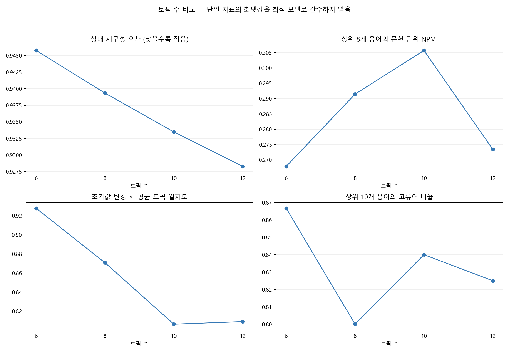
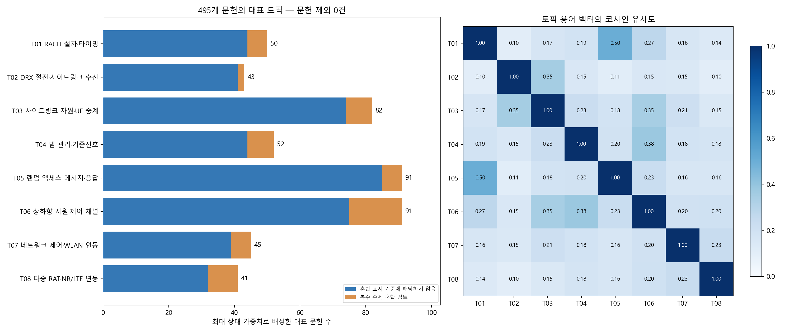

# 3단계 — NMF 토픽모델링 실행 및 검토

## 결과 요약

3단계 검토에서 발견한 공백 경계 오류와 작성 문구 잔류를 고쳐 2단계를 갱신한 뒤, **495개 패밀리 대표 문헌 × 3,955개 TF-IDF 특성**을 사용했다. 6·8·10·12개 토픽을 비교한 뒤, 주제 검토용으로 **8개 토픽 모델**을 선택했다. 문헌 제외는 0건이다.

8개 모델 토픽 중 두 개는 랜덤 액세스와 RACH로 같은 상위 기술을 다른 표현·세부 절차로 나누고 있다. 따라서 기술 범위를 해석할 때는 함께 보아 **7개 상위 묶음**으로 정리했다. 이는 모델을 7개로 다시 학습한 결과가 아니다.

이 표본에서는 접속·전송·절전·중계 등 통신 관련 주제가 중심이다. **대표 문헌 검토에서 뚜렷한 비통신 노이즈 주제를 확인하지 못했다.** 원래 검색 결과 21,900개 패밀리에서 5,000개 이하로 좁히려면 다음 단계에서 연구할 세부 기술 범위를 정해야 할 수 있다. 이번 모델이 검색 결과를 이미 줄인 것은 아니다.

## 1. 모델과 입력

- 입력: qualcom1.csv 1,000개 문헌을 패밀리 정보로 묶고 선택한 495개 대표 문헌의 정제 제목·초록.
- 행렬: 최초 실행에서 약어 치환이 뒤 단어와 붙는 오류, 10개 토픽 탐색에서 various·generally·relate·numerous 등 상투어 중심의 주제가 나타났다. 2단계의 정규식과 상투어 목록을 수정하고 8개 공백 경계 회귀 사례를 검증한 뒤 TF-IDF와 모든 후보 모델을 다시 계산했다. 최종 모델은 수정된 2단계 행렬을 그대로 사용하며 별도의 추가 가중치를 적용하지 않았다.
- 방법: NMF, X ≈ W H. H는 토픽별 용어 가중치, W는 문헌별 토픽 가중치다. 음수 없는 TF-IDF에서 자주 함께 나타나는 용어 패턴을 찾는다.
- 설정: solver=cd, init=random, max_iter=1200, tol=0.0001. 토픽 수별로 seed 7·42·99를 비교하고 결과 표시는 seed 42로 고정했다.
- 스케일: H 각 행을 L2 길이 1로 만들고 그 배율을 W에 보상했다. 이 조정은 재구성 W H를 바꾸지 않는다. 이후 W의 각 문헌 행을 합계 1로 바꿔 상대 가중치로 표시했다. **이는 보정된 소속 확률이나 정확도가 아니다.**

## 2. 왜 8개 토픽인가

| 토픽 수 | 상대 재구성 오차 | 용어 NPMI | 상위 용어 고유어 비율 | 초기값 변경 시 평균 일치도 | 가장 작은 토픽 문헌 수 |
|---|---:|---:|---:|---:|---:|
| 6 | 0.9458 | 0.2679 | 86.7% | 92.8% | 47 |
| 8 | 0.9393 | 0.2915 | 80.0% | 87.1% | 41 |
| 10 | 0.9335 | 0.3057 | 84.0% | 80.6% | 19 |
| 12 | 0.9283 | 0.2734 | 82.5% | 80.9% | 20 |

8개 모델은 평균 초기값 일치도 약 87.1%로, NPMI가 가장 높은 10개 모델의 약 80.6%보다 높았다. 가장 작은 토픽도 41개여서 10개 모델의 19개보다 덜 세분화됐다. 6개 모델의 일치도는 약 92.8%로 가장 높지만 주제 구분이 더 거칠다. 따라서 해석 범위와 초기값 민감도를 함께 고려해 8개를 탐색용으로 선택했다. **8개는 이번 탐색의 선택이며 검증된 유일한 최적 토픽 수가 아니다.**

지표의 의미와 한계는 다음과 같다.

- 상대 재구성 오차는 ||X−WH||F / ||X||F다. 같은 데이터에서 토픽을 늘리면 줄어드는 경향이 있어 이것만으로 토픽 수를 정하지 않았다. PCA의 설명분산과 다르다.
- NPMI는 각 토픽 상위 8개 용어 쌍이 같은 문헌에 나타나는 관계를 측정해 평균했다. 공동 출현이 없는 쌍은 −1로 처리했다. 단어·2단어 구문이 겹치는 특성 구조 때문에 지표가 높아질 수 있으며, 의미적 정확도는 아니다.
- 고유어 비율은 전체 토픽의 상위 10개 용어 중 고유 용어 수를 토픽 수×10으로 나눈 값이다. 높은 값이 무조건 좋은 모델을 뜻하지 않는다.
- 초기값 일치도는 seed 42와 다른 두 실행의 토픽 용어 벡터를 코사인 유사도로 비교하고 최적 일대일 대응으로 맞춘 평균이다. 8개 모델의 약 87.1%는 이 세 초기값에서의 일치도이며, 정답률이나 재표집 안정성은 아니다. 모든 실행에서 수렴 경고는 없었다.

## 3. 발견된 8개 토픽

아래 문헌 수는 최대 상대 가중치인 토픽 하나에 배정한 값이다. 실제 문헌은 여러 주제를 포함할 수 있다. 이름은 주요 용어와 토픽별 대표 문헌의 제목·정제 텍스트를 보고 해석했다.

| 토픽 | 해석한 기술 주제 | 문헌 수 | 비중 | 핵심어 |
|---|---|---:|---:|---|
| T01 | RACH 절차·타이밍 | 50 | 10.1% | rach, access channel, rach procedure, procedure, channel rach, random access |
| T02 | DRX 절전·사이드링크 수신 | 43 | 8.7% | drx, sidelink drx, drx configuration, sidelink, configuration, sidelink communication |
| T03 | 사이드링크 자원·UE 중계 | 82 | 16.6% | sidelink, resource, user_equipment, sidelink communication, relay, user_equipment sidelink |
| T04 | 빔 관리·기준신호 | 52 | 10.5% | beam, downlink, reference_signal, uplink, transmit, base_station |
| T05 | 랜덤 액세스 메시지·응답 | 91 | 18.4% | random, random access, access, access procedure, message, access message |
| T06 | 상하향 자원·제어 채널 | 91 | 18.4% | uplink, transmission, downlink, resource, uplink transmission, set |
| T07 | 네트워크 제어·WLAN 연동 | 45 | 9.1% | network, entity, network entity, positioning, wlan, user_equipment |
| T08 | 다중 RAT·NR/LTE 연동 | 41 | 8.3% | rat, nr, lte, radio access, radio, technology |

왼쪽의 주황색은 최대 상대 가중치가 0.35 미만이거나 1·2위 상대 가중치 차이가 0.10 미만인 문헌이다. 이는 여러 주제에 걸친 문헌을 먼저 살펴보기 위한 탐색 기준이다. 주황색 문헌이 잘못 분류됐거나 노이즈라는 뜻은 아니다.

오른쪽은 토픽 간 **용어 가중치 벡터**의 유사도다. 문헌 중복 비율이나 기술의 동일성 확률이 아니다.

### 대표 문헌 내용 확인

동일한 제목이나 동일 정제 텍스트가 대표 예시를 중복 점유하지 않도록 토픽 안에서 대표 예시를 골랐다. 원문 문헌 자체를 추가로 제외하지는 않았다. 아래는 대표 문헌 제목의 기술 내용을 요약한 것이다.

| 토픽 | 대표 문헌에서 확인한 내용 |
|---|---|
| T01 | 2단계 RACH의 타이밍 표시, 접속 절차 유형과 단말 성능 표시 |
| T02 | 사이드링크 DRX 설정과 수신 주기 정렬 |
| T03 | 원격 단말과 중계 단말의 사이드링크 자원 선택·전송 및 NR 중계 |
| T04 | 상하향 기준신호를 이용한 빔 관리와 주기적 이동에 대한 빔 추적 |
| T05 | 랜덤 액세스 메시지·응답, 접속 절차 및 폴백 |
| T06 | 상향 제어 채널 자원 할당과 DCI를 통한 상하향 스케줄링 |
| T07 | 분산 RAN 제어, WLAN·셀룰러 이중연결과 네트워크 선택 |
| T08 | 여러 무선접속기술 간 이동성·전력 제어, 음성 폴백과 5G 복귀 |

대표 문헌은 해당 대표 토픽에 배정된 문헌 중 토픽 용어 벡터와의 코사인 유사도가 높은 순서로 고른다. 이는 모델의 전형적인 예시이며 모든 문헌의 분류 정확도를 검증하는 절차는 아니다. 청구항이나 표준필수 여부를 검토한 결과도 아니다.

## 4. 겹치는 주제와 과도한 분할

T01과 T05의 용어 벡터 유사도가 약 **0.502**로 토픽 쌍 중 가장 높다. RACH는 random access channel의 약어이며, 2단계에서는 이를 완전히 같은 토큰으로 통합하지 않았다. 절차 유형·접속 메시지 같은 실제 세부 차이와 약어·구문 표현 차이가 함께 토픽을 나눴을 수 있다. 다음 검색식에서 별개의 무관한 분야로 처리해서는 안 된다.

RACH와 random access를 상위 범주로 묶으면 다음과 같다.

| 상위 기술 묶음 | 모델 토픽 | 문헌 수 |
|---|---|---:|
| 랜덤 액세스·RACH | T01,T05 | 141 |
| DRX 절전 | T02 | 43 |
| 사이드링크 자원·중계 | T03 | 82 |
| 빔 관리·기준신호 | T04 | 52 |
| 상하향 자원·제어 채널 | T06 | 91 |
| 네트워크 제어·WLAN 연동 | T07 | 45 |
| 다중 RAT 연동 | T08 | 41 |

문헌 **61개**가 복수 주제 혼합 검토 기준에 해당한다. 사이드링크는 절전·중계·자원 할당 등 여러 기술과 연결되므로 T02·T03·T06의 용어가 겹치는 것은 자연스러운 부분도 있다. T07은 WLAN·분산 네트워크 제어·측위 관련 용어가 함께 나타나는 넓은 토픽으로, 단일 세부 기술로 확정하지 않고 추가 검토 대상으로 둔다. 주제가 겹친다는 이유로 문헌을 제거하지 않았다.

## 5. 검증한 것과 남은 한계

| 항목 | 확인 결과 |
|---|---|
| 입력 행렬 | 495×3,955, 수정된 2단계 행렬 재사용 및 해시 보존 |
| 대표 토픽별 문헌 수 합계 | 495개 |
| 추가 문헌 제외 | 0건 |
| 가중치 | 유한·비음수, 문헌별 상대 가중치 합계 1 |
| NMF 수렴 경고 | 비교한 모든 실행에서 없음 |
| 초기값 민감도 | 3개 seed로 비교, 재표집 검증은 하지 않음 |
| 같은 정제 텍스트의 추가 행 | 4개, 서로 다른 패밀리로 남은 문헌일 수 있어 이번에 추가 삭제하지 않음 |
| 외부 정답에 대한 정확도 | 측정하지 않음 |

전체 21,900개 패밀리 중 일부 문헌의 분석이므로, 주제 비중을 Lens 전체 비중으로 일반화할 수 없다. 같은 제목·정제 텍스트의 잔여 반복과 제한된 추출 범위도 모델에 영향을 줄 수 있다. 여러 초기값과 토픽 수 비교는 이러한 수집 편향을 해결하지 않는다.

특히 **‘모델 주제가 통신처럼 보인다’는 사실은 모든 문헌이 연구 목적에 적합하다는 증거가 아니며, 반대로 혼합 문헌이 노이즈라는 증거도 아니다.** 현재 결과를 근거로 AI·측위·보안 등의 큰 분야를 무조건 NOT 조건에 넣지 않았다.

## 6. 다음 4단계에서 결정할 내용

랜덤 액세스, 사이드링크, DRX, 빔 관리, 제어 채널, 중계, 다중 RAT 중 어떤 세부 기술을 연구 범위에 남길지 검토한다. 범위가 정해지면 약어·전체 표현을 함께 포함하고 세부 CPC로 보완해 검색식 후보를 만든다. 이후 Lens에서 Simple Families 수와 관련 문헌의 누락을 확인한다.

이번 단계에서는 검색식 변경이나 Lens 재검색을 하지 않았다. 따라서 5,000패밀리 이하를 달성했다고 볼 수 없다.

## 파일

- [토픽 수별 지표](./topic_count_comparison.csv)
- [토픽별 핵심어·가중치](./topic_keywords.csv)
- [토픽별 문헌 수](./topic_counts.csv)
- [주제 이름과 해석](./topic_interpretation.csv)
- [상위 기술 묶음](./interpreted_group_counts.csv)
- [토픽 용어 벡터 유사도](./topic_similarities.csv)
- [결과 수치·설정·입력 해시](./topic_results.json)
- [분석 코드](./build_query_step03.py)

로컬 query_refinement_steps 폴더에는 step03_document_topics_LOCAL_ONLY.csv(문헌별 상대 가중치), step03_representatives_LOCAL_ONLY.csv(토픽별 대표 예시), 토픽 수별 NMF 행렬을 저장했다. 원문·식별자와 문헌별 행렬은 신규 GitHub 업로드에서 제외했다. 코드는 2단계 결과가 있는 Downloads에서 먼저 `python build_query_step03.py`, 이후 `python build_query_step03.py --topics 8` 순서로 실행한다.
