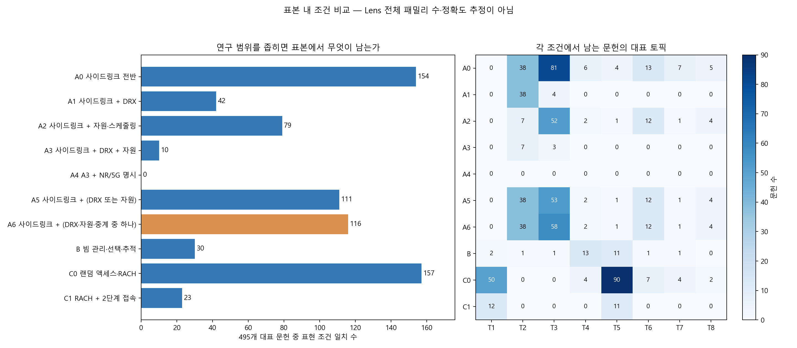

# 4단계 — 연구 가치 비교와 포함·제외 범위 확정

## 선택한 연구 범위

사용자 선택에 따라 **사이드링크의 자원 할당·DRX·중계**를 중심 범위로 정했다. 수집 기준은 **사이드링크 문맥 AND (자원 관련 표현 OR DRX OR 중계)**로 설계한다. 세 기능을 모두 동시에 언급하도록 강제하지 않는다.

권장 연구 제목은 **‘사이드링크 자원 할당·DRX·중계 기술의 특허 구조와 진화’**다. 그 안의 구체적인 연구 질문으로 ‘DRX 절전과 자원 운영을 함께 다루는 특허는 어떤 기술적 해결책을 제시하는가’를 우선 검토한다. NR과 LTE의 비교·구분은 수집 후 본문 검토와 태깅으로 보완하고, 이번 표본에서 NR이라는 단어가 없다는 이유만으로 바로 제외하지 않는다.

## 1. 연구 가치 비교

아래 우선순위는 **현재의 퀄컴 특허 데이터 분석, 범위의 명확성, 표준과의 연결, 결과 해석 가능성**을 기준으로 한 판단이다. 논문 게재 가능성·특허 가치·상업성을 수치로 평가한 결과가 아니다.

| 방향 | 장점 | 주의점 | 이번 프로젝트 판단 |
|---|---|---|---|
| 사이드링크 DRX·자원 운영 | 전력 절감, 전송 지연·신뢰성 사이의 관계로 연구 질문을 구체화하기 좋음. 모델에서도 DRX와 사이드링크 자원·중계가 나타남 | DRX 자체는 이미 표준에 존재해 ‘DRX를 쓴다’는 것만으로 새롭지 않음 | 우선 추천 |
| 빔 관리·선택·추적 | 표준·AI/ML 연구와 연결할 수 있고 기술적 관심이 큰 주제 | AI 빔 연구까지 넓히려면 현재 표본의 키워드·알고리즘·실험 자료가 부족할 수 있음 | 대안 주제 |
| 랜덤 액세스·RACH | 절차와 메시지 구성이 비교적 명확해 분류와 표준 대응이 쉬움 | 범위를 그대로 잡으면 넓음. 2단계 접속·특정 문제로 좁혀야 연구 질문이 선명해짐 | 절차 중심 대안 |

DRX 동작과 sidelink 전송·자원 선택은 실제 MAC 규격에 기술돼 있다. 이 사실은 연구 대상을 표준과 연결할 근거이며 신규성의 증거는 아니다. [3GPP Release 18 MAC 규격, TS 38.321](https://etsi.org/deliver/etsi_ts/138300_138399/138321/18.01.00_60/ts_138321v180100p.pdf)

Release 19 물리계층 규격에도 sidelink 자원 선택 절차가 포함돼 있어 관련 특허를 후속 규격과 비교할 수 있다. [3GPP TS 38.214 Release 19](https://etsi.org/deliver/etsi_ts/138200_138299/138214/19.02.00_60/ts_138214v190200p.pdf)

빔 관리의 AI/ML은 3GPP가 Release 19 관련 과제로 소개한 방향이다. 기술적 유망성과 별개로 현재 파일만으로 해당 알고리즘의 효과나 차별성을 평가할 수는 없다. [3GPP 기술 소식지](https://www.3gpp.org/ftp/Information/Highlights/3GPP_Highlights_Issue_9_WEB_Download.pdf)

## 2. 어떤 문헌을 남길 것인가

| 항목 | 포함할 내용 | 범위 밖으로 검토할 내용 |
|---|---|---|
| 자원 할당 | 사이드링크 자원 선택·풀·grant·스케줄링·선점 | 사이드링크와 연결되지 않은 일반 상하향 스케줄링 |
| DRX | 사이드링크 DRX 주기·활성 시간·타이머·정렬 | 사이드링크와 연결되지 않은 일반 단말 DRX |
| 중계 | 사이드링크와 연결된 원격 단말·중계 단말의 선택·활성화·자원 운영 | 사이드링크와 연결되지 않은 일반 네트워크 중계 |
| 빔·접속·다중 RAT | 위 세 기능과 연결되는 경우 포함 가능 | 연결되지 않은 일반 빔·RACH·RAT 연동은 중심 범위 밖 |
| NR/LTE | 사이드링크 관련 문헌을 먼저 수집하고 기술 세대 구분을 검토 | NR 단어 미검출만으로 노이즈라고 판단하지 않음 |

범위 밖은 ‘중요하지 않은 기술’이라는 뜻이 아니다. 이번 연구 질문과의 관계에 따른 범위 구분이다. 같은 문헌에 여러 기술이 섞일 수 있어 일반 분야명 전체를 NOT 조건으로 제외하지 않는다.

## 3. 후보 조건을 표본에서 비교

495개 대표 문헌의 제목·초록에 정규표현식으로 조건을 적용했다. Lens의 어간 처리·문서 범위·검색 인덱스를 그대로 재현한 것이 아니므로 아래는 **표본 내 표현 일치 건수**다.

| 후보 | 조건 | 일치 문헌 | 비일치 문헌 |
|---|---|---:|---:|
| A0 | 사이드링크 전반 | 154 | 341 |
| A1 | 사이드링크 + DRX | 42 | 453 |
| A2 | 사이드링크 + 자원·스케줄링 | 79 | 416 |
| A3 | 사이드링크 + DRX + 자원 | 10 | 485 |
| A4 | A3 + NR/5G 명시 | 0 | 495 |
| A5 | 사이드링크 + (DRX 또는 자원) | 111 | 384 |
| A6 | 사이드링크 + (DRX·자원·중계 중 하나) | 116 | 379 |
| B | 빔 관리·선택·추적 | 30 | 465 |
| C0 | 랜덤 액세스·RACH | 157 | 338 |
| C1 | RACH + 2단계 접속 | 23 | 472 |

선택한 **A6은 116개 문헌**에 일치한다. 나머지 379개가 실제로 모두 범위 밖이라는 판정은 아니며 조건·동의어·초록의 표현 누락 가능성도 있다. 이 단계에서 원본 문헌을 삭제하지 않았다.

연구 질문을 DRX와 자원 운영의 연계로 잡더라도 검색에서 두 표현을 모두 요구하는 A3은 10개만 남긴다. 여기에 NR/5G 명시를 추가한 A4는 0개다. **0개는 해당 기술이 없다는 뜻이 아니라 제목·초록에 모든 표현이 동시에 나타나지 않았다는 뜻**이다. 과도한 AND 조건은 필요한 문헌을 놓칠 수 있다.

A6의 116/495를 전체 21,900개 패밀리에 곱해 Lens 결과를 예상하지 않았다. 현재 파일은 무작위 표본으로 확인되지 않았기 때문이다. 5,000개 이하 여부는 다음 단계에서 실제 검색으로 확인해야 한다.

### 선택 조건과 기존 토픽의 관계

| 대표 토픽 | 원래 문헌 수 | A6 일치 | A6 비일치 |
|---|---:|---:|---:|
| T01 | 50 | 0 | 50 |
| T02 | 43 | 38 | 5 |
| T03 | 82 | 58 | 24 |
| T04 | 52 | 2 | 50 |
| T05 | 91 | 1 | 90 |
| T06 | 91 | 12 | 79 |
| T07 | 45 | 1 | 44 |
| T08 | 41 | 4 | 37 |

이 표는 NMF 라벨과 표현 조건의 관계이며 정확도·재현율 검증이 아니다. 모델의 대표 토픽이 DRX여도 사이드링크를 명시하지 않을 수 있고, 일반 자원 토픽에 배정됐어도 사이드링크를 언급할 수 있다. 다음 검토에서는 일치·비일치 양쪽의 문헌을 살펴 오포함·누락을 확인해야 한다.

## 4. 세부 CPC로 보완할 근거

| CPC 접두부 | 의미 | 대표 문헌에서 일치 | 패밀리 멤버 분류 합집합에서 일치 |
|---|---|---:|---:|
| H04W76/28 | DRX·DTX | 68 | 68 |
| H04W52/02 | 절전 | 58 | 58 |
| H04W72/40 | D2D·사이드링크 자원 관리 | 22 | 22 |
| H04W72/25 | 사이드링크 자원 관리 신호 | 29 | 29 |
| H04W88/04 | 단말 중계 | 41 | 41 |
| H04W16/28 | 빔 조향 | 26 | 26 |
| H04B7/0695 | 빔 선택 | 30 | 30 |
| H04W74/08 | 비예약·경쟁 접속 | 188 | 188 |

표는 접두부가 일치하는 코드를 세었으므로 하위 분류도 포함한다. 패밀리 합집합은 현재 파일에 있는 문헌들의 분류만 합친 것으로, 모든 해외 패밀리 멤버의 CPC를 새로 확보한 결과가 아니다.

DRX·절전·직접통신 자원·중계 분류는 선택 범위를 보완하는 후보다. **모든 관련 CPC를 AND로 묶지 않는다.** 특히 H04W72/40은 분류 개정에 따른 재분류 경고가 있고 이전 H04W72/02·72/04·72/12 등을 함께 고려하라는 안내가 있으므로 새 코드 하나만으로 2015~2025년 자료를 제한하면 누락 위험이 있다. [USPTO H04W 분류표](https://www.uspto.gov/web/patents/classification/cpc/html/cpc-H04W.html)

빔 비교 후보는 H04W16/28 및 H04B7/0695 계열을 참고했다. 위 비교 표는 해당 CPC만으로 연구 대상을 자동 결정하지 않았다. [USPTO H04B 분류표](https://www.uspto.gov/web/patents/classification/cpc/html/cpc-H04B.html)

## 5. 연구 질문을 어떻게 구체화할 것인가

1. **기술 구조:** DRX 설정·자원 선택·중계 운영은 각각 어떤 특허 주제로 구성되는가?
2. **연계:** DRX 활성 시간과 전송 자원의 정렬을 다루는 특허는 어떤 해결 방식을 제시하는가?
3. **진화:** 패밀리 최초 우선일 기준으로 해결 방식이 어떻게 달라지는가?
4. **표준 대응:** 특허의 기술 요소가 표준 절차와 어디에서 맞닿는가?

위 질문은 제안 단계다. 기존 문헌·특허 청구항과의 비교 없이 공백 기술, 신규성, 성능 향상 또는 표준필수성을 확정하지 않는다. 실제 성능 연구를 하려면 시뮬레이션·실험과 명확한 비교 기준이 추가로 필요하다.

## 다음 5단계

선택 범위 A6을 출발점으로 출원인·2015~2025년·H04W 조건을 유지한 검색식 후보를 만든다. 키워드와 세부 CPC를 단계적으로 조합하고, 기존 미국 관할 필터도 유지한다. 그다음 Lens의 Simple Families 수와 누락 문헌을 확인해 5,000개 이하 여부를 검증한다. 현재 보고서는 최종 검색식이나 Lens 실행 결과가 아니다.

## 파일

- [후보별 표본 건수](./candidate_scope_counts.csv)
- [후보·토픽 교차표](./candidate_topic_cross_table.csv)
- [CPC 보완 근거](./cpc_scope_evidence.csv)
- [검토 결과](./scope_review_results.json)
- [분석 코드](./build_query_step04.py)

문헌별 조건 일치 여부는 로컬 query_refinement_steps/step04_scope_matches_LOCAL_ONLY.csv에 저장하고 신규 GitHub 업로드에서 제외했다.
