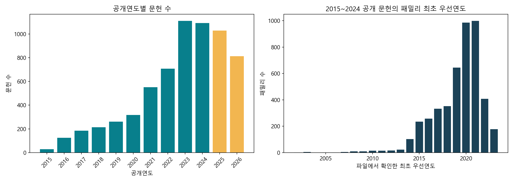
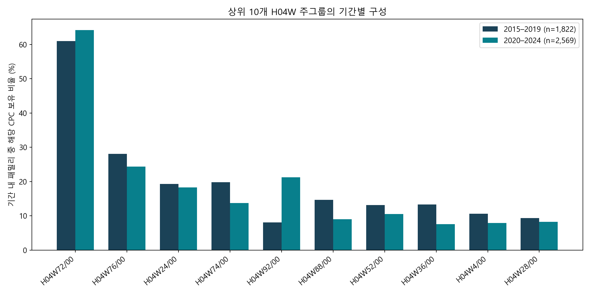
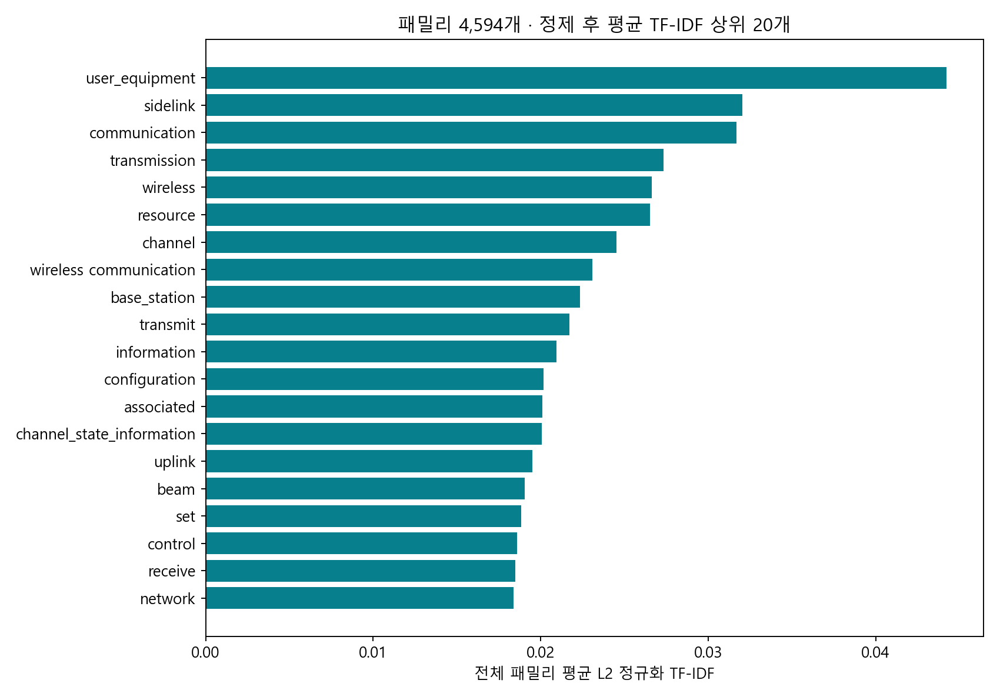

# PPT 페이지별 내용

기준은 직전 작성한 12장 발표 개선본의 페이지 순서다. 아래 문구와 수치는 새 CSV의 공개연도 2015~2024 범위에서 계산했다. PPT 파일 반영을 위한 원고이며, 이번 작업의 산출물은 GitHub 문서·집계표·그래프다.

## 1쪽 표지

**퀄컴 무선통신 특허의 기술 구조와 사이드링크 연구 범위**

부제는 ‘공개연도 2015~2024 · 관측 패밀리 4,594개 기반 분석’으로 바꾼다. 기존 표지의 495개 표본 표시는 새 수치로 교체한다. 팀명과 발표자 정보는 실제 정보를 입력한다.

## 2쪽 기업 개요와 분석 질문

**무선통신 포트폴리오에서 사이드링크의 위치와 기술 변화를 살펴본다**

발표 질문은 다음 세 가지로 정리한다.

1. 퀄컴 무선통신 문헌에서 어떤 기술 용어와 CPC가 두드러지는가?
2. 최초 우선연도 2015~2019와 2020~2024 사이에서 기술 구성이 어떻게 달라지는가?
3. 사이드링크 자원·DRX·중계를 후속 연구 범위로 구체화할 수 있는가?

사업 배경에는 2017년 C-V2X 제품 발표와 2019년 자동차 통신 플랫폼 발표를 활용한다. 특허 데이터와 사업 이벤트의 관계는 9쪽에서 검토한다. [2017년 퀄컴 발표](https://www.qualcomm.com/news/releases/2017/09/qualcomm-announces-groundbreaking-cellular-v2x-solution-support-automotive), [2019년 퀄컴 발표](https://www.qualcomm.com/news/releases/2019/02/qualcomm-announces-automotive-industrys-first-5g-dual-sim-dual-active-and)

## 3쪽 데이터 수집과 품질

**CSV 6,434건에서 공개연도 2015~2024의 4,594건을 분석한다**

| 점검 항목 | 결과 |
|---|---|
| 관할 | 전체 US |
| CSV 문헌 수 | 6,434 |
| Lens ID 중복 | 0 |
| 분석 범위 | Publication Year가 2015~2024인 4,594건 |
| 범위 밖 | 2025년 1,028건, 2026년 812건 |
| 제목·초록 결측 | 전체 및 분석 범위 모두 0 |
| 최초 우선일 결측 | 전체 39건, 분석 범위 0건 |
| 패밀리 중복 | 구성원 ID 연결 기준 전체·분석 범위 모두 관측된 중복 0건 |

패밀리 중복은 `Simple Family Members`와 자체 `Lens ID`의 집합을 만들고, 구성원 ID가 하나라도 겹치면 같은 연결 그룹으로 묶어 확인했다. 패밀리 구성원 목록의 문자열 순서 차이는 중복 판단에 영향을 주지 않는다. 내보낸 메타데이터에서 관측되는 연결 관계를 사용했다.

공개연도 조건에 따른 범위 밖 처리는 분석 기간 설정에 따른 것이다. 노이즈 문헌의 내용 판정은 아직 수행하지 않았다. 원검색식·검색일·Lens 전체 Simple Families 수는 검색 이력 또는 화면을 통해 보완한다. [데이터 점검 결과](../03_집계표/data_audit.json)

## 4쪽 필수 EDA ①

**공개문헌은 2023~2024년, 최초 우선일은 2020~2021년에 집중된다**

| 기준 | 연도 | 건수 |
|---|---|---|
| 공개연도 | 2022 | 707 |
| 공개연도 | 2023 | 1,111 |
| 공개연도 | 2024 | 1,093 |
| 최초 우선연도 | 2019 | 645 |
| 최초 우선연도 | 2020 | 986 |
| 최초 우선연도 | 2021 | 999 |

공개연도는 분석 문헌을 선택하는 기준이고, 최초 우선연도는 기술 활동의 시점을 비교하는 기준이다. 공개연도 2015~2024 문헌에는 2014년 이전 최초 우선일을 가진 203개 패밀리도 포함돼 있다. 최근 우선연도의 감소에는 공개 시차와 공개연도 상한의 영향이 있으므로 연구개발 축소라는 해석에 주의가 필요하다. [공개연도 집계](../03_집계표/publication_year_counts.csv), [최초 우선연도 집계](../03_집계표/priority_year_counts.csv)

## 5쪽 필수 EDA ②

**상위 CPC 주그룹에서 기간별 기술 구성을 비교한다**

기간별 분모는 최초 우선연도 2015~2019의 1,822개, 2020~2024의 2,569개다. 2014년 이전 203개는 이 기간 비교에서 빠진다. CPC 세부 코드는 `H04W72/23` 등을 `H04W72/00` 같은 주그룹 수준으로 통일하고, 한 패밀리 내 같은 주그룹은 한 번만 센다.

| CPC | 2015~2019 | 2020~2024 | 변화 |
|---|---|---|---|
| H04W72/00 | 1,111 / 1,822, 60.98% | 1,649 / 2,569, 64.19% | +3.21%p |
| H04W74/00 | 361 / 1,822, 19.81% | 352 / 2,569, 13.70% | −6.11%p |
| H04W92/00 | 148 / 1,822, 8.12% | 546 / 2,569, 21.25% | +13.13%p |

복수 CPC를 모두 반영하는 보유 비율을 사용했다. 기존 495개 표본 PPT의 분할 배분 방식과 분모 정의가 달라, 두 그래프의 수치 직접 비교는 적절하지 않다. 차트 설명도 새 정의로 교체한다. CPC는 현재 내보낸 분류 정보를 사용하므로 과거 당시의 분류 부여 상태를 재현하지는 못한다. [전체 CPC 집계](../03_집계표/cpc_period_counts.csv)

## 6쪽 기술 영역 정의와 대표 특허

**TF-IDF로 기술 용어를 표현하고 NMF로 세부 분야를 도출한다**

현재 완료한 내용은 용어 정제, TF-IDF 구성, 민감도 확인이다. 문헌 수는 4,594, 특성 수는 7,730이며 빈 행은 0개다. `min_df=3·5·10`에서 평균 TF-IDF 상위 20개 용어 집합은 동일했다.

사이드링크·자원·CSI·상향링크·빔 용어가 관측된다. 평균 TF-IDF가 높은 `user_equipment`, `communication` 같은 넓은 용어는 문헌 전반에 공통적인 기술 표현이다. 토픽별 구분력은 NMF 계수와 대표 문헌 검토를 통해 추가 평가한다.

새 데이터의 NMF 실행과 대표 특허 선정은 다음 분석 단계다. 기존 495개 표본의 ‘8개 토픽’, ‘안정성 87.1%’, 대표 특허를 새 데이터에서 얻은 결과로 인용하려면 재검증이 필요하다. 대표 특허는 새 NMF의 토픽별 고기여 문헌에서 뽑고 제목·초록·핵심 청구항을 대조한 뒤 확정한다. [TF-IDF 설정과 후속 기준](../02_TFIDF_설계/)

## 7쪽 시기별 기술 변화

**사이드링크·PC5 언급 비율이 11.58%에서 41.88%로 증가한다**

새 토픽 결과가 나올 때까지 이 페이지의 근거는 제목·초록의 용어 언급 비율로 제시할 수 있다.

| 용어군 | 2015~2019, n=1,822 | 2020~2024, n=2,569 | 변화 |
|---|---|---|---|
| sidelink / side link / PC5 | 211, 11.58% | 1,076, 41.88% | +30.30%p |
| DRX / discontinuous reception | 37, 2.03% | 72, 2.80% | +0.77%p |
| relay 계열 | 23, 1.26% | 110, 4.28% | +3.02%p |

이 표는 서로 중복될 수 있는 용어군의 출현 통계다. NMF 토픽 비중 그래프는 모델 실행 후 채운다. CSV에 해당 용어가 없는 문헌도 의미상 관련될 수 있고, 용어가 있어도 중심 기술은 다를 수 있다. [기간별 용어 집계](../03_집계표/lexical_period_counts.csv)

## 8쪽 가장 중요한 변화 두 건

**사이드링크 언급 증가와 CPC H04W92/00 비중 증가를 관측했다**

첫 번째 변화는 사이드링크·PC5 언급 패밀리의 증가다. 211개에서 1,076개로 늘었고, 기간 내 비율은 11.58%에서 41.88%로 30.30%p 증가했다.

두 번째 변화는 H04W92/00 보유 비율의 증가다. 148개에서 546개로 늘었고, 기간 내 비율은 8.12%에서 21.25%로 13.13%p 증가했다.

이 두 관측은 서로 같은 패밀리에서 나타날 수 있다. 독립된 두 성장 분야라는 해석은 CPC·용어 교차표와 새 토픽 모델을 검토한 후 판단한다. 최종 발표에서 변화 두 건은 NMF 대표 문헌을 확인한 뒤 재선정할 수 있다. 기존 표본에서 나온 DRX의 +10.4%p는 새 데이터의 용어 출현 변화 +0.77%p와 정의가 다르다.

## 9쪽 사업 이벤트와 기술 변화 연결

**C-V2X 발표와 특허의 최초 우선일을 함께 검토한다**

| 시점 | 기업 발표 | 특허에서 추가 확인할 사항 |
|---|---|---|
| 2017 | 퀄컴 C-V2X 솔루션 발표 | PC5·사이드링크 기술의 최초 우선일과 대표 특허 |
| 2019 | 자동차 5G 통신 플랫폼 발표 | 2020~2024 최초 우선연도군의 사이드링크·중계 기술 내용 |

회사의 제품 발표일과 특허 최초 우선일은 서로 다른 시점 지표다. 현재 관측된 연관성의 원인을 기업 발표 하나로 설명하기에는 추가 근거가 필요하다. 기술 내용·제품 적용 여부를 대표 특허의 청구항과 공식 제품 문서로 연결해 검증한다. [2017년 발표 원문](https://www.qualcomm.com/news/releases/2017/09/qualcomm-announces-groundbreaking-cellular-v2x-solution-support-automotive), [2019년 발표 원문](https://www.qualcomm.com/news/releases/2019/02/qualcomm-announces-automotive-industrys-first-5g-dual-sim-dual-active-and)

## 10쪽 핵심 발견과 전략적 시사점

앞선 요청에 따라 본문 작성은 보류한 페이지다. 새 NMF와 대표 특허 검토가 끝나면 4~9쪽의 근거를 사용해 작성한다. 현재 확정 가능한 것은 문헌 범위, CPC 구성, 용어 출현 변화까지다.

## 11쪽 결론과 한계

앞선 요청대로 결론 문안 작성을 보류한다. 추후 결론에는 검색 결과 완전성 확인, 공개 시차, 미국 관할 편중, 복수 CPC, 초록 중심 분석, 토픽 라벨의 검토 절차를 반영한다.

## 12쪽 참고자료

- 사용자 제공 v2 Lens CSV. 파일 SHA-256과 재현 환경은 데이터 점검 JSON에 기록했다.
- 기존 PPT 개선본의 12장 페이지 구조.
- 기존 08 폴더의 전처리 기준을 이어받아 사이드링크·자원 풀·랜덤 액세스 표기 통합을 추가했다.
- TF-IDF 구현은 scikit-learn의 sublinear TF, smooth IDF, L2 정규화를 따른다. [공식 TF-IDF 설명](https://scikit-learn.org/stable/modules/feature_extraction.html#tfidf-term-weighting), [TfidfVectorizer API](https://scikit-learn.org/stable/modules/generated/sklearn.feature_extraction.text.TfidfVectorizer.html)
- 기업 이벤트의 공식 발표 원문은 2쪽과 9쪽에 기재했다.

계산일은 2026년 11월 18일이다. 원검색일은 CSV에서 확인할 수 없다.
