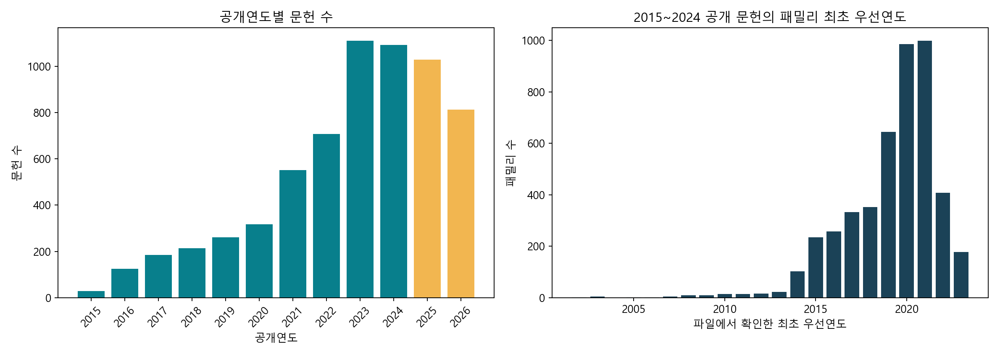
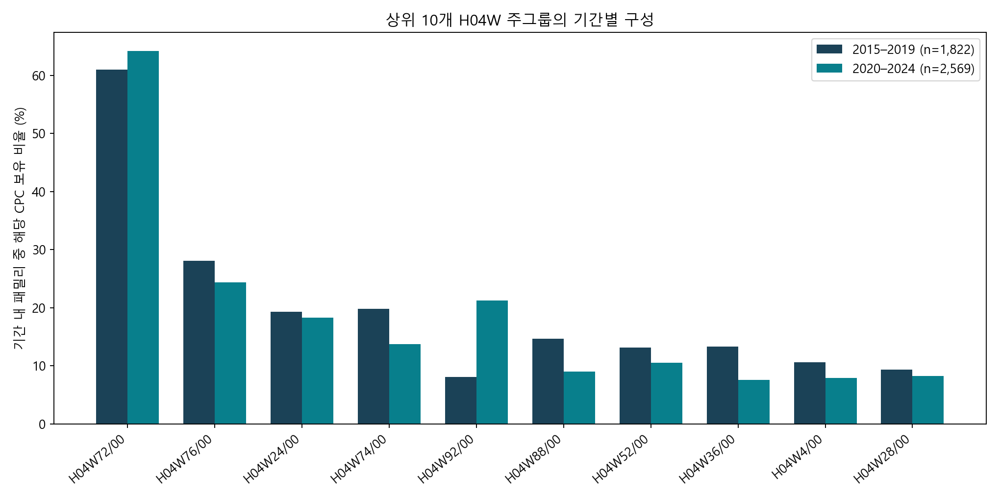
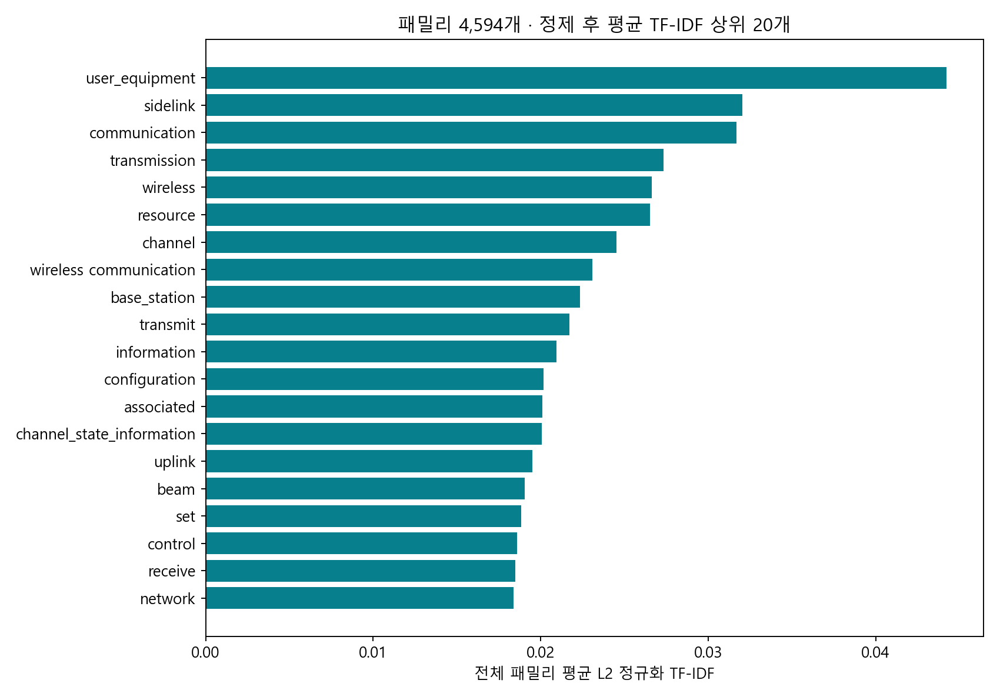

# 수정 검색 데이터 기반 발표자료

2026년 11월 18일 제공된 v2 Lens CSV를 기존 12장 PPT 순서에 맞춰 정리했다. 사용자가 확인한 분석 범위는 **공개연도 2015~2024**다.

| 구분 | 확인 결과 |
|---|---|
| CSV 전체 | 미국 문헌 6,434건 |
| 공개연도 2015~2024 | 4,594건, 관측된 패밀리 4,594개 |
| 범위 밖 공개연도 | 2025년 1,028건, 2026년 812건 |
| 분석 범위 제목·초록 결측 | 0건 |
| TF-IDF 예비 계산 | 4,594문헌 × 7,730특성, 빈 문헌 0건 |
| 이전 분석과 관계 | 08 폴더의 495개 표본 분석 이후 제공된 새 데이터 |

4,594는 파일에 공개연도 조건을 적용한 결과다. Lens의 동일 검색식 전체 Simple Families 수와 다운로드 완전성은 검색 화면에서 추가 확인해야 한다. CSV에는 원검색식과 원검색일이 포함돼 있지 않다. 따라서 파일명에 있는 ‘전수검토’만으로 전체 검색 결과의 누락 여부를 확정하기 어렵다.

| 폴더 | 내용 |
|---|---|
| [01 페이지별 정리](./01_페이지별_정리/) | PPT 1~12쪽에 넣을 제목·수치·도표·보완 항목 |
| [02 TF-IDF 설계](./02_TFIDF_설계/) | 확정한 전처리·가중치·민감도 결과와 NMF 후속 분석 기준 |
| [03 집계표](./03_집계표/) | 데이터 점검 JSON, 연도·CPC·용어 집계 CSV |
| [04 그래프](./04_그래프/) | 연도 분포, CPC 기간 비교, TF-IDF 상위어 |
| [05 코드](./05_코드/) | 집계·TF-IDF·그래프 재현 코드와 실행 방법 |

## 먼저 확인할 연구 범위

제목·초록의 사이드링크·PC5 언급 문헌은 1,287건이다. 사이드링크·PC5와 자원·스케줄링·grant·preemption·DRX·중계 중 하나가 함께 관측되는 문헌은 804건이다. 이는 문자열 조건의 진단 결과다. 의미 기반 관련도 검증과 기술 분류는 후속 검토가 필요하다.

현재 데이터로 무선통신 전체 구조를 분석하고, 사이드링크 자원·DRX·중계는 하위 연구 범위로 비교한다. 4,594개 전체에 TF-IDF를 적합하고 하위 범위에도 같은 어휘와 IDF를 적용한다. 사이드링크 중심 최종 검색을 의도했다면 Lens 검색식에 필수 조건이 실제로 적용됐는지 확인한다.

## 분석 그래프

왼쪽 청록색은 공개연도 분석 범위, 노란색은 2025~2026년 범위 밖 자료다. 오른쪽은 2015~2024 공개 문헌 4,594개의 최초 우선연도다.

기간은 최초 우선연도 기준이다. CPC별 보유 패밀리를 중복 허용해 계산했으므로 비율 합계는 100%를 초과할 수 있다.

TF-IDF는 전체 어휘 표현의 예비 결과다. 상위 용어만으로 기술 토픽의 이름이나 문헌의 연구 가치를 확정하지 않는다.
