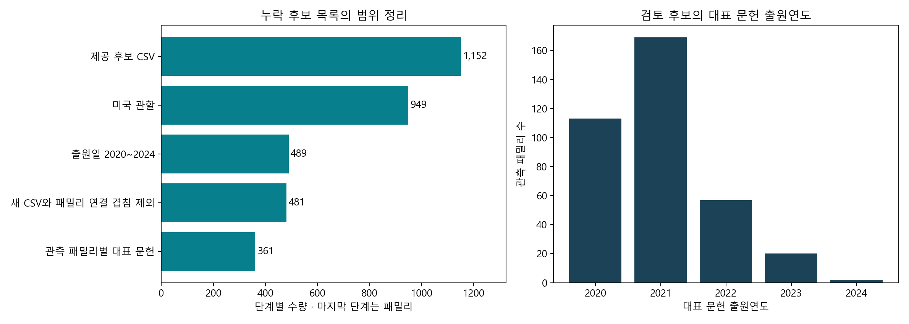

# 4장 데이터 정제와 누락 후보 검토

제공된 `missing_query_candidates_LOCAL.csv`를 검토하고, 보고서 4장에 사용할 원고와 그래프를 별도로 정리했다. 분석 범위는 미국 관할, 출원일 2020년 1월 1일~2024년 12월 31일이다.

**[제4장 원고 읽기](./제4장_데이터정제및EDA.md)**

| 항목 | 결과 |
|---|---:|
| 제공된 후보 목록 | 1,152문헌 |
| 미국·출원일 2020~2024 적용 | 489문헌 |
| 새 CSV와 패밀리 연결이 겹치는 문헌 제외 후 | 481문헌 |
| 패밀리별 대표 문헌 선정 후 | 361개 관측 패밀리 |
| 대표 문헌 제목에 기존 검색어가 관측된 후보 | 18개 패밀리 |
| 비교 기준인 v2 본 분석 데이터 | 5,073문헌 |

361개는 추가 검토 후보 수다. KIPRIS 검색식 실행 결과와의 대조 및 관련성 판정은 후속 확인 항목이다. 본 분석 데이터에 추가할 문헌 수는 검증을 거쳐 결정한다.

| 자료 | 내용 |
|---|---|
| [제4장 원고](./제4장_데이터정제및EDA.md) | 정제 기준, 본 분석 EDA, 후보 목록 EDA, 검색 개선 근거 |
| [집계표](./집계표/) | 단계별 건수, 연도·CPC, 점검 결과 |
| [그래프](./그래프/) | 본 분석 EDA, 연도별 CPC 구성, 후보 정제·분포 |
| [재현 코드](./코드/) | 입력 자료와 실행 방법 |

파일의 초기 후보 생성 조건은 초록 키워드의 로컬 근사 매칭이었다. KIPRIS의 실제 인접·절단·구문 검색 동작을 그대로 재현한 결과로 해석하려면 검색 화면 검증이 필요하다.
