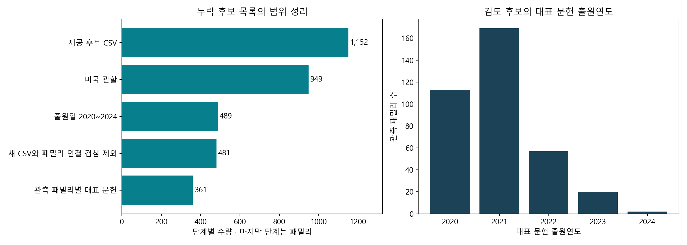
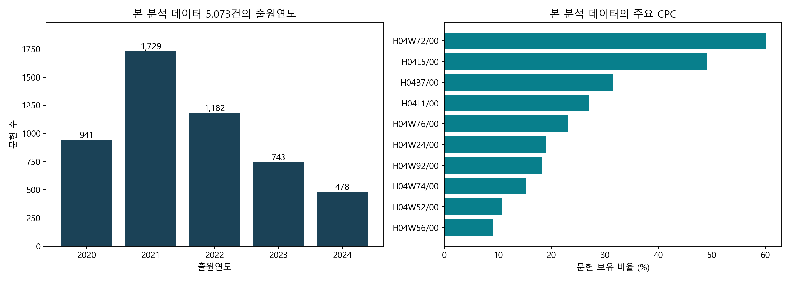
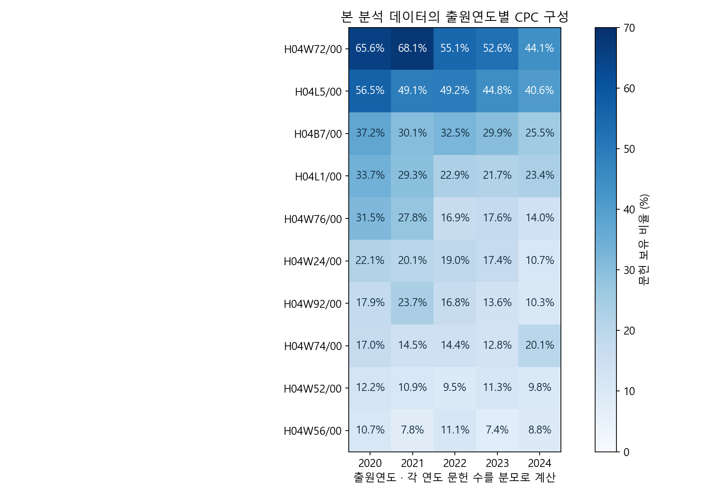
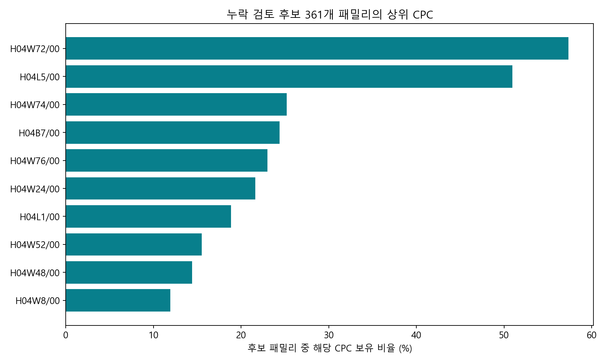

# 제4장 데이터 정제 및 탐색적 분석

## 4.1 데이터 정제와 집계 기준

### 4.1.1 자료의 구성과 분석 범위

본 장에서는 수정 검색으로 수집한 v2 CSV와 이전 수집 자료에서 생성한 누락 검토 후보 목록을 사용하였다. 출원일은 2020년 1월 1일부터 2024년 12월 31일까지, 관할은 미국으로 설정하였다. 출원일 조건은 원검색식의 AD 항목과 연결되며, 공개일·최초 우선일과 구분해 적용하였다.

| 자료 | 전체 규모 | 본 장에서의 역할 |
|---|---:|---|
| v2 Lens CSV | 6,434문헌 | 미국·출원일 2020~2024의 5,073문헌을 본 분석 대상으로 집계 |
| 누락 검토 후보 CSV | 1,152문헌 | 범위·패밀리 관계를 정리하고 추가 검토 대상을 도출 |
| 이전 lens-export·qualcom·qualcom1 CSV | Lens ID 기준 통합 2,962문헌 | 후보 문헌의 패밀리 구성원 정보를 복원하고 v2와 연결 관계 확인 |

누락 후보 CSV에는 문헌번호, Lens ID, 제목, 초록, 출원일, 공개일, CPC, URL, 원자료 이름, 제목의 검색어 매칭 결과가 포함돼 있다. 패밀리 구성원 목록은 이 파일에 없어 이전 원자료에서 Lens ID로 연결하였다. 이 2,962문헌은 제한된 비교 집합이므로 퀄컴의 전체 관련 특허를 대표한다고 보기는 어렵다.

### 4.1.2 초기 후보 목록의 생성 기준

제공된 후보 CSV는 이전 세 CSV를 통합한 뒤, 새 v2 CSV에 같은 Lens ID가 없고 출원일이 2015~2024년에 해당하며 출원인에 Qualcomm이 포함된 문헌에서 생성되었다. CPC에 H04W·H04L·H04B가 관측되고, 초록에서 지정 검색어의 로컬 매칭이 발견되지 않은 문헌을 후보로 저장하였다.

로컬 매칭은 검색식에 포함된 구문, beamform·handover·sidelink 계열과 상·하향링크 및 grant·scheduling의 근접 표현을 정규식으로 탐색한 방식이다. KIPRIS의 색인·어간 처리·구문 검색·인접 연산·절단 연산과 차이가 있을 수 있다. 따라서 초기 목록의 의미는 검색 조건에 따른 추가 검토 대상이다. 실제 검색 누락 여부는 KIPRIS에서 문헌번호와 검색식을 대조해 판정한다.

### 4.1.3 결측과 중복 점검

| 점검 항목 | 후보 CSV 전체 결과 |
|---|---:|
| Lens ID 중복 | 0건 |
| Lens ID 결측 | 0건 |
| 제목 결측 | 0건 |
| 초록 결측 | 8건 |
| 출원일 변환 실패 | 0건 |

초록 결측은 초록의 검색어가 검출되지 않은 원인일 수 있다. 이를 검색식의 의미적 누락으로 해석하려면 원문 초록을 추가 확인해야 한다. 아래 범위 정리와 대표 문헌 선정을 거친 361개 후보에서는 초록 결측이 0건이었다. 결측 점검 결과와 범위 정리 결과는 데이터 점검 JSON에 기록하였다. [점검 결과](./집계표/audit_summary.json)

### 4.1.4 관할·기간·패밀리 정리

문헌 수준에서 Lens ID가 달라도 같은 발명이 여러 국가 또는 공개·등록 문헌으로 나타날 수 있다. 이전 원자료와 v2 원자료의 `Simple Family Members` 및 자체 Lens ID를 통합하고, 구성원 ID가 겹치는 문헌을 연결하였다. 중간 문헌을 통해 이어지는 관계도 같은 연결 그룹으로 처리하였다. 이 방법으로 내보낸 메타데이터에서 관측되는 패밀리를 구성했다.

| 단계 | 남은 수량 | 해당 단계의 처리 |
|---|---:|---|
| 후보 CSV 입력 | 1,152문헌 | 전체 후보 목록 |
| 미국 관할 적용 | 949문헌 | 다른 관할 203문헌 제외 |
| 출원일 2020~2024 적용 | 489문헌 | 미국 문헌 중 2015~2019의 460문헌 제외 |
| v2와 패밀리 연결 겹침 확인 | 481문헌 | v2 문헌과 같은 연결 그룹의 8문헌 제외 |
| 패밀리별 대표 선정 | 361개 패밀리 | 같은 그룹 내 추가 문헌 120건 통합 |

대표 문헌은 초록이 있는 문헌을 우선하고, 같은 조건에서는 공개일이 빠른 문헌을 선택하였다. 공개일도 같으면 Lens ID 순서로 정하였다. 관할·출원일 조건은 대표 선정 전에 적용하였다. 패밀리 정보를 새로 확보하면 현재의 연결 관계도 재점검할 수 있다.

그림 4-1의 왼쪽은 문헌 수에서 패밀리 수로 집계 단위가 바뀌는 정리 과정이다. 마지막 361은 관측 패밀리 수다. 오른쪽 연도는 해당 패밀리에서 선택한 대표 문헌의 출원연도다. 출처는 후보 CSV, 이전 세 CSV 및 v2 CSV의 저자 재집계이다. [단계별 집계](./집계표/cleaning_flow.csv)

## 4.2 본 분석 데이터의 EDA

### 4.2.1 출원연도별 문헌 수

수정 검색 v2 자료에서 미국·출원일 2020~2024 조건을 충족한 문헌은 5,073건이다. 아래 표와 그림은 본 분석 데이터의 문헌 수를 나타낸다.

| 출원연도 | 문헌 수 |
|---|---:|
| 2020 | 941 |
| 2021 | 1,729 |
| 2022 | 1,182 |
| 2023 | 743 |
| 2024 | 478 |
| 합계 | 5,073 |

2021년 문헌이 1,729건으로 가장 많고 이후 수집 건수가 감소한다. 이러한 양상에는 공개 시차, 원검색일, 검색식의 포함 범위, 다운로드 완전성이 영향을 줄 수 있다. 출원 건수의 감소 원인을 연구개발 축소로 확정하려면 추가 자료가 필요하다. 원검색일은 제공된 CSV에서 확인되지 않았다.

출처는 v2 CSV의 미국·출원일 2020~2024 범위를 재집계한 결과이다. [연도별 집계](./집계표/baseline_year_counts.csv), [CPC 집계](./집계표/baseline_cpc_counts.csv)

### 4.2.2 주요 CPC와 연도별 구성

세부 CPC는 주그룹으로 묶었다. 예를 들어 H04W72/23과 H04W72/542는 H04W72/00으로 집계한다. 한 문헌에서 동일 주그룹은 한 번만 계산하고, 복수 주그룹은 각각 반영하였다. 비율의 분모는 본 분석 문헌 5,073건이다.

| CPC 주그룹 | 문헌 수 | 보유 비율 |
|---|---:|---:|
| H04W72/00 | 3,047 | 60.06% |
| H04L5/00 | 2,490 | 49.08% |
| H04B7/00 | 1,599 | 31.52% |
| H04L1/00 | 1,367 | 26.95% |
| H04W76/00 | 1,175 | 23.16% |
| H04W24/00 | 960 | 18.92% |
| H04W92/00 | 926 | 18.25% |
| H04W74/00 | 772 | 15.22% |
| H04W52/00 | 546 | 10.76% |
| H04W56/00 | 463 | 9.13% |

그림 4-3은 각 출원연도 문헌 수를 분모로 계산하였다. 분모는 2020년 941건, 2021년 1,729건, 2022년 1,182건, 2023년 743건, 2024년 478건이다. 동일한 주그룹 정의를 모든 연도에 적용하였다. 복수 분류를 반영하므로 열의 비율 합계는 100%를 초과할 수 있다. CSV에 수록된 현재 분류를 사용했으며 각 연도 당시의 분류 부여 상태는 재현하지 않았다. [연도별 CPC 원자료](./집계표/baseline_cpc_yearly.csv)

## 4.3 누락 검토 후보의 EDA

### 4.3.1 대표 문헌 출원연도

| 대표 문헌 출원연도 | 후보 패밀리 수 |
|---|---:|
| 2020 | 113 |
| 2021 | 169 |
| 2022 | 57 |
| 2023 | 20 |
| 2024 | 2 |
| 합계 | 361 |

후보는 대표 문헌 출원연도 2020~2021년에 집중돼 있다. 이 목록은 이전에 제공된 제한된 세 CSV에서 생성됐기 때문에, 최근 연도에 후보가 적다는 사실로 최근 검색의 누락이 줄었다고 판단하기는 어렵다. [후보 연도별 집계](./집계표/candidate_year_counts.csv)

### 4.3.2 후보의 CPC 분포

패밀리 내 후보 문헌의 CPC를 합치고, 같은 주그룹은 패밀리당 한 번만 계산하였다. 분모는 361개 후보 패밀리다.

| CPC 주그룹 | 후보 패밀리 수 | 보유 비율 |
|---|---:|---:|
| H04W72/00 | 207 | 57.34% |
| H04L5/00 | 184 | 50.97% |
| H04W74/00 | 91 | 25.21% |
| H04B7/00 | 88 | 24.38% |
| H04W76/00 | 83 | 22.99% |

후보 목록에서도 본 분석 데이터와 공통된 CPC가 다수 관측된다. 이는 검토 우선순위를 정할 참고 근거이며, 개별 문헌의 관련성은 발명의 중심 내용을 읽고 판단해야 한다. 본 분석의 문헌 보유 비율과 후보의 패밀리 보유 비율은 집계 단위가 다르다. [후보 CPC 집계](./집계표/candidate_cpc_counts.csv)

## 4.4 검색어와 표현 차이의 검토

361개 후보 중 대표 문헌 제목에서 기존 검색어가 관측된 패밀리는 18개, 대표 문헌 제목에서 해당 검색어가 관측되지 않은 패밀리는 343개였다. 이 구분에는 제공 CSV의 `title_terms` 매칭 결과를 사용하였다. 같은 패밀리의 다른 문헌 제목까지 합친 검색 결과와 차이가 있을 수 있다.

| 대표 문헌 | 제목의 검색어 | 제공 초록에서 관측된 표현과 검토 내용 |
|---|---|---|
| US 2021/0195653 A1 | random access response | 초록은 random access procedure, response message, timing offsets로 설명함. [문헌](https://lens.org/088-604-900-051-832) |
| US 2021/0266979 A1 | PRACH | 초록은 random access signal과 subcarrier spacing으로 설명함. [문헌](https://lens.org/169-330-280-895-823) |
| US 2022/0060242 A1 | beam management | 초록은 후보 빔의 측정·선택과 참조 신호로 설명함. [문헌](https://lens.org/031-121-709-111-556) |

이 세 문헌은 18개 중 제목·초록을 직접 대조한 예시다. 지정된 기술 표현이 제목과 초록에서 다르게 나타나는 사례로 볼 수 있다. KIPRIS의 현재 검색식으로 실제 검색되는지는 문헌번호를 이용한 재검색으로 확인해야 한다. 18개 전체의 기술 관련성 판정은 아직 완료하지 않았다.

## 4.5 검색식 보완과 후속 검증

제목에서 기술 키워드가 확인되는 후보를 바탕으로 제목과 초록의 OR 검색을 비교할 수 있다. PRACH와 random access signal, beam management와 빔 측정·선택 표현 등의 추가 여부도 검토한다. 구체적인 동의어 추가는 새로 유입되는 문헌의 관련성 확인과 함께 결정한다.

후속 판정은 다음 순서로 진행한다.

1. KIPRIS에서 후보의 문헌번호가 수록돼 있는지 확인한다.
2. 기존 검색식의 출원인·관할·출원일 조건을 동일하게 적용하고 검색 여부를 확인한다.
3. 제목·초록·필요한 청구항을 검토해 무선 접속, 자원 관리, 신호 처리, 전송 신뢰성, 연결 관리 등 연구 범위의 중심 기술인지 판정한다.
4. 같은 패밀리가 검색 결과에 이미 있는지 재확인한다.
5. 수록은 되어 있으나 기존 검색에서 빠지고 연구 범위에 해당하는 문헌을 누락 사례로 확정한다.

수록 자체가 없는 경우에는 DB 수록 범위의 차이를, 검색되지만 다운로드 파일에 없는 경우에는 내보내기 범위를 먼저 확인한다. 검증이 끝난 후보의 추가 여부를 결정한 다음 TF-IDF 어휘·IDF와 토픽모델을 다시 계산한다. 이전 09 폴더의 4,594개·7,730특성 결과는 공개연도 2015~2024 자료에서 계산한 값이므로, 이번 출원일 2020~2024 분석에는 재계산이 필요하다.

현재 361개 후보를 본 분석 데이터에 합산해 결과 수를 확정하려면 위 검증이 선행돼야 한다. 제공된 비교 집합 밖의 누락 문헌은 추가로 존재할 수 있어 이 검토만으로 전체 재현율을 계산하기는 어렵다.

## 자료와 재현 정보

- 사용자 제공 누락 후보 CSV와 v2 Lens CSV 및 이전 세 CSV를 2026년 11월 18일 재집계했다.
- 출원일 기준은 검색식 AD 조건에 맞췄다. [KIPRIS 검색 가이드](https://file.kipris.or.kr/pr/pr_new/2016_KIPRIS_GuideBook_Beginner_rn.pdf)
- CPC 의미를 해석할 때는 공식 주그룹 정의를 확인한다. [H04W](https://www.uspto.gov/web/patents/classification/cpc/html/cpc-H04W.html), [H04L](https://www.uspto.gov/web/patents/classification/cpc/html/cpc-H04L.html), [H04B](https://www.uspto.gov/web/patents/classification/cpc/html/cpc-H04B.html)
- 원본 후보 CSV의 SHA-256, 결측 수와 단계별 검증 상태는 점검 JSON에 기록했다. 원검색일은 제공된 파일에서 확인되지 않았다.
- 재현 코드는 해당 폴더의 코드 문서에 설명했다. [코드 실행 방법](./코드/)
