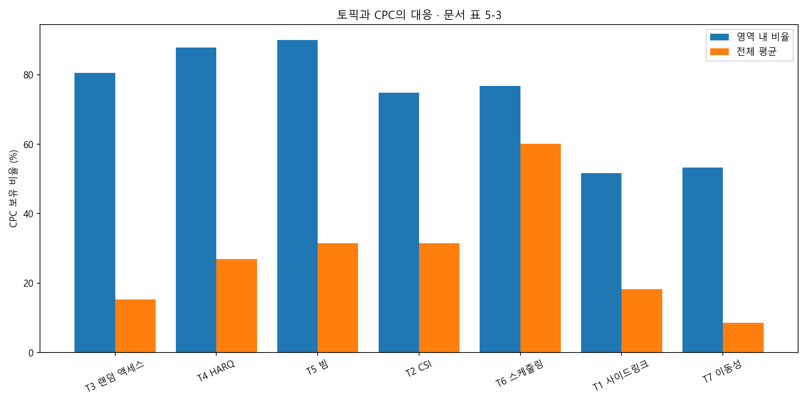
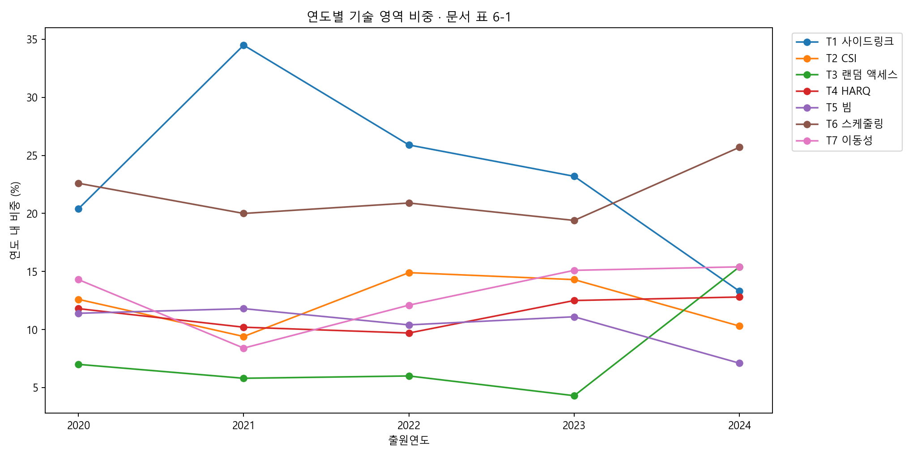
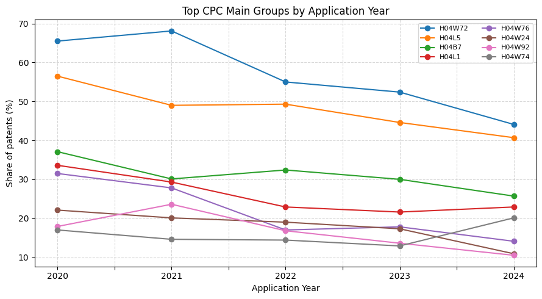
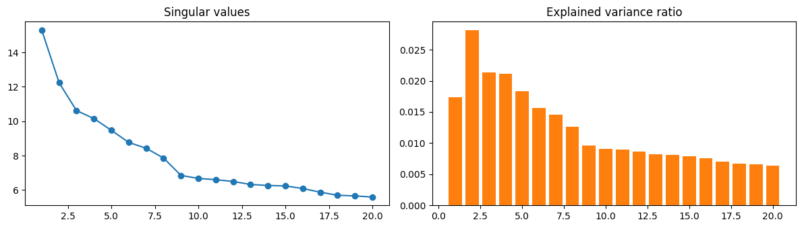
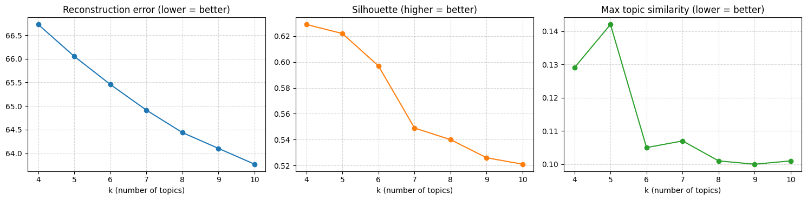
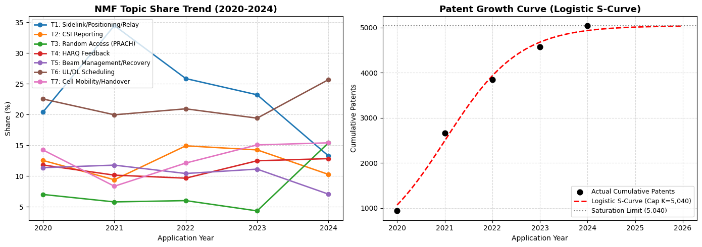
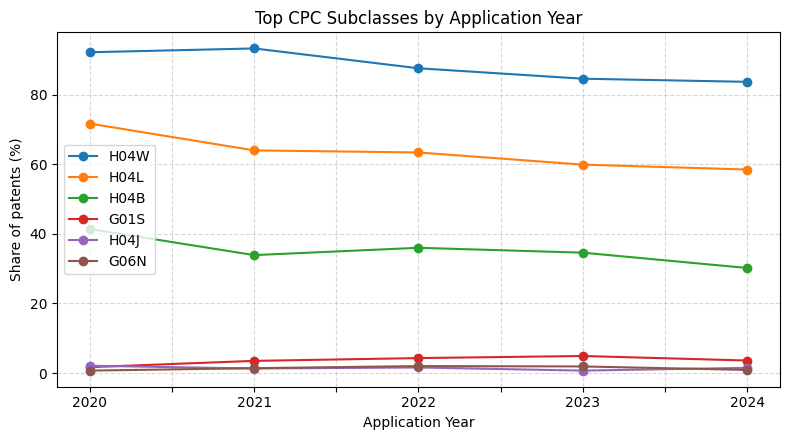
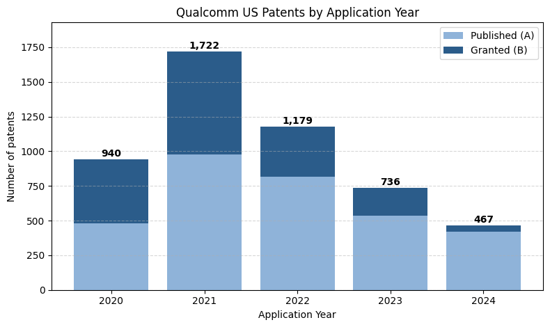
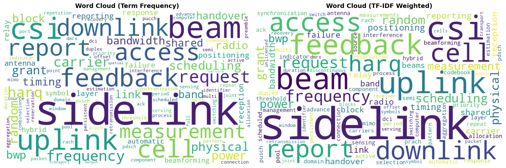

# Google 문서 전체 보고서

사용자가 지정한 Google Drive DOCX의 2026년 11월 25일 사본이다. 본문과 표의 원문을 보존해 Markdown으로 옮기고 내장 이미지를 함께 저장했다. 작성 안내와 미작성 항목도 원문에 포함된 상태로 보존했다.

- [전체 본문과 시각화 보기](./전체본문.md)
- [원본 DOCX 내려받기](./보고서_원본.docx)
- [이미지 폴더](./images/)
- [Google 문서 원문](https://docs.google.com/document/d/1QIUXVRbakKrxc_dfx_3lUxnLYuNacI1Z/edit)

Markdown은 읽기용 사본이다. 원본의 페이지 배치·병합 셀·수식 서식은 DOCX에서 확인할 수 있다.

## 표 수치로 재작성한 시각화

원본 DOCX에는 내장 이미지가 없어 아래 그래프를 문서 표의 수치로 재작성했다. 모델이나 원자료를 재계산한 결과와는 구분한다.

### 토픽과 CPC의 대응

### 연도별 기술 영역 비중

**연도별 CPC 구성 변화 · Colab 셀 15**

출원일 기준 2020~2024년, 중복 제거 후 5,044건. 각 연도의 전체 특허 수를 분모로 해당 CPC 메인그룹 보유 비율을 계산했다. 한 특허에서 같은 그룹은 한 번만 집계하고 복수 그룹은 각각 반영했다.

| 출원연도 | H04W72 | H04L5 | H04B7 | H04L1 | H04W76 | H04W24 | H04W92 | H04W74 |
|---|---:|---:|---:|---:|---:|---:|---:|---:|
| 2020 | 65.5% | 56.5% | 37.1% | 33.6% | 31.5% | 22.1% | 17.9% | 17.0% |
| 2021 | 68.1% | 49.0% | 30.1% | 29.3% | 27.8% | 20.1% | 23.6% | 14.6% |
| 2022 | 55.0% | 49.3% | 32.4% | 22.9% | 17.0% | 19.0% | 16.8% | 14.4% |
| 2023 | 52.4% | 44.6% | 30.0% | 21.6% | 17.8% | 17.3% | 13.6% | 12.9% |
| 2024 | 44.1% | 40.7% | 25.7% | 22.9% | 14.1% | 10.9% | 10.5% | 20.1% |

H04W72는 2020년 65.5%에서 2024년 44.1%로 21.4%p 감소했고, H04W74는 17.0%에서 20.1%로 3.1%p 증가했다. 연도별 특허당 CPC 그룹 수와 공개·등록 문헌 구성 차이도 함께 검토해야 한다. 출처는 사용자 지정 Colab 셀 15의 저장된 실행 결과다.

## Colab 시각자료 전체

노트북에 저장된 그래프 7개를 전체 본문의 관련 절에 배치했다. 아래에서도 모두 확인할 수 있다.

### LSA 20개 성분의 설명분산

### NMF 토픽 수별 비교

### 연도별 토픽 비중과 탐색적 S곡선

### CPC 서브클래스 분포

### 연도별 공개본·등록본 구성

### 빈도 및 TF-IDF 워드클라우드

[복합어·약어 보존 개선 실험](../12_복합어_약어보존_비교/)에서 기존 설정과의 비교 결과를 볼 수 있다.

[최신 첨부 노트북의 분석과 시각자료](../12_복합어_약어보존_비교/)를 추가했다. 기존 전체본문은 이전 수치이며, 최신 토픽 번호는 T3=빔·T5=랜덤 액세스다.
