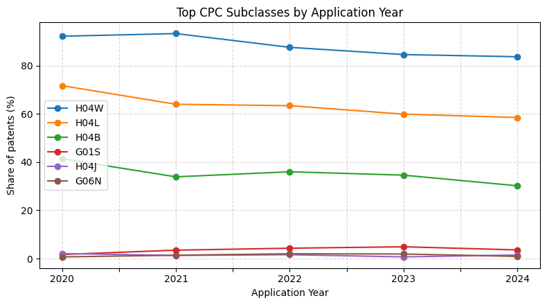
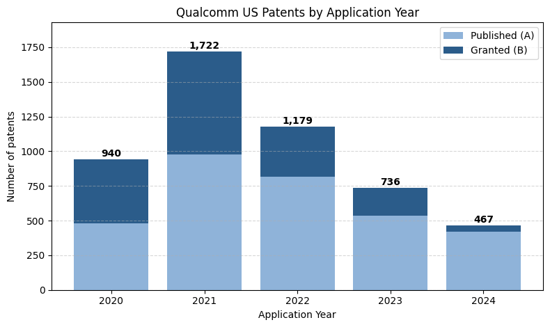
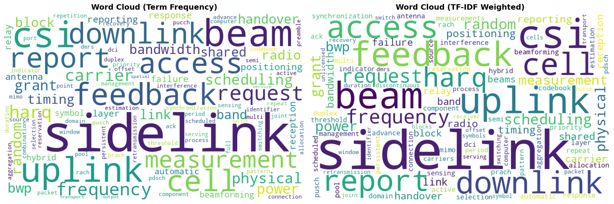
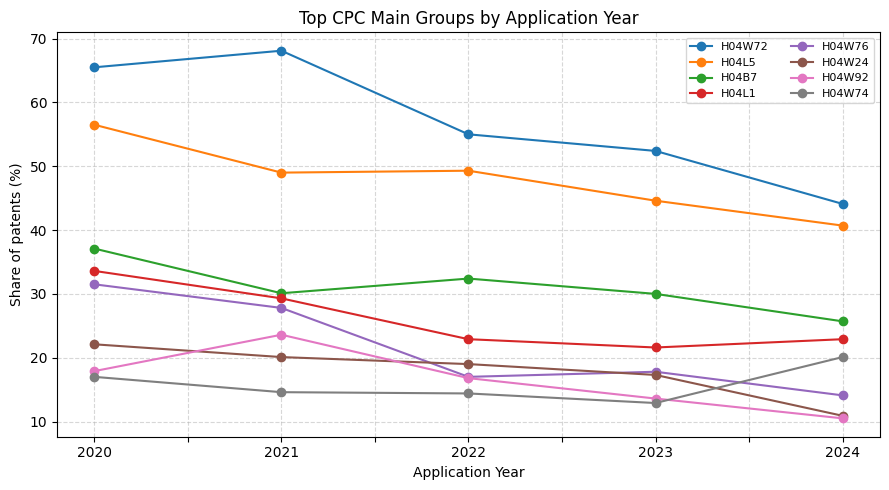
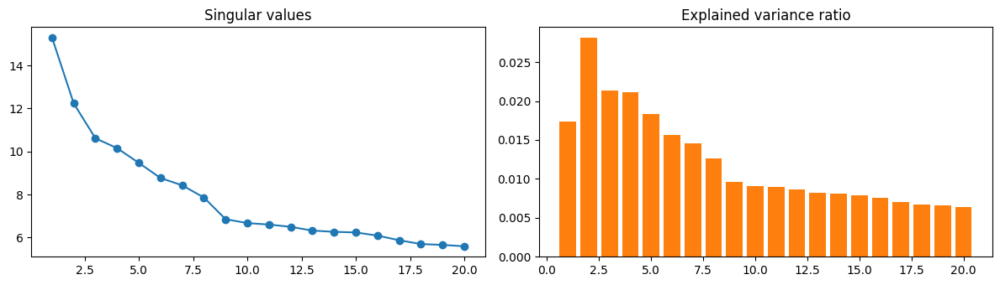
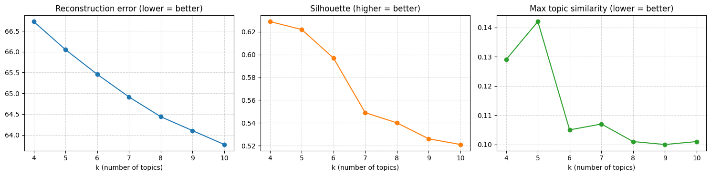
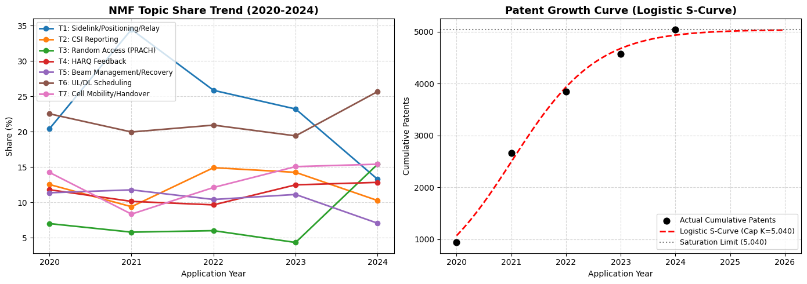
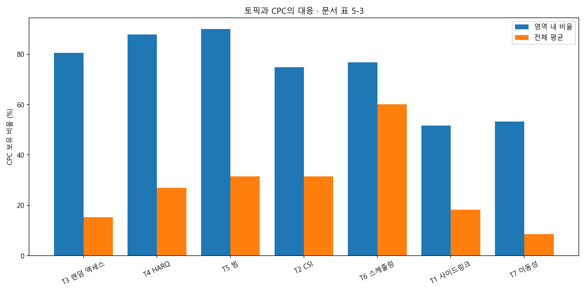
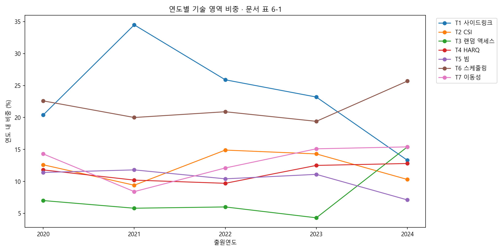

2026학년도 2학기 빅데이터애널리틱스  |  팀 프로젝트 최종 보고서

[기업명] 특허 포트폴리오 변화 분석

특허 데이터로 읽는 핵심 기술의 변화와 사업 전략

| 항목 | 기입 |
| --- | --- |
| 팀명 | [팀명] |
| 팀원 (이름·학번·담당 역할) | 고유영, 심예닮, 성윤제, 바트조 |
| 대상 기업 | [법인명 및 필요한 경우 영문명] |
| 분석 기간 / 구간 | [예: 2006–2025, 5년×4구간] |
| 주요 특허 DB | Lens Org |
| 분석 특허 수 / 분석 단위 | [원자료 ○건 → 정제 후 ○건 / 출원 또는 패밀리] |
| 제출일 | [YYYY.MM.DD] |

## 작성 안내 | 보고서 제출 시 삭제

| · 최종 보고서는 A4 최대 20쪽. 목차와 참고문헌만 분량에서 제외하며, 표지·요약·본문·부록은 모두 포함한다. 작성 안내·체크리스트·평가표는 최종 제출 전에 삭제한다. |
| --- |

### 보고서 작성의 공통 원칙 | 최종 제출 시 삭제

분석을 잘하는 것과 분석을 잘 설명하는 것은 다릅니다. 

이 과제는 독자가 원자료와 방법을 이해하고, 핵심 수치가 결론으로 이어지는 과정을 따라갈 수 있도록 쓰는 보고서입니다.

표현은 명확하고 쉽게 작성하세요. 지나치게 현학적인 표현이나 불필요하게 전문용어를 반복하는 것은 명확한 감점 요인입니다.

| 원칙 | 학생용 작성 지침 | 제출 전 스스로 확인할 질문 |
| --- | --- | --- |
| 글의 목적 | 방법의 개수보다 질문에 대한 답이 중요합니다. | 결론을 읽고 “무엇이 달라졌는가?”에 답할 수 있는가 |
| 독자의 수준 | 특허 분석을 처음 접하는 동료 학생도 이해할 수 있게 씁니다. | 설명 없는 전문 용어·약어가 없는가 |
| 쉬운 문장 | 한 문장에 중요한 주장 하나를 담고 긴 문장은 나눕니다. | 두세 번 읽지 않고도 문장 뜻이 전달되는가 |
| 전문 용어 | 처음 나올 때 풀어 쓰고 쉬운 예를 덧붙입니다. | 예: NMF = 문서의 단어 패턴을 주제별로 정리하는 방법 |
| 한 문단의 구조 | 주장 → 수치·표/그림 → 해석 → 한계/시사점 순으로 씁니다. | “그림을 보면 알 수 있다”로 끝내지 않았는가 |
| 수치의 표현 | 건수, %, %p를 구분하고 대상 기간·분모를 밝힙니다. | 12%에서 38%는 +26%p (26% 증가가 아님) |
| 사실과 추정 | 데이터로 확인한 사실과 가능한 설명·전략 제안을 구분합니다. | 시기적 일치만으로 사업 이벤트가 원인이라고 하지 않았는가 |
| 표·그림 해설 | 번호·제목·기간·단위·출처를 쓰고 핵심 발견을 문장으로 해설합니다. | 그림 하나마다 주요 수치와 의미를 설명했는가 |
| 출처 | 외부 자료·기업 정보·대표 특허는 본문 [번호]와 문헌 목록을 연결합니다. | 검색일·자료명·URL을 다시 확인할 수 있는가 |
| 형식 | 최종 보고서는 A4 최대 20쪽(목차·참고문헌 제외). 표지·요약·본문·부록은 포함합니다. 본문 11pt, 줄간격 150–160%, 표·그림 글자 9pt 이상, 상하좌우 여백 약 2–2.5cm로 작성합니다. | 목차·참고문헌을 제외한 전체가 20쪽 이내인가? 제목 단계·표/그림 서식이 일관적인가? |

### 예시로 배우는 보고서 문장 (아래 수치는 모두 가상 예시)

| 사례 | 피할 표현 | 권장 표현 |
| --- | --- | --- |
| 전문 용어 | NMF 토픽의 weight가 상승하여 포트폴리오가 reconfiguration되었다. | NMF로 유사한 특허를 묶어 보니 배터리 관련 기술의 비중이 이전보다 커졌다. 먼저 NMF가 무엇인지 간단히 소개한다. |
| 그래프 설명 | 그림 3에서 배터리 기술의 성장세가 뚜렷하게 나타난다. | 배터리 분야의 비중은 초기 12%(20/167건)에서 최근 38%(57/150건)로 26%p 늘었다(그림 3). |

### 요약 | Executive summary

작성 안내: 본문 작성 후 4–6문장(약 반 쪽)으로 정리한다. ① 기업·질문 ② 특허 범위·분석 방법 ③ 가장 중요한 기술 변화(수치) ④ 사업 이벤트와의 관계 ⑤ 시사점·해석의 한계.

[대상 기업의 기술 변화에 관한 핵심 결론을 수치와 함께 작성]

## 목차

작성 안내: 최종 편집 후 Word의 [참조 > 목차]에서 자동 목차를 삽입하고, 제출 직전에 전체 목차를 업데이트한다. 현재는 삽입 전 자리이다.

[아래는 목차 구성 예시입니다. 최종 제출 시 자동 목차로 대체하세요.]

1장  기업 개요[쪽]

2장  분석 질문과 범위[쪽]

3장  데이터 수집과 품질 확인[쪽]

4장  데이터 정제 및 EDA[쪽]

5장  기술 영역 도출 및 해석[쪽]

6장  시기별 기술 변화와 사업 연결[쪽]

7장  핵심 발견과 전략적 시사점[쪽]

참고문헌[쪽]

부록 A–E[쪽]

## 1장 기업 개요 | Company overview

작성 안내: 기업의 사업 맥락을 먼저 파악한다. 이후 특허 변화와 비교할 수 있도록 시기·숫자·출처가 있는 자료를 우선한다(사업보고서, DART 공시, 기업 홈페이지 등).

### 1.1 기본 정보

| 항목 | 내용 (기준 시점 포함) | 출처 |
| --- | --- | --- |
| 기업 기본 정보 | 퀄컴(Qualcomm Incorporated)은 1985년 설립된 미국의 무선통신·반도체 기업이다. 본사는 미국 캘리포니아주 샌디에이고에 있으며, 나스닥에 QCOM으로 상장돼 있다. 2024회계연도 매출은 약 389억 6,200만 달러, 고용 인력은 약 4만 9,000명이다.  | https://www.sec.gov/Archives/edgar/data/804328/000080432824000075/qcom-20240929.htm |
| 주요 사업 | 주요 사업은 QCT의 반도체·플랫폼 공급과 QTL의 특허 라이선스다. QCT는 스마트폰·자동차·IoT용 반도체와 시스템 소프트웨어를 제공하며, QTL은 이동통신 관련 지식재산을 라이선스한다. **2024회계연도 QCT 매출은 약 331억 9,600만 달러로 전체의 85.2%, QTL은 약 55억 7,200만 달러로 14.3%**를 차지한다  | https://www.sec.gov/Archives/edgar/data/804328/000080432824000075/qcom-20240929.htm |
| 대표 제품·서비스 | 스냅드래곤 모바일 플랫폼, 스냅드래곤 X 시리즈 PC 프로세서, 5G 모뎀-RF 시스템, 자동차용 Snapdragon Digital Chassis, Wi-Fi·Bluetooth 및 IoT용 연결 솔루션이 대표적이다. 주요 공급 대상은 스마트폰·PC 제조사, 자동차 제조사와 부품 공급업체, IoT 기기 제조사다.  | https://www.qualcomm.com/news/releases/2024/05/snapdragon-x-series-is-the-exclusive-platform-to-power-the-next- |
| 핵심 기술 또는 역량 | 5G 모뎀과 무선통신 시스템 설계, 밀리미터파 빔포밍·MIMO, 반송파 집성, 모뎀부터 RF·안테나까지 연결하는 통합 설계가 핵심 역량이다. 또한 저전력 CPU·GPU·NPU를 활용한 단말 내 AI 처리 역량을 확대하고 있다. 이러한 기술을 반도체 제품과 특허 라이선스 사업에 연결한다.  | https://www.qualcomm.com/news/releases/2020/02/qualcomm-introduces-third-generation-5g-modem-rf-system-enhance-5g |
| 최근 사업 변화 | 2024년에는 PC와 산업용 IoT 분야로 사업을 확대했다. 스냅드래곤 X Elite·X Plus를 탑재한 Windows Copilot+ PC가 2024년 6월 18일부터 판매되며 PC 시장 진출을 본격화했다. 또한 2024년 9월 30일 Sequans의 4G IoT 기술 인수를 완료해 산업용 IoT의 저전력 셀룰러 연결 기술을 보강했다.  | https://www.qualcomm.com/news/releases/2024/09/qualcomm-and-sequans-complete-sale-of-4g-iot-technology |

### 1.2 주요 사업 이벤트 연표

작성 안내: 분석 기간의 사업 이벤트 3–5개를 연대순으로 정리한다. 해당 사건이 실제로 어느 사업·기술과 관련 있는지 출처를 확인한다.

| 연월 | 주요 사업 이벤트 | 연관 가능성이 있는 기술 | 출처 |
| --- | --- | --- | --- |
| 2016.10 | 세계 최초 5G 모뎀 '스냅드래곤 X50' 공개 및 시연. 2016년 10월 최초의 5G 모뎀 칩셋을 발표하고, 2017년 28GHz 밀리미터파(mmWave) 대역에서 기가비트급 데이터 통신에 성공하며 5G 상용화의 포문을 열었음 | 적응형 빔 포밍 |  |
| 2019.02 | RF 프론트엔드(RFFE) 사업 본격화. TDK와의 합작법인(RF360) 설립 및 인수를 통해 모뎀에서 안테나까지 연결하는 5G 밀리미터파 안테나 모듈(QTM525 등)과 RFFE 솔루션을 핵심 수익원으로 육성 | RF 송수신 회로 |  |
| 2020.02 | 2세대·3세대 5G 모뎀 및 원칩 출시. 5G를 통합한 스냅드래곤 865 및 5nm 공정 기반의 3세대 5G 모뎀 '스냅드래곤 X60'을 선보이며 글로벌 5G 스마트폰 보급을 주도. | 다중 통신모드 지원 |  |
| 2023.01 | 위성통신 기반 스냅드래곤 새틀라이트(Satellite) 발표. 저궤도 위성통신망을 활용해 기지국이 없는 지역에서도 스마트폰 양방향 메시징이 가능한 무선통신 솔루션을 상용화 칩셋에 도입. | 위성 중계 통신 |  |

## 2장 분석 질문과 범위 | Objective & scope

작성 안내: 특정 기술의 전체 산업 동향이 아니라, 선정한 기업의 특허 포트폴리오 변화가 분석 대상이다. “무엇이 바뀌었으며 그 근거가 무엇인가?”라는 질문에 답한다.

### 2.1 핵심 질문

"[기업명]의 특허 포트폴리오에서 [기간] 동안 어떤 기술 영역이 확대·축소되었으며, 그 변화는 주요 사업 이벤트와 어떻게 연결되는가?"

작성 안내: 아래 세 질문 모두에 답해야 합니다. 각 질문의 답이 5–7장의 수치·그림·대표 특허와 직접 연결되어야 합니다.

초기와 최근 시기의 핵심 기술 영역은 각각 무엇인가?

특허 비중 또는 출원 건수가 두드러지게 바뀐 영역은 무엇인가?

변화의 시기와 공개된 사업 이벤트는 어떤 연관을 보이는가?

### 2.2 기간 구분

작성 안내: 5년 단위 구간을 권장하되 사업 이벤트에 따라 조정할 수 있다. 출원일·우선일·공개일 중 집계 기준을 하나 정하고 모든 구간에 동일하게 적용한다. 출원 특허는 보통 출원 후 약 18개월까지 미공개될 수 있어 최근 구간의 하락을 그대로 해석하지 않는다.

| 구간 | 기간 (집계 기준 동일) | 분석 특허 수 | 관련 주요 사업 이벤트 |
| --- | --- | --- | --- |
| 1 | [예: 2006–2010] | [○건] | [사건] |
| 2 | [예: 2011–2015] | [○건] | [사건] |
| 3 | [예: 2016–2020] | [○건] | [사건] |
| 4 | [예: 2021–2025] | [○건] | [사건] |

### 2.3 분석 범위와 집계 단위

작성 안내: 포함할 법인·자회사, 국가, 연도, 특허 상태, 분석 단위(개별 출원/공개 또는 패밀리)를 명시한다. 분석 대상에서 제외한 자료와 제외 이유도 적는다.

## 3장 데이터 수집과 품질 확인 | Data collection

### 3.1 출원인 중심 검색식 설계

작성 안내: 후보 검색식에서 최종 검색식으로 좁혀간 이유를 쓴다. 검색 결과 중 임의 표본(예: 30–50건)을 확인해 선정 기업과 무관한 특허의 비율을 기록한다. 표본 적합률은 누락 특허를 찾는 재현율과 다르다.

분석 대상은 퀄컴이 미국에 출원한 무선통신 특허이다. 특허 DB는 [Lens.org](http://lens.org)를 사용하였다. 검색식은 세 단계로 좁혀 갔다. ① 출원인 조건으로 퀄컴(출원인명 표기 변형 확인)의 무선통신을 잡고, ② 노이즈 제거를 위해 무선통신의 구체적인 기술 키워드로 범위를 좁힌 뒤, ③ 분석에 용이한 개수를 위해 연도를 조절하였다.(표 3-1)

| 단계 | 검색 조건 | 결과 (건) | 판단 |
| --- | --- | --- | --- |
| 후보 A | 국가: 미국 출원인: Qualcomm* 출원기간: 2015-01-01~2024-01-01 검색필드: {요약: “wireless communication”)} | 9317 | 퀄컴의 무선통신으로만 검색 키워드가 한정되어 무선통신을 활용한 타 기술들이 함께 집계되는 문제 발생. |
| 후보 B | 국가: 후보 A와 동일 출원인: 후보 A와 동일 출원기간: 후보 A와 동일 검색필드: {요약: 무선통신 기술 키워드(랜덤 액세스, 상·하향링크 스케줄링, HARQ, 빔포밍·MIMO, 핸드오버·캐리어 집성·사이드링크, WLAN·Wi-Fi 등)}  | 6263 | 셀룰러 표준 절차와 Wi-Fi를 기술 단위로 검색해, 분석하려는 무선통신 범위를 직접 지정했다. 다만 당초 목표했던 5000개 내외의 개수에서 1200개가량 초과되었으며, 표본을 통해 노이즈를 확인해본 결과 노이즈가 확인되지 않아 개수 조절의 필요성을 느꼈다. |
| 최종 | 후보 B의 출원기간을 [2020-01-01 TO 2024-12-31]으로 제한, 이하 동일 | 5087 | 검색 날짜를 지정해 1176개를 덜어냈다. 5087개는 분석에 적절한 개수라고 판단했다. |

출원인명 표기 변형: 수집한 6,463건의 출원인 필드는 "QUALCOMM INC"가 6,347건(98.2%)으로 대부분이다. 나머지는 "QUALCOMM Incorporated"처럼 표기가 다르거나 "INCORPROATED", "LNCORPORATED" 같은 오타다. 그래서 정확한 법인명 대신 "Qualcomm*"(Qualcomm으로 시작하는 모든 이름)으로 검색했다. 미국 특허만 대상이므로 국문 표기는 검토하지 않았다.

자회사·인수 기업 포함 여부: "Qualcomm*" 조건에는 QUALCOMM TECHNOLOGIES INT LTD(6건), QUALCOMM CONNECTED EXPERIENCES INC(1건), QUALCOMM INNOVATION CT INC(1건) 같은 계열사도 함께 잡힌다. 모두 퀄컴 그룹의 특허이므로 포함했다. 반면 NUVIA·Arriver처럼 인수 전 원래 회사 이름으로 출원된 특허는 출원인명이 달라 포함되지 않는다(2.3절 범위와 동일).

대상 관할·DB·기간·집계 기준일: DB는 Lens.org, 관할은 미국(US), 기간은 출원일 2020-01-01~2024-12-31이다(다만 5년 단위 빅데이터 분석을 위해 2015-01-01~2019-12-31의 특허도 활용한다). 공개특허와 등록특허를 모두 포함했고, 연도는 출원일 기준으로 집계했다. 검색일은 2026-11-11이다.

표본 적합률: 검색일 동안 2015-01-01~2024-01-01 특허 데이터를 저장한 뒤, 분석 대상 2020-2024 기간 동안의 5087건에서 무작위 50건을 뽑아 요약(Abstraction)을 확인했다. 50건 모두 무선통신 특허로 표본 적합률이 100%(50/50)이었다. 무관한 특허의 비율이 낮아 전체 5087건의 요약(Abstraction) 필드를 모두 확인해보았다. 판단 기준은 무선통신과 관련되어야 하며, 검색식의 기술 키워드가 있더라도, 요약문의 주제가 무선통신기술을 활용한 이외의 기술인 경우를 배제하였다. 그 결과 99.3%(5044/5087)로 확인되었다. 표본 적합률이 매우 높은 이유에 대해 다음과 같이 해석하였다.1. 검색식에서 이미 출원인을 퀄컴으로 한정하였다. 이에 따라 무관한 기업들이 검색되지 않는다.2. 검색 필드를 특허 전체(서지, 요약, 청구항을 모두 포함)가 아닌, 요약 필드에 대해서만 검색하였다. (청구항을 포함하는 경우에 무선통신기술을 더 많이 찾을 수 있으나 키워드 수준의 검색에서 매우 많은 노이즈가 검색되어 배제하였다.)

표본적합률에 대해, 구체적인 노이즈 특허 판정 기준은 발명이 무선 송수신, 접속, 재전송, 자원 배분, 빔, 채널, 이동성, 관련 RF 회로, 무선망 절차를 개선하는지였다. WLAN, Bluetooth, 셀룰러, 위성, V2X(차량 통신)를 포함하고, 무선 위치 측정과 통신·센싱 통합도 포함했다. 무선을 적용 장치나 배경으로만 언급한 발명은 제외했다. 제외한 29건의 오류 유형은 표 3-2와 같다.

표 3-2. 제외 특허의 오류 유형 (요약 전수 검토, 29건)

| 오류 유형 | 전체 (건) | 2020–24 (건) | 잘못 검색된 이유 | 예시 |
| --- | --- | --- | --- | --- |
| 무선 센싱·레이더 | 10 | 7 | 전파를 통신이 아닌 감지에 사용했다(beamforming, MIMO, CSI 등이 검색됨). | 호흡수 추정, 제스처 인식 |
| 음향·초음파 처리 | 7 | 4 | beamforming, channel, handover가 소리·초음파 처리의 뜻으로 쓰였다. | 마이크 음향 줌, 초음파 생체 센서 |
| 컴퓨팅·전력·저장장치 | 6 | 2 | WLAN·Wi-Fi가 적용 장치로만 등장한다. | CPU 작업 배치, 전압 조정 회로 |
| 유선 통신 | 3 | 1 | handover, MIMO가 유선 버스·전력선의 뜻으로 쓰였다. | 버스 클록 권한 이전, 전력선 MIMO |
| 기타 (무선이 배경) | 3 | 0 | 무선 신호가 입력원이나 전달 수단일 뿐이다. | WLAN 신호로 난수 생성 |
| 합계 | 29 | 14 |   |   |

### 3.2 최종 검색식과 분석 대상 특허

| DB / 범위 | 최종 검색식 (부록 전문) | 검색 결과 (건) | 정제 후 (건) | 검색일 |
| --- | --- | --- | --- | --- |
| Lens.org / 미국, 출원일 2020-2024, 공개·등록 | 출원인 Qualcomm* AND 무선통신 기술 키워드(랜덤 액세스, 상·하향링크 스케줄링, HARQ, 빔포밍·MIMO, 핸드오버·캐리어 집성·사이드링크, WLAN·Wi-Fi 등) [부록 A] | 5087 | 5044 | 2026-11-11 |
|  |  |  |  |  |

### 3.3 주요 IPC/CPC 기술 분류 분포

**CPC 서브클래스 분포**

출처는 사용자 지정 Colab 노트북의 셀 14에 저장된 실행 결과다.

표 3-4. 주요 CPC 메인그룹 분포 (2020–2024 출원, 5,044건, 중복 집계)

| 주요 IPC/CPC | 의미 (기술 내용) | 특허 수 | 해당 특허 비율 (%) |
| --- | --- | --- | --- |
| H04W 72 | 무선 자원 관리 (자원 할당·스케줄링) | 3,030 | 60.1 |
| H04L 5 | 전송 자원의 다중 사용 (부반송파·참조신호 배치 등) | 2,474 | 49.0 |
| H04B 7 | 무선 전송 방식 (다중 안테나·빔포밍·다이버시티) | 1,590 | 31.5 |
| H04L 1 | 수신 오류의 검출·정정 (HARQ 재전송 포함) | 1,356 | 26.9 |
| H04W 76 | 연결 관리 (연결 설정·해제) | 1,172 | 23.2 |
| H04W 24 | 망 운용 지원 (측정·보고) | 956 | 19.0 |
| H04W 92 | 망 구성요소 간 인터페이스 (단말 간 직접 통신 포함) | 922 | 18.3 |
| H04W 74 | 무선 채널 접속 (랜덤 액세스 등) | 770 | 15.3 |

비율 = 해당 메인그룹 코드가 하나 이상 붙은 특허 수 ÷ 5,044건 × 100. 한 특허에 여러 코드가 붙으므로 비율의 합은 100%를 넘는다. 자료: Lens.org CPC 필드, 출원번호 기준 중복 제거 후.

CPC(협력특허분류)는 특허청이 특허마다 붙이는 기술 분류 코드다. 서브클래스 수준에서 보면 2020–2024년 특허의 89.6%에 무선통신망(H04W)이, 64.2%에 디지털 정보 전송(H04L)이, 35.6%에 전송 일반(H04B)이 붙어 있다. 정제한 자료가 무선통신에 집중되어 있음을 분류 코드로도 확인할 수 있다.

메인그룹 수준에서는 무선 자원 관리(H04W 72)가 60.1%로 가장 많다. 2015–2019년(1,361건)의 55.9%보다 4.2%p 늘었다. 가장 크게 늘어난 분류는 H04W 92로, 2.9%(40건)에서 18.3%(922건)로 15.4%p 늘었다. 이 중 887건이 단말 간 인터페이스(H04W 92/18)로, 기지국을 거치지 않는 단말 간 직접 통신(사이드링크) 특허가 크게 늘었음을 보여준다. 반대로 무선 전송 방식(H04B 7)은 37.6%에서 31.5%로 6.1%p, 무선 채널 접속(H04W 74)은 19.8%에서 15.3%로 4.5%p 줄었다. 

## 4장 데이터 정제 및 EDA | Preprocessing & EDA

### 4.1 정제·전처리 및 집계 기준

**연도별 공개본·등록본 구성**

출처는 사용자 지정 Colab 노트북의 셀 18에 저장된 실행 결과다.

분석에 사용한 데이터 필드(IPC/CPC·제목·요약·청구항 등)를 명시하고 누락·제외 기준과 이유를 기록

중복 정리: 특허 패밀리 또는 동일 출원 중복의 처리 기준과 제거 건수 기재

텍스트 방법을 사용한 팀: 토큰화·표제어/형태소 처리, 언어별 전처리 규칙을 기록

텍스트 방법을 사용한 팀: 불용어·상투어(method, system 등) 제거 기준을 부록 B에 기록

텍스트 방법을 사용한 팀: BoW 또는 TF-IDF의 표현·문서 빈도 기준을 기록 / IPC 방법을 사용한 팀: 코드 병합·다중 라벨 규칙을 기록

### 4.2 EDA: 무엇이 바뀌었는가?

**빈도 및 TF-IDF 워드클라우드**

출처는 사용자 지정 Colab 노트북의 셀 19에 저장된 실행 결과다.

**연도별 CPC 구성 변화 · Colab 셀 15**

출원일 기준 2020~2024년, 중복 제거 후 5,044건. 각 연도의 전체 특허 수를 분모로 해당 CPC 메인그룹 보유 비율을 계산했다. 한 특허에서 같은 그룹은 한 번만 집계하고 복수 그룹은 각각 반영했다.

| 출원연도 | H04W72 | H04L5 | H04B7 | H04L1 | H04W76 | H04W24 | H04W92 | H04W74 |
|---|---:|---:|---:|---:|---:|---:|---:|---:|
| 2020 | 65.5% | 56.5% | 37.1% | 33.6% | 31.5% | 22.1% | 17.9% | 17.0% |
| 2021 | 68.1% | 49.0% | 30.1% | 29.3% | 27.8% | 20.1% | 23.6% | 14.6% |
| 2022 | 55.0% | 49.3% | 32.4% | 22.9% | 17.0% | 19.0% | 16.8% | 14.4% |
| 2023 | 52.4% | 44.6% | 30.0% | 21.6% | 17.8% | 17.3% | 13.6% | 12.9% |
| 2024 | 44.1% | 40.7% | 25.7% | 22.9% | 14.1% | 10.9% | 10.5% | 20.1% |

H04W72는 2020년 65.5%에서 2024년 44.1%로 21.4%p 감소했고, H04W74는 17.0%에서 20.1%로 3.1%p 증가했다. 연도별 특허당 CPC 그룹 수와 공개·등록 문헌 구성 차이도 함께 검토해야 한다. 출처는 사용자 지정 Colab 셀 15의 저장된 실행 결과다.

작성 안내: ① 연도별 특허 건수 ② 기간별 IPC/CPC 구성 변화, 두 그림을 모두 작성합니다. 그림별로 [관찰 수치] → [쉬운 해석] → [주의점]을 쓰고, 사용한 출원 기준일과 분모를 일치시킵니다. 특허 건수는 R&D 규모·실제 매출의 직접 측정치가 아닙니다.

| 필수 EDA 그림 | 핵심 해석과 유의점 |
| --- | --- |
| ① 연도별 특허 건수 | 연도별 건수와 급변 연도를 설명한다. 최근 미공개 출원의 영향 및 기준일을 함께 밝힌다. |
| ② 구간별 IPC/CPC 구성 변화 | 상위 IPC/CPC 비중의 시기별 변화를 수치로 설명한다. 복수 분류 코드의 분모·중복 집계 방식을 밝힌다. |

## 5장 기술 영역 도출 및 해석 | Technology domains

퀄컴 특허 5,044건을 7개 기술 영역으로 나누었고, 가장 큰 영역은 사이드링크(26.2%)와 상향링크 스케줄링(21.1%)이다. 영역은 특허 제목·요약의 단어 패턴으로 만들었고, 특허 분류코드(CPC)와 대조해 검증했다.

### 5.1 기술 영역 정의 방법 및 선정 근거

**LSA 20개 성분의 설명분산**

출처는 사용자 지정 Colab 노트북의 셀 5에 저장된 실행 결과다.

주된 방법은 NMF 토픽 모델링이고, CPC 분류코드는 검증용으로 사용했다.

분석 텍스트: 특허의 제목과 요약을 합친 글(5,044건). 불용어와 특허 상투어를 제거했다(부록 B).

TF-IDF: 한 특허에는 자주 나오지만 다른 특허에는 드문 단어에 높은 점수를 주는 방법이다. 상위 1,000개 단어를 쓰고, 문서의 50% 넘게 나오는 단어는 뺐다.

NMF: 문서의 단어 패턴을 주제별로 정리하는 방법이다. 함께 자주 나오는 단어 묶음(토픽)을 찾고, 각 특허가 어느 묶음에 가까운지 점수를 준다.

이 방법을 고른 이유는 세 가지다.

CPC만으로는 너무 거칠다. 퀄컴 특허의 89.6%가 H04W(무선 통신망), 64.2%가 H04L(디지털 정보 전송), 35.6%가 H04B(전송)에 걸쳐 있어 세부 기술을 구분하기 어렵다.

NMF는 점수에 음수가 없어서 토픽을 단어 묶음 그대로 읽고 이름을 붙일 수 있다. LSA(SVD)도 시도했으나(20개 성분, 설명분산 24.5%) 음수 방향이 섞여 이름 붙이기 어려워 문서 검색과 유사 단어 확인에만 썼다.

하나의 모델을 전 기간(2020~2024년)에 똑같이 적용해서 연도별 비교의 기준이 흔들리지 않는다.

배정 규칙: 한 특허는 점수가 가장 높은 토픽 1개에만 배정한다. NMF 점수는 확률이나 점유율이 아니므로, 영역의 건수와 비중(%)은 배정된 특허 수로 계산했다.

### 5.2 영역 수 또는 분류 수준의 타당성

**NMF 토픽 수별 비교**

출처는 사용자 지정 Colab 노트북의 셀 9에 저장된 실행 결과다.

토픽 수를 4~10개로 바꿔 비교한 뒤, 단어를 직접 읽고 k=7을 선택했다(표 5-1). 수치만으로는 뚜렷한 최적점이 없었다.

표 5-1. 토픽 수(k)별 비교 ◇

| k | 재구성 오차 | 실루엣 | 토픽 간 최대 유사도 | 가장 작은 토픽 비중(%) |
| --- | --- | --- | --- | --- |
| 4 | 66.916 | 0.629 | 0.129 | 13.1 |
| 5 | 66.240 | 0.617 | 0.142 | 11.6 |
| 6 | 65.645 | 0.593 | 0.106 | 7.7 |
| 7 | 65.101 | 0.545 | 0.107 | 6.8 |
| 8 | 64.624 | 0.541 | 0.101 | 6.5 |
| 9 | 64.286 | 0.525 | 0.100 | 5.9 |
| 10 | 63.951 | 0.516 | 0.101 | 4.0 |

출처: 저자 분석(Lens 검색 데이터[3]). 재구성 오차는 낮을수록 원자료를 잘 복원하고, 토픽 간 최대 유사도는 낮을수록 토픽이 덜 겹친다.

재구성 오차는 k가 커질수록 완만하게 줄 뿐 꺾이는 지점이 없어서 k를 정하는 데 쓸 수 없었다.

토픽 간 최대 유사도는 k=5에서 0.142로 가장 높았다가 k=6에서 0.106으로 떨어졌고 이후 0.10~0.11로 일정했다. k=5에서는 랜덤 액세스와 스케줄링 단어가 한 토픽에 섞여 있었다.

실루엣은 k=6(0.593)까지 높다가 k=7(0.545)에서 낮아졌다. k가 커지면 원래 낮아지는 경향이 있어 보조 지표로만 보았다.

가장 작은 토픽은 모든 k에서 4% 이상이라 구분 기준이 되지 못했다.

단어를 읽어 비교했다. k=6에서 7로 늘리면 핸드오버·이동성(cell, handover, serving, mobility)이 스케줄링 토픽에서 따로 떨어져 나온다. k=8에서는 대역폭 부분(BWP) 토픽이 추가되지만 세부 기능에 가깝고 BWP 단어가 다른 토픽과 겹쳤다. 사이드링크·CSI·HARQ·빔 영역의 대표 단어는 k=5~8에서 거의 같았다.

따라서 서로 다른 이름을 붙일 수 있고 큰 기술 영역을 빠뜨리지 않는 k=7을 선택했다. 최적점이 수치로 확인되지 않은 점은 7.5절의 한계에 적었다.

### 5.3 기술 영역 정의와 대표 특허

각 영역은 대표 단어와 대표 특허의 제목·요약을 함께 읽고 이름을 붙였다. 대표 특허는 같은 토픽으로 배정된 특허 중 NMF 점수가 가장 높은 것이다.

표 5-2. 7개 기술 영역의 정의와 대표 특허

| 영역 | 대표 단어 | 기술 영역 이름 | 특허 수 | 비중(%) | 대표 특허번호·제목 ◇ |
| --- | --- | --- | --- | --- | --- |
| T1 | sidelink, positioning, pool, reservation, relay | 사이드링크(단말 간 직접통신) | 1,324 | 26.2 | US 2022/0070850 A1, Signaling an indication of a sidelink transmission |
| T2 | csi, report, reporting, measurement, interference | 채널 상태 측정·보고(CSI) | 609 | 12.1 | US 2021/0143882 A1, CSI report including information identifying CSI-RS |
| T3 | random, access, prach, rach, preamble | 랜덤 액세스(초기 접속) | 341 | 6.8 | US 2025/0193939 A1, Random access channel occasion configurations for random access preamble repetitions |
| T4 | harq, feedback, hybrid, automatic, repeat | HARQ(수신 응답·재전송) | 552 | 10.9 | US 2023/0143786 A1, Hybrid automatic repeat request feedback verification |
| T5 | beam, failure, recovery, management, beamforming | 빔 관리·빔 실패 복구 | 548 | 10.9 | US 2023/0118940 A1, Beam failure detection per beam for multi-beam communications |
| T6 | uplink, grant, scheduling, pusch, bwp | 상향링크 승인·스케줄링 | 1,066 | 21.1 | US 11838907 B2, Simultaneous feedback information and uplink shared channel transmissions |
| T7 | cell, handover, serving, mobility, source | 셀 이동성·핸드오버 | 604 | 12.0 | US 11570706 B2, Operation modes for L1/L2-centric inter-cell mobility |

출처: 저자 분석(Lens 검색 데이터[3]), 출원 5,044건, 한 특허를 한 영역에 배정. 대표 특허는 부록 C에 영역별 3건씩 수록한다.

영역 이름을 붙인 이유

T1 사이드링크: 단말끼리 기지국을 거치지 않고 직접 통신하는 기술이다. 대표 특허는 직접 통신 자원의 알림과 할당을 다룬다. 차량통신(V2X)에 쓰이는 기술이다.

T2 CSI: 단말이 무선 채널 상태를 측정해 기지국에 보고하는 기술이다. 대표 특허 3건 모두 CSI 보고의 설정과 우선순위를 다룬다.

T3 랜덤 액세스: 단말이 처음 네트워크에 접속할 때 쓰는 절차다. 대표 특허는 접속 신호(프리앰블)를 반복 전송하는 방법을 다룬다.

T4 HARQ: 데이터를 잘 받았는지 응답하고 실패하면 다시 보내는 방식이다.

T5 빔: 신호를 좁은 빔으로 쏘고 빔이 끊기면 복구하는 기술이다.

T6 스케줄링: 상향 전송에 필요한 무선 자원을 배정하는 기술이다. 영역 안에 여러 세부 기능이 섞여 있어 가장 포괄적이다.

T7 이동성: 단말이 이동할 때 다른 셀로 연결을 옮기는(핸드오버) 기술이다.

분류코드(CPC)와의 교차검증. 각 영역에 속한 특허 중 해당 CPC 그룹을 가진 비율이 전체 평균보다 크게 높았다(표 5-3). 단어로 붙인 영역 이름이 독립적인 분류코드와도 맞는다는 뜻이다.

표 5-3. 영역별 대표 CPC 그룹 보유 비율(%)

| 영역 | 대표 CPC 그룹 | 의미 [4] | 해당 영역 특허 중 비율 | 전체 평균 |
| --- | --- | --- | --- | --- |
| T3 랜덤 액세스 | H04W74 | 무선 채널 접속 | 80.6 | 15.3 |
| T4 HARQ | H04L1 | 수신 오류 검출·재전송 | 87.9 | 26.9 |
| T5 빔 | H04B7 | 무선 송수신 시스템 | 90.0 | 31.5 |
| T2 CSI | H04B7 | 무선 송수신 시스템 | 74.9 | 31.5 |
| T6 스케줄링 | H04W72 | 무선 자원 관리 | 76.8 | 60.1 |
| T1 사이드링크 | H04W92 | 무선망 인터페이스(단말 간 연결 포함) | 51.7 | 18.3 |
| T7 이동성 | H04W36 | 핸드오버 | 53.3 | 8.6 |

출처: 저자 분석(Lens 검색 데이터[3]), 비율의 분모는 각 영역의 특허 수. CPC 그룹의 의미는 CPC 공식 분류표[4]에서 확인함.

해석할 때 주의할 점

한 특허가 한 영역에만 들어간다. 사이드링크는 다른 영역에도 걸쳐 있다. 사이드링크를 언급한 특허 1,747건 중 T1에 배정된 것은 1,324건(75.8%)이고, T4(HARQ) 영역 특허의 27.5%, T5(빔) 영역의 16.4%도 사이드링크를 언급한다 ◇. 그래서 T1의 건수만으로 사이드링크 전체를 판단하지 않고, 6장에서 사이드링크 언급 특허의 연도별 비중을 보조 지표로 함께 본다.

T6와 T7은 여러 세부 기능의 묶음이다. 영역 이름의 핵심 키워드(스케줄링·핸드오버)를 가진 특허는 T6에서 41.7%, T7에서 44.6%였다 ◇. 이 두 영역의 변화는 세부 기능이 아니라 큰 묶음의 변화로 읽는다.

CPC 그룹은 한 특허에 여러 개 붙어서 비율의 합이 100%를 넘는다.

## 6장 시기별 기술 변화와 사업 연결 | Portfolio change

사이드링크 비중은 2021년 34.5%로 정점을 찍고 2024년 13.3%로 줄었고, 랜덤 액세스는 2023년 4.3%에서 2024년 15.4%로 늘었다. 스케줄링은 20~26%를 유지한 가장 큰 축이다. 5장에서 정의한 7개 영역을 모든 연도에 같은 모델로 적용했다. 비중은 그 해 출원 건수를 분모로 계산했다(출원일 기준).

### 6.1 구간별 기술 영역 구성 비교

**연도별 토픽 비중과 탐색적 S곡선**

출처는 사용자 지정 Colab 노트북의 셀 10에 저장된 실행 결과다. 오른쪽 S곡선은 탐색적 적합 결과이며, 보고서의 기술 변화 해석에는 왼쪽 관측 비중을 사용한다.

데이터가 2020~2024년 5개 연도뿐이어서 연도를 그대로 구간으로 썼다. 한 특허는 한 영역에만 배정되므로 각 연도의 비중 합은 100%다.

표 6-1. 연도별 기술 영역 구성 (각 칸: 건수 / 비중 %, 출원일 기준)

| 기술 영역 | 2020 | 2021 | 2022 | 2023 | 2024 |
| --- | --- | --- | --- | --- | --- |
| T1 사이드링크 | 192 / 20.4 | 594 / 34.5 | 305 / 25.9 | 171 / 23.2 | 62 / 13.3 |
| T2 CSI | 118 / 12.6 | 162 / 9.4 | 176 / 14.9 | 105 / 14.3 | 48 / 10.3 |
| T3 랜덤 액세스 | 66 / 7.0 | 100 / 5.8 | 71 / 6.0 | 32 / 4.3 | 72 / 15.4 |
| T4 HARQ | 111 / 11.8 | 175 / 10.2 | 114 / 9.7 | 92 / 12.5 | 60 / 12.8 |
| T5 빔 | 107 / 11.4 | 203 / 11.8 | 123 / 10.4 | 82 / 11.1 | 33 / 7.1 |
| T6 스케줄링 | 212 / 22.6 | 344 / 20.0 | 247 / 20.9 | 143 / 19.4 | 120 / 25.7 |
| T7 이동성 | 134 / 14.3 | 144 / 8.4 | 143 / 12.1 | 111 / 15.1 | 72 / 15.4 |
| 합계 | 940 / 100 | 1,722 / 100 | 1,179 / 100 | 736 / 100 | 467 / 100 |

출처: 저자 분석(Lens 검색 데이터[3]), 중복 제거 후 5,044건. 그림 6-1에는 노트북의 ‘영역별 비중 추이’ 그림(왼쪽)을 쓴다. 오른쪽 S곡선은 쓰지 않는다.

사이드링크(T1) 비중은 2020년 20.4%에서 2021년 34.5%(594건)로 뛰어 정점을 찍은 뒤 2024년 13.3%(62건)까지 해마다 낮아졌다.

랜덤 액세스(T3)는 2020~2023년에 4~7%에 머물렀다가 2024년에 15.4%로 뛰었다. 건수도 2023년 32건에서 2024년 72건으로 두 배 넘게 늘었다. 전체 건수가 줄어드는 해에 늘었다는 점이 눈에 띈다.

스케줄링(T6)은 매년 19~26%로 가장 크고 안정적이다.

이동성(T7) 비중은 2021년 8.4%에서 2024년 15.4%로 커졌다(+7.1%p).

2021년은 전체 출원이 2020년의 1.8배(940→1,722건)로 늘어 대부분 영역의 건수가 함께 늘었다. 그래서 건수보다 비중의 변화를 중심으로 본다.

보조 지표(사이드링크는 여러 영역에 걸쳐 있어 T1 하나로는 전체를 보기 어렵다). 제목·요약에 ‘sidelink’가 들어간 특허의 연도별 비중은 2020년 28.4%, 2021년 45.0%, 2022년 33.7%, 2023년 29.6%, 2024년 17.6%로 T1과 같은 모양의 흐름이다 ◇. CPC 그룹 H04W74(무선 채널 접속) 보유 비율은 2023년 12.9%에서 2024년 20.1%로 늘어, T3의 증가와 같은 방향이었다. 다만 특허당 CPC 그룹 수가 4.36개(2020)에서 2.95개(2024)로 줄어 대부분 그룹의 비율이 함께 낮아졌다. 그 영향을 보정하면 H04W74만 분명히 늘었다(보정 지수 1.75, 나머지 대부분 0.9~1.1).

### 

### 6.2 가장 큰 변화: 건수와 비중 차이

두 해씩 묶은 초기(2020~2021년, 2,662건)와 최근(2023~2024년, 1,203건)을 비교했다. 한 해만 비교하면 우연에 크게 좌우되기 때문이다. 비중 차이는 최근 비중에서 초기 비중을 뺀 값이다(단위 %p). 참고로 2020년 대 2024년 한 해만의 차이를 함께 실었다.

표 6-2. 초기와 최근의 건수·비중 비교

| 핵심 영역 | 초기(2020~21) 건수 / 비중 | 최근(2023~24) 건수 / 비중 | 비중 차이(%p) | 2020 대 2024 한 해 차이(%p) |
| --- | --- | --- | --- | --- |
| T1 사이드링크 | 786 / 29.5% | 233 / 19.4% | −10.2 | −7.1 |
| T7 이동성 | 278 / 10.4% | 183 / 15.2% | +4.8 | +1.2 |
| T3 랜덤 액세스 | 166 / 6.2% | 104 / 8.6% | +2.4 | +8.4 |
| T5 빔 | 310 / 11.6% | 115 / 9.6% | −2.1 | −4.3 |
| T2 CSI | 280 / 10.5% | 153 / 12.7% | +2.2 | −2.3 |
| T4 HARQ | 286 / 10.7% | 152 / 12.6% | +1.9 | +1.0 |
| T6 스케줄링 | 556 / 20.9% | 263 / 21.9% | +1.0 | +3.1 |

출처: 저자 분석(Lens 검색 데이터[3]), 비중의 분모는 각 기간의 전체 특허 수(2,662건, 1,203건). 예: T1 29.5% → 19.4% = −10.2%p(반올림 차이 포함).

가장 크게 줄어든 영역은 사이드링크다. 비중이 10.2%p 줄었고 건수는 786건에서 233건으로 초기의 30% 수준이 됐다. 전체 건수(2,662→1,203건)가 초기의 45%로 줄었으므로 전체 감소보다 더 크게 줄었다.

이동성(T7)의 건수는 278건에서 183건(66%)으로 전체보다 덜 줄어 비중이 4.8%p 커졌다. 그러나 2020년 대 2024년 한 해 비교에서는 +1.2%p로, 2021년의 낮은 비중(8.4%)에 크게 좌우된다.

랜덤 액세스(T3)는 두 해 묶음으로는 +2.4%p에 그치지만 2024년 한 해만 보면 +8.4%p다. 증가가 2024년 한 해에 집중된 형태다.

건수가 줄었다는 것이 사업이 쇠퇴한다는 뜻은 아니다. 전체 출원이 2021년을 정점으로 줄었기 때문에 대부분 영역의 건수도 함께 줄었다.

### 

### 6.3 변화 유형과 판정 기준

아래 기준을 정해 두 기준(두 해 묶음, 2020 대 2024 한 해)을 함께 보고 판정했다.

### 

| ### 유형 | ### 판정 기준(경계값) |
| --- | --- |
| ### 확장 | ### 두 기준 모두 비중이 늘고, 하나라도 +5%p 이상 |
| ### 상대적 축소 | ### 두 기준 모두 비중이 줄고, 하나라도 −5%p 이하 (건수 감소폭 확인) |
| ### 유지 | ### 두 기준 모두 ±3%p 이내 |
| ### 경계(민감) | ### 위 세 가지에 해당하지 않음. 기준에 따라 결과가 달라짐 |
| ### 구성 이동 | ### 여러 영역의 비중이 동시에 ±3%p 이상 움직임(직접적 대체 관계는 별도 입증 필요) |

### 

| ### 영역 | ### 두 해 묶음 / 한 해 차이(%p) | ### 판정 | ### 이유 |
| --- | --- | --- | --- |
| ### T1 사이드링크 | ### −10.2 / −7.1 | ### 상대적 축소 | ### 두 기준 모두 감소, 한 기준이 −5%p 이하. 건수도 전체보다 더 줄었다(30% vs 45%) |
| ### T3 랜덤 액세스 | ### +2.4 / +8.4 | ### 확장 | ### 두 기준 모두 증가, 한 기준이 +5%p 이상. 다만 2024년 한 해에 집중 |
| ### T7 이동성 | ### +4.8 / +1.2 | ### 경계(민감) | ### 두 기준의 크기가 다름. 2021년 저점 영향 |
| ### T6 스케줄링 | ### +1.0 / +3.1 | ### 유지(경계에 가까움) | ### 두 기준 모두 작은 증가. 한 기준이 기준선(3%p)을 근소하게 넘음 |
| ### T2 CSI, T4 HARQ | ### +2.2 / −2.3, +1.9 / +1.0 | ### 유지 | ### 두 기준 모두 ±3%p 이내 |
| ### T5 빔 | ### −2.1 / −4.3 | ### 경계(소폭 감소) | ### 두 기준 모두 감소이나 −5%p에 못 미침 |

### 구성 이동: 초기 대비 최근에 사이드링크가 10.2%p 줄고 이동성(+4.8%p)·랜덤 액세스(+2.4%p)·CSI(+2.2%p)·HARQ(+1.9%p) 등이 늘었다. 비중의 합은 100%이므로 한 영역이 줄면 다른 영역이 기계적으로 늘어 보인다. 사이드링크에서 다른 영역으로 기술이 옮겨갔다는 직접 대체 관계는 이 분석만으로 입증하지 못했다. 특허 감소를 사업 자체의 쇠퇴로 보지도 않는다.

### 

### 6.4 기술 변화와 사업 이벤트의 비교

### 아래 사업·표준 이벤트는 공개된 자료에서 확인한 것만 썼다. 1장의 이벤트 연표와 일치시켜야 한다. 시기가 비슷하더라도 인과는 단정하지 않는다.

### 표 6-3. 기술 변화와 사업·표준 이벤트

| ### 시기 | ### 관찰한 변화 (수치) | ### 대표 특허 ◇ | ### 사업·표준 이벤트 (출처) | ### 해석 / 다른 설명 |
| --- | --- | --- | --- | --- |
| ### 2020~2021년 | ### 사이드링크 20.4% → 34.5%(192→594건). 전체 출원도 940→1,722건 | ### US 2022/0070850 A1, 사이드링크 전송 알림 | ### 3GPP Release 17에 사이드링크 향상 과제 포함[5], Release 17 완료: 2022년 3월[6] | ### 표준 작업 기간에 사이드링크 출원이 몰린 것과 시기가 비슷하다. 다른 설명: 전체 출원이 1.8배 늘어 사이드링크 외 영역도 함께 늘었다 |
| ### 2022~2024년 | ### 사이드링크 25.9% → 13.3%(305→62건), 언급 특허 비중 33.7% → 17.6% ◇ | ### 동일 | ### 3GPP Release 18(5G-Advanced) 표준화 시작(RAN1 기준 2022년 2분기), 기능 동결 2023년 9~12월·ASN.1 동결 2024년 6월[7]. Release 19 주제에 AI/ML·MIMO 진화·XR 등 포함[7][8] | ### 표준의 중심 주제가 사이드링크에서 다른 주제로 옮겨 가는 시기와 겹친다. 다른 설명: 사이드링크 언급 특허가 큰 폭으로 줄어든 것은 2024년 한 해이므로 일시적일 수도 있다 |
| ### 2023~2024년 | ### 이동성 12.1%(2022) → 15.4%(2024), 2021년 8.4% 대비 +7.1%p. 건수 143→72 | ### US 11570706 B2, L1/L2 중심 셀 간 이동성 | ### 2023년 2월 Snapdragon X75 발표(5G Advanced 대응)[9]. Release 19 주제에 이동성 개선 포함[7] | ### 건수는 줄었지만 감소폭이 작아 비중이 커졌다. 시점이 고정되지 않아(6.3 경계 판정) 해석을 조심한다 |
| ### 2024년 | ### 랜덤 액세스 4.3% → 15.4%(32→72건), CPC H04W74 12.9% → 20.1% | ### US 2025/0193939 A1, 랜덤 액세스 프리앰블 반복 | ### 2024년 2월 Snapdragon X80: 위성(NB-NTN) 지원·AI 프로세서[10]. Release 19 주제에 위성(NTN) 진화·저전력 깨움 신호 포함[8] | ### 신호가 약한 환경(위성 등)에서 접속 성공률을 높이는 기술과 관련될 수 있다(추정, 이 자료로 확인하지 못함). 다른 설명: 한 해 증가라 일시적일 수 있고, 특정 특허 묶음(반복 전송)의 영향일 수 있다 |
| ### 전 기간 (회사 실적) | ### 사이드링크 비중 감소 | ### — | ### 회계연도 2024(2023.10~2024.9): 자동차 매출 $2.91B(+68%), 핸드셋 $24.86B(+10%), IoT 매출 전년 대비 −9%[11] | ### 자동차 매출이 크게 늘었지만 차량통신 중심 사이드링크 비중은 줄었다. 자동차 성장 동력으로 기사는 콕핏·텔레매틱스 중심의 Digital Chassis를 꼽았다[11]. 사업 성장과 사이드링크 특허는 직접 연동되지 않았다 |

### 출처: 저자 분석(Lens 데이터[3]) 및 본문 인용 출처[5]~[11]. 재무 수치는 분석 기관 기사[11]에 인용했으므로, 최종 제출 전에 퀄컴 발표자료로 다시 확인하는 것이 좋다.

### 

### 7장 핵심 발견과 전략적 시사점 | Insights & conclusion

초기에는 사이드링크(29.5%)가 가장 컸지만, 최근에는 스케줄링(21.9%)과 사이드링크(19.4%)가 비슷한 수준이고 이동성(15.2%)이 그 뒤를 잇는다. 아래는 관찰한 사실, 가능한 해석, 제안을 구분해 썼다.

### 7.1 핵심 기술 축의 과거와 현재

큰 영역과 빠르게 커진 영역을 구분했다. 비교 기준은 6.2절과 같은 초기(2020~21)와 최근(2023~24)이다.

표 7-1. 초기와 최근의 상위 기술 영역

| 순위 | 초기(2020~21, 2,662건) | 최근(2023~24, 1,203건) |
| --- | --- | --- |
| 1 | T1 사이드링크 786건 / 29.5% | T6 스케줄링 263건 / 21.9% |
| 2 | T6 스케줄링 556건 / 20.9% | T1 사이드링크 233건 / 19.4% |
| 3 | T5 빔 310건 / 11.6% | T7 이동성 183건 / 15.2% |

큰 영역: 스케줄링(T6)은 초기 20.9%, 최근 21.9%로 자리를 지켰다. 사이드링크(T1)는 초기 1위였으나 2위로 내려왔다.

빠르게 커진 영역: 이동성(T7)이 초기 6위(10.4%)에서 최근 3위(15.2%)로 올랐고, 랜덤 액세스(T3)는 2024년 한 해 15.4%로 공동 2위였다.

2024년 한 해만 보면 상위는 스케줄링 25.7%, 이동성 15.4%, 랜덤 액세스 15.4%, 사이드링크 13.3% 순이다.

### 7.2 기술 포트폴리오 변화의 스토리

사이드링크 비중은 2021년 34.5%로 정점을 찍고 2024년 13.3%로 줄었다(−21.2%p). 같은 기간 이동성은 8.4%에서 15.4%로(+7.1%p) 커졌고, 랜덤 액세스는 2023년 4.3%에서 2024년 15.4%로(32→72건) 뛰었다. 스케줄링은 19~26%를 오가며 가장 큰 축을 유지했다. 사이드링크 정점은 3GPP Release 17 작업 시기와, 2024년 랜덤 액세스 증가는 위성 확대 흐름과 시기가 비슷하지만, 인과는 단정할 수 없다.

### 7.3 영역별 전략적 시사점

### 표 7-2. 기술 영역별 시사점

| ### 기술 영역 | ### 관찰된 변화 | ### 근거 (숫자·특허) | ### 시사점 / 불확실성 |
| --- | --- | --- | --- |
| ### T1 사이드링크 | ### 상대적 축소 | ### 비중 29.5% → 19.4%(−10.2%p), 건수 786 → 233. 대표 특허 US 2022/0070850 A1 ◇ | ### 정점 뒤 안정화 단계로 보인다. 다른 영역에도 사이드링크가 걸쳐 있어 여전히 큰 기반이다. 특허 감소를 사업 쇠퇴로 보지는 않는다 |
| ### T6 스케줄링 | ### 유지(경계에 가까움) | ### 20.9% → 21.9%(+1.0%p), 2024년 25.7%. 대표 특허 US 11838907 B2 ◇ | ### 무선접속의 기본 기능이라 꾸준히 출원된다. 세부 기능이 섞여 있어 세부 변화는 가려진다 |
| ### T7 이동성 | ### 경계(민감), 완만한 확대 | ### 10.4% → 15.2%(+4.8%p). 2020 대 2024 한 해는 +1.2%p. 건수 감소폭은 전체보다 작음(66% vs 45%) | ### 기준에 따라 결과가 달라지므로 ‘주목할 변화’ 정도로만 다룬다. 이동성 특허가 줄어들지 않는 이유는 추가 확인이 필요하다 |
| ### T3 랜덤 액세스 | ### 확장(2024년 집중) | ### 6.2% → 8.6%(+2.4%p), 2024년 15.4%(+8.4%p, 32→72건). CPC H04W74 12.9% → 20.1%. 대표 특허 US 2025/0193939 A1 ◇ | ### 가장 분명한 신규 증가 신호다. 한 해의 증가라 다음 해에도 이어지는지 확인이 필요하다. 또 같은 유형의 특허(반복 전송)가 몰린 결과일 수 있다 |

### 출처: 저자 분석(Lens 검색 데이터[3]), 표 6-2·6-3과 동일 기준.

### 

### 7.4 향후 주목할 기술 방향

아래 두 영역을 주목할 만하다고 제안한다. 미래 성과는 단정하지 않는다.

랜덤 액세스(접속 성공률·연결 안정성). 분석 근거: 2024년 비중 15.4%(2023년 4.3%), CPC H04W74 보유 비율도 12.9%에서 20.1%로 늘어 두 방법이 같은 방향이다. 외부 근거: 퀄컴은 2024년 2월 위성 지원(NB-NTN) 모뎀 Snapdragon X80을 발표했고[10], 3GPP Release 19에는 위성(NTN) 진화와 저전력 깨움 신호가 포함된다[8]. 위성·저전력 환경은 신호가 약해 최초 접속 절차가 중요해질 수 있다(추정).

셀 이동성(핸드오버). 분석 근거: 비중이 최근 15.2%로 커졌고 건수 감소폭이 전체보다 작았다(66% vs 45%). 외부 근거: 3GPP Release 19 주요 주제에 이동성 개선이 포함된다[7].

두 영역 모두 시점 일치에 기대는 근거이며, 실제 사업 성과로 이어진다는 증거는 아니다.

### 7.5 시사점·대안 해석·한계

시사점: 퀄컴의 특허는 스케줄링 중심의 넓은 기반 위에, 사이드링크 정점 후 이동성·랜덤 액세스 쪽이 커지는 모양이다. 포트폴리오 관리 관점에서 일회성 증가와 추세를 구분해 지켜보는 것이 좋다.

대안 해석: 시기가 겹치는 표준(3GPP) 일정이나 제품 발표가 출원 변화의 원인인지는 입증하지 못했다. 자동차 매출이 늘었지만(+68%)[11] 사이드링크 비중은 줄었다는 점이 그 예다.

데이터의 한계: 미국(US) 특허 5,044건만 대상이다. 퀄컴 표기 변형(오타 포함)은 한 법인으로 봤고, 출원번호 기준 중복 29쌍(공개본 A1과 등록본 B2)을 제거했다. 2024년 출원의 약 90%는 아직 등록 전이다. 공개일이 2026년 11월 5일까지라 미공개 영향은 작지만 완전히 없다고 보지는 않는다. 검색 조건(부록 A)이 결과에 영향을 주었을 수 있다. 특허당 CPC 그룹 수가 줄어(4.36→2.95) CPC 비중은 직접 비교할 수 없었다.

방법의 한계: 토픽 수는 수치로 최적점이 정해지지 않아 해석 가능성을 함께 보고 k=7을 골랐다. 한 특허를 한 영역에만 배정해 사이드링크처럼 여러 영역에 걸친 주제는 건수가 나뉘어 집계된다(보조 지표로 보완). T6·T7은 여러 세부 기능의 묶음이다. 변화 판정은 비교 기준(두 해 묶음과 한 해)에 민감했다(T7).

해석의 한계: 특허 출원은 R&D 규모나 매출, 경쟁력 자체가 아니다. 사업·표준 이벤트와 시점이 겹쳐도 인과를 입증하지 못한다.

### 7.6 최종 결론

퀄컴의 미국 무선통신 특허 포트폴리오는 2020년 이후 사이드링크가 가장 크던 구성에서, 스케줄링과 사이드링크가 비슷한 수준이 되고 이동성·랜덤 액세스가 커지는 구성으로 바뀌었다. 사이드링크 비중은 2021년 34.5%에서 2024년 13.3%로 줄었고(초기 대비 최근 −10.2%p), 랜덤 액세스는 2023년 4.3%에서 2024년 15.4%로(32→72건) 늘었다. 이는 5G 표준의 주제가 차량통신에서 5G-Advanced·위성 확대 쪽으로 옮겨 가는 시기와 겹치지만, 특허 활동은 R&D·매출의 직접 지표가 아니고 사업 이벤트와 인과를 입증하지 못한다. 특히 2024년 랜덤 액세스 증가는 한 해의 관찰이라 후속 확인이 필요하다.

## 참고문헌

본문 인용은 [1], [2]처럼 번호로 통일하고, 등장한 순서대로 참고문헌 번호를 부여합니다. 기업·기사·공시·특허에서 확인한 사실과 직접 만든 그림·표의 원자료는 반드시 출처를 밝힙니다. 각 참고문헌은 작성 주체·자료 제목·발행연도(있으면)·URL 또는 DOI·접속일을 포함합니다. 표 아래에는, 그림의 경우 제목 아래 또는 별도 출처 줄에 원자료 출처를 기록합니다.

본문 인용 예시: “[기업명]은 [연도]에 신규 사업을 발표했다[1].” / “최근 구간의 배터리 관련 특허 비중이 높아졌다(그림 3; 데이터 출처 [2]).”

[1] [기업명]. ([발행연도]). [사업보고서·공시 제목]. DART 또는 기업 IR. [URL] (접속일: YYYY-MM-DD).

[2] KIPRIS. (발행연도 없음). [특허 검색 결과: 기업명·대상 기간·관할]. [검색 결과 URL 또는 서비스 주소] (검색일: YYYY-MM-DD; 최종 검색식은 부록 A).

[3] [출원인]. ([공개연도]). [발명의 명칭] ([공개번호]). KIPRIS 또는 Google Patents. [URL] (접속일: YYYY-MM-DD).

[4] [저자/기관]. ([발행연도]). [기사 또는 논문 제목]. [매체/학술지]. [URL 또는 DOI] (웹자료 접속일: YYYY-MM-DD).

그림 출처 표기 예시: “그림 3. 기술 영역별 특허 비중 변화(단위: %, 출원일 기준)” / 그림 아래 “출처: KIPRIS 검색 데이터[2], 검색일 YYYY-MM-DD, 저자 재집계.”

표 제목은 표 위, 그림 제목은 그림 아래에 작성합니다. 본문에 인용한 자료는 참고문헌에서 찾아볼 수 있어야 하고, 참고문헌에 적은 자료는 본문·그림·표에서 실제 사용한 것이어야 합니다.

AI 도구나 외부 코드의 도움을 받았다면 부록 D에 도구·사용 목적·직접 검증한 내용을 2–3줄로 기록합니다. 생성된 수치나 존재하지 않는 출처를 확인 없이 사용하지 않습니다.

## 

## 부록

### 부록 A. 검색식 설계 및 최종 쿼리 전문

### A.1 검색식 설계

검색식은 다음과 같은 구조로 구성되어 있다.

출원국가 AND 출원기간 AND 출원인명 AND ( (무선 초기 접속 기술) OR (무선 자원 할당 기술) OR (전송 신뢰성 및 적응형 통신 기술) OR (빔포밍 및 다중 안테나 기술) OR (이동성 및 연결 관리 기술) OR (무선 근거리 통신 기술) )

### A.2 최종 쿼리 전문

| 필드 | 의미 |
| --- | --- |
| jurisdiction | 출원국가 |
| application_reference.date | 출원기간(연월일) |
| application.name | 출원인명 |
| abstraction.en.text.unstemmed | 요약(영문) 검색 (어간검색 비활성화) |

### 

jurisdiction:US AND application_reference.date:[2015-01-01 TO 2024-12-31] AND applicant.name:qualcomm AND abstract.en.text.unstemmed:( ("random access preamble" OR "random access response" OR PRACH OR "timing advance") OR ("uplink grant" OR "uplink grants" OR "uplink schedule" OR "uplink schedules" OR "uplink scheduled" OR "uplink scheduler" OR "uplink schedulers" OR "uplink scheduling" OR "downlink grant" OR "downlink grants" OR "downlink schedule" OR "downlink schedules" OR "downlink scheduled" OR "downlink scheduler" OR "downlink schedulers" OR "downlink scheduling" OR "configured grant" OR "scheduling request" OR "semi-persistent scheduling") OR (HARQ OR "hybrid automatic repeat request" OR "link adaptation" OR "channel quality indicator") OR (beamform* OR "beam management" OR "beam failure recovery" OR "channel state information" OR "channel estimation" OR MIMO) OR (handover* OR "cell reselection" OR "carrier aggregation" OR "dual connectivity" OR "bandwidth part" OR sidelink*) OR (WLAN OR "wireless local area network" OR "Wi-Fi" OR WiFi) )

### 부록 B. 정제·집계 규칙 (텍스트 분석의 경우 불용어 목록 포함)

### 부록 C. 기술 영역의 대표 단어·특허 목록

### 부록 D. 재현 자료(코드·설정값·데이터 접근 경로)

### 부록 E. 팀 구성과 기여

작성 안내: 각 팀원의 맡은 분석·검증·작성 작업을 구체적으로 적습니다. 기여도 비율의 합은 100%로 작성하며 동료 평가는 별도 익명으로 수행합니다.

| 이름 (학번) | 역할 | 구체적인 수행 작업 | 기여도 (%) |
| --- | --- | --- | --- |
|  |  |  |  |
|  |  |  |  |
|  |  |  |  |
|  |  |  |  |

## 표 수치로 재작성한 시각화

원본 DOCX에는 내장 이미지가 없어 아래 그래프를 문서 표의 수치로 재작성했다. 모델이나 원자료를 재계산한 결과와는 구분한다.

### 토픽과 CPC의 대응

### 연도별 기술 영역 비중

