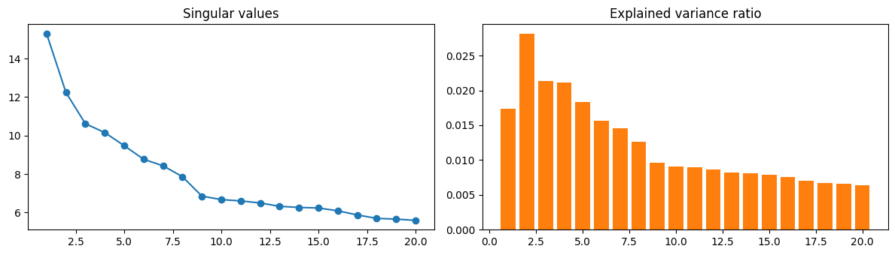
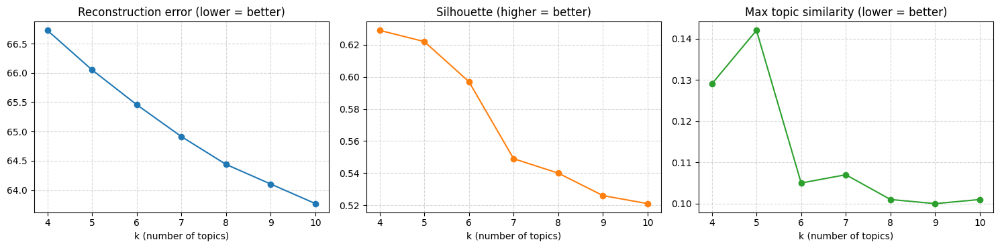
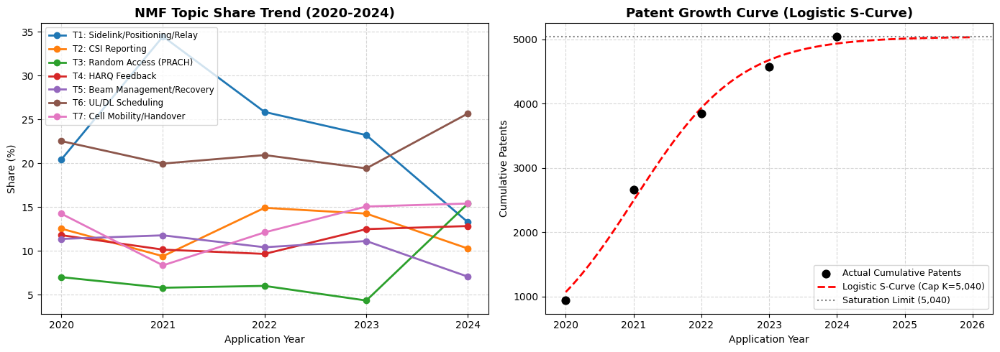
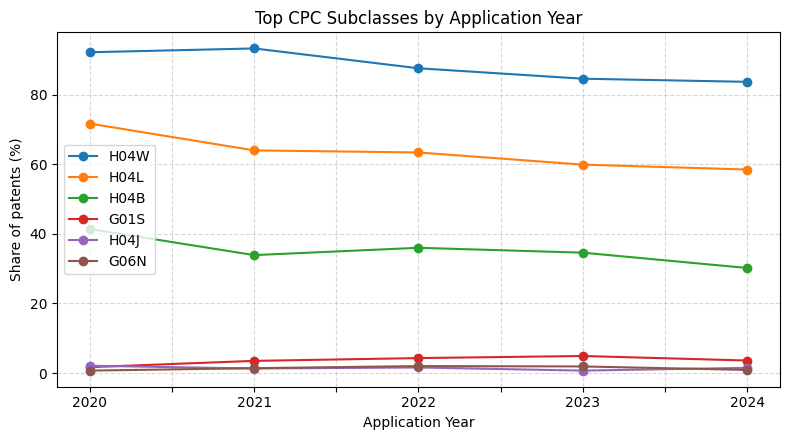
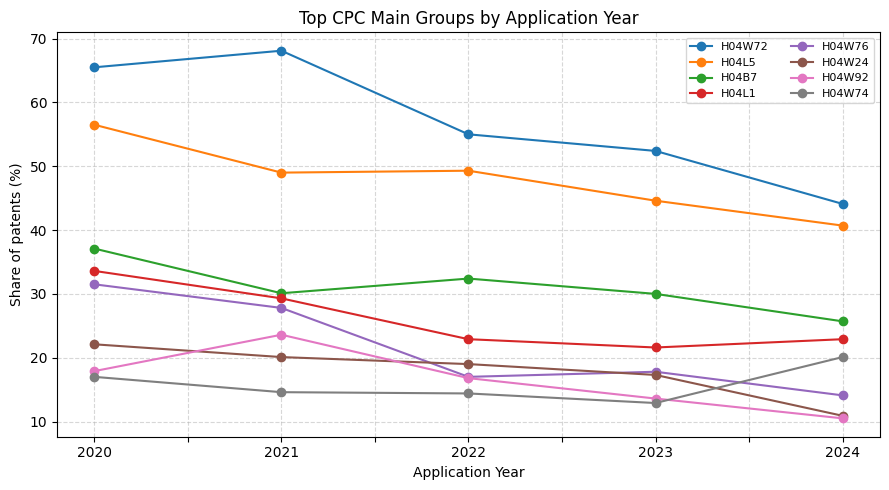
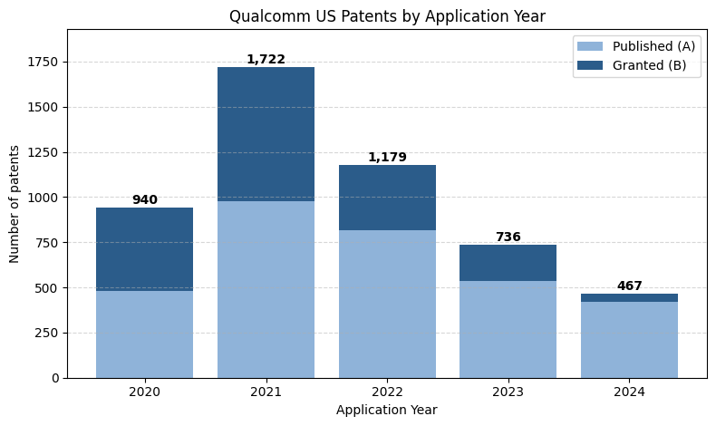
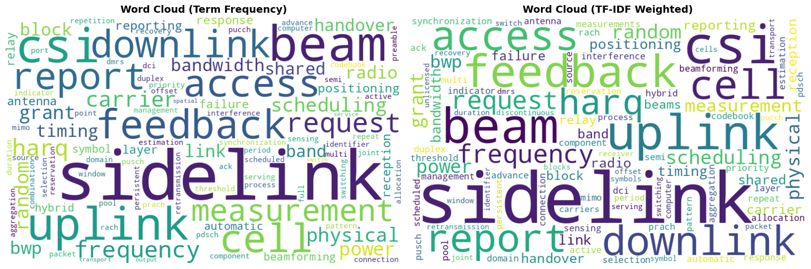

# Colab 코드 기반 시각자료

[사용자 지정 Colab](https://colab.research.google.com/drive/1OFHVdEM3WOPGr-xsYPCWkFzaEIOKfyn8)의 저장된 실행 결과를 2026년 11월 25일 추출했다. 원본 코드를 확인하고 보고서 항목별로 그래프를 배치했다. 이번 작업에서는 노트북을 재실행하지 않았다.

입력 파일은 코드의 `Qualcomm_patents_2020-2024.csv`다. 동일 출원번호는 등록본을 우선 유지한다. TF-IDF는 최대 1,000특성, max_df=0.5이며 NMF 최종 토픽 수는 7개다. 입력 파일을 새로 확보해 재실행할 때에는 원본과 동일한 데이터인지 확인해야 한다.

- [원본 노트북과 실행 결과](./code/analysis.ipynb)
- [저장된 실행 로그](./code/saved_execution_log.txt)

셀 10의 오른쪽 S곡선은 탐색적 적합 결과다. 보고서 본문에는 왼쪽의 관측된 연도별 비중을 사용하고 미래 추세 해석은 별도 검증한다. 이전 11 폴더의 그래프 2개는 보고서 표로 재작성한 자료이며, 이 폴더에는 코드의 실제 저장 출력을 수록했다.

## 5장 보조 분석

LSA 20개 성분의 설명분산

원본 코드 셀 5의 저장된 실행 결과.

## 5.2 토픽 수 선정

NMF 토픽 수별 재구성 오차·실루엣·중첩

원본 코드 셀 9의 저장된 실행 결과.

## 6장 기술 변화

연도별 토픽 비중과 탐색적 S곡선

원본 코드 셀 10의 저장된 실행 결과.

## 3.3 CPC 분포

CPC 서브클래스 분포

원본 코드 셀 14의 저장된 실행 결과.

## 4.2 CPC 변화

주요 CPC의 연도별 변화

원본 코드 셀 15의 저장된 실행 결과.

## 4.2 자료 구성

연도별 공개본·등록본 구성

원본 코드 셀 18의 저장된 실행 결과.

## 4장 텍스트 탐색

빈도 및 TF-IDF 워드클라우드

원본 코드 셀 19의 저장된 실행 결과.

## 코드의 표 출력

- [셀 1 표 1](./tables/cell_01_01.html)
- [셀 6 표 0](./tables/cell_06_00.html)
- [셀 7 표 0](./tables/cell_07_00.html)
- [셀 7 표 1](./tables/cell_07_01.html)
- [셀 8 표 0](./tables/cell_08_00.html)
- [셀 9 표 0](./tables/cell_09_00.html)
- [셀 10 표 0](./tables/cell_10_00.html)
- [셀 10 표 2](./tables/cell_10_02.html)
- [셀 10 표 4](./tables/cell_10_04.html)
- [셀 11 표 1](./tables/cell_11_01.html)
- [셀 12 표 1](./tables/cell_12_01.html)
- [셀 12 표 3](./tables/cell_12_03.html)
- [셀 13 표 0](./tables/cell_13_00.html)
- [셀 13 표 1](./tables/cell_13_01.html)
- [셀 14 표 1](./tables/cell_14_01.html)
- [셀 14 표 2](./tables/cell_14_02.html)
- [셀 15 표 0](./tables/cell_15_00.html)
- [셀 15 표 1](./tables/cell_15_01.html)
- [셀 15 표 2](./tables/cell_15_02.html)
- [셀 16 표 1](./tables/cell_16_01.html)
- [셀 17 표 0](./tables/cell_17_00.html)