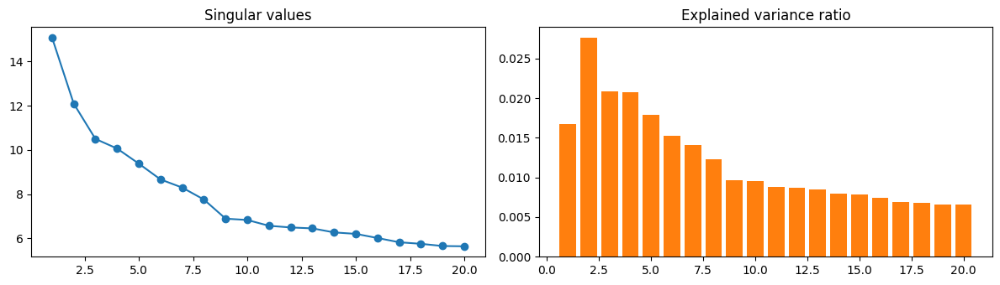
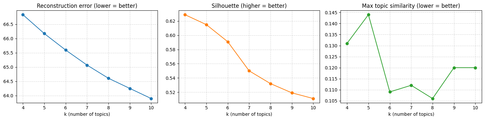
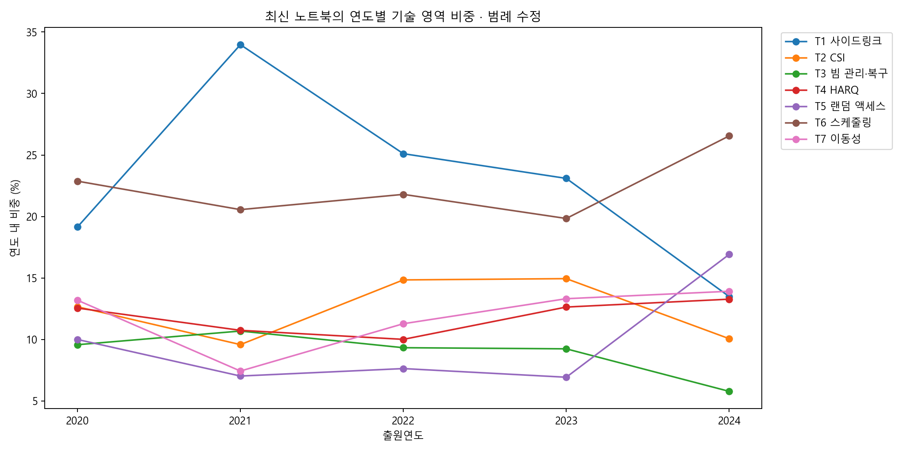
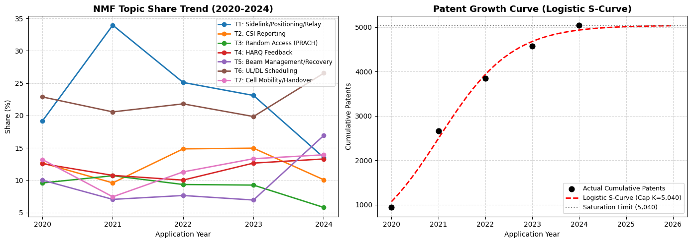
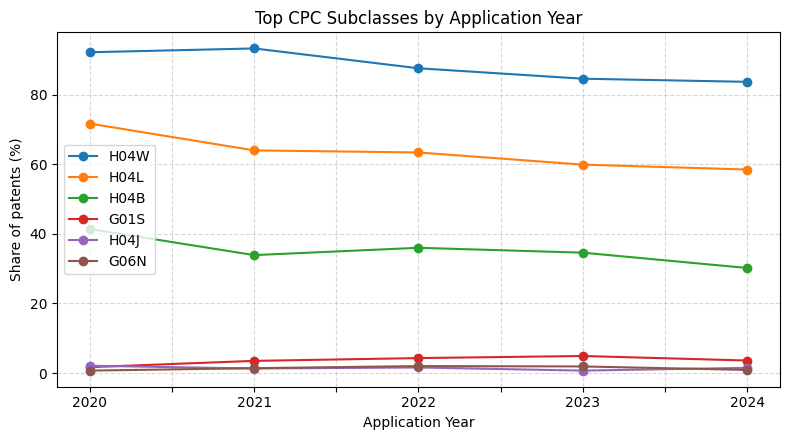
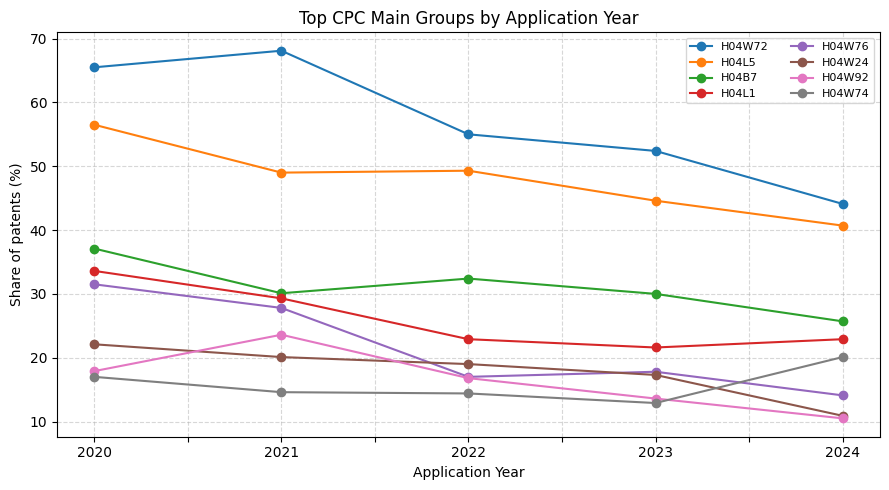
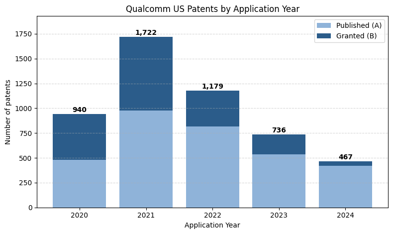
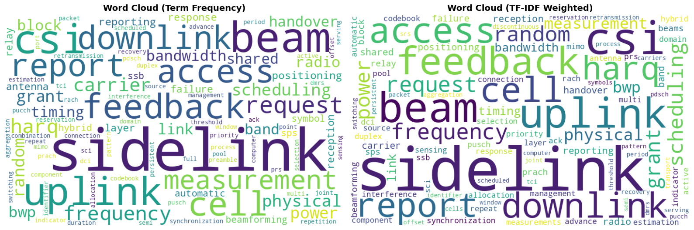

# 최신 노트북 기반 퀄컴 특허 분석

사용자가 제공한 `12주차_수업_내용_바탕_분석_1 (1).ipynb`의 코드와 저장된 실행 결과를 2026년 11월 25일 정리했다. 노트북을 새로 실행한 결과와 구분해 저장된 출력값을 사용했다.

- [최신 원본 노트북](./코드/latest_analysis.ipynb)
- [최신 실행 로그](./코드/latest_execution_log.txt)
- [이전 로컬 복합어 통합 비교](./이전_복합어비교.md)

## 전처리와 분석 설정

| 항목 | 최신 코드와 실행 결과 |
|---|---|
| 입력 | Qualcomm_patents_2020-2024.csv, 5,073문헌 |
| 중복 처리 | 같은 출원번호에서 등록본 우선 보존, 29문헌 제거 |
| 분석 대상 | 미국 출원 2020~2024, 5,044문헌 |
| 토큰화 | 영문·숫자를 유지하고 순수 숫자는 제외 |
| 짧은 약어 | NR은 목록에 없음. NTN·AI·ML·TCI·SSB·SRS·SCI·V2X 등 명시된 목록 보존 |
| 복합어 통합 | 별도 치환 규칙 없음. 밑줄도 정규식에서 공백으로 바뀜 |
| TF-IDF | 5,044×1,000, max_df=0.5, 비영 원소 비율 1.33% |
| NMF | 최종 k=7, random_state=42, max_iter=500 |
| LSA | 20성분, 누적 설명분산 24.1% |

이전 로컬 실험은 복합어 통합까지 적용했다. 최신 노트북은 숫자 포함 기술어·짧은 약어 보존을 적용한 분석이므로 두 결과를 같은 모델로 취급하면 안 된다. 아래 수치는 최신 노트북 출력이다.

## 기술 영역 구성

| 토픽 | 잠정 기술명 | 문헌 수 | 비중 |
|---|---|---:|---:|
| T1 | 사이드링크 | 1,294 | 25.7% |
| T2 | CSI 측정·보고 | 616 | 12.2% |
| T3 | 빔 관리·복구 | 479 | 9.5% |
| T4 | HARQ | 576 | 11.4% |
| T5 | 랜덤 액세스 | 435 | 8.6% |
| T6 | 스케줄링 | 1,096 | 21.7% |
| T7 | 이동성·핸드오버 | 548 | 10.9% |

최신 토픽 번호는 T3=빔, T5=랜덤 액세스다. 이전 보고서의 번호와 대표 특허를 인용할 때 이 대응 관계를 확인해야 한다. 비중은 반올림한 값이다.

## 연도별 기술 영역 비중

| 기술 영역 | 2020 | 2021 | 2022 | 2023 | 2024 |
|---|---:|---:|---:|---:|---:|
| 사이드링크 | 19.15% | 33.97% | 25.11% | 23.10% | 13.49% |
| CSI | 12.66% | 9.58% | 14.84% | 14.95% | 10.06% |
| 빔 | 9.57% | 10.69% | 9.33% | 9.24% | 5.78% |
| HARQ | 12.55% | 10.74% | 10.01% | 12.64% | 13.28% |
| 랜덤 액세스 | 10.00% | 7.03% | 7.63% | 6.93% | 16.92% |
| 스케줄링 | 22.87% | 20.56% | 21.80% | 19.84% | 26.55% |
| 이동성 | 13.19% | 7.43% | 11.28% | 13.32% | 13.92% |

사이드링크 비중은 2021년 33.97%에서 2024년 13.49%로 20.48%p 감소했다. 랜덤 액세스는 2023년 51건·6.93%에서 2024년 79건·16.92%로 9.99%p 증가했다. 스케줄링은 전 기간 19.84~26.55%다. 이는 수집된 문헌의 구성 변화이며 회사 사업 성과와의 인과는 별도 근거가 필요하다.

## 기술어 보존 점검

NTN·IAB·RIS·AI·ML·XR·IoT·TCI·SSB·SRS·PRS·SPS·SCI·UCI·V2X 등이 TF-IDF 어휘에 포함됐다. 6G·FDD·NRU·MBS는 저장된 점검 결과에서 최대 1,000특성에 포함되지 않은 것으로 나타났다. NR은 짧은 약어 보존 목록에 없어 전처리에서 제거될 수 있다.

## 해석할 때 확인할 사항

연도별 토픽 비중 그래프의 오른쪽 누적 S곡선은 탐색적 적합이다. 누적 출원 건수의 적합만으로 시장 포화나 기술 성숙을 확정하려면 추가 검증이 필요하다.

CPC의 연도별 분모는 각 연도 특허 수이며 한 특허에 복수 그룹이 부여된다. 특허당 평균 CPC 그룹 수가 2020년 4.36에서 2024년 2.95로 줄었으므로 비율 하락을 기술 축소로 바로 해석하기 어렵다. 연도별 공개·등록 문헌 구성도 함께 확인한다.

동일 출원번호 29쌍에서 저장 출력은 우선일 동일 건수를 0으로 표시한다. 결측값끼리의 비교나 파싱 차이도 영향을 줄 수 있어 실제 우선권이 모두 다르다고 해석하기 전에 원자료를 확인해야 한다.

## LSA 20성분 설명분산

출처는 최신 노트북 셀 7의 저장된 실행 결과다.

## NMF 토픽 수 비교

출처는 최신 노트북 셀 15의 저장된 실행 결과다.

## 연도별 기술 영역 비중과 탐색적 S곡선

최신 저장 그래프에는 T3·T5의 기술명이 이전 순서로 남아 있어 범례를 수정한 그래프를 먼저 제시한다. 아래 첫 그래프는 셀 17의 건수 표로 재작성했다.

아래 원본 저장 그래프의 범례는 T3=빔, T5=랜덤 액세스로 읽어야 한다.

출처는 최신 노트북 셀 17의 저장된 실행 결과다.

## CPC 서브클래스 연도별 구성

출처는 최신 노트북 셀 26의 저장된 실행 결과다.

## 연도별 CPC 메인그룹 구성

출처는 최신 노트북 셀 28의 저장된 실행 결과다.

## 연도별 공개본 등록본 구성

출처는 최신 노트북 셀 34의 저장된 실행 결과다.

## 단어 빈도와 TF-IDF 워드클라우드

출처는 최신 노트북 셀 36의 저장된 실행 결과다.

## 최신 표 전체

- [셀 1 표 1](./최신표/cell_01_01.html)
- [셀 9 표 0](./최신표/cell_09_00.html)
- [셀 11 표 0](./최신표/cell_11_00.html)
- [셀 11 표 1](./최신표/cell_11_01.html)
- [셀 13 표 0](./최신표/cell_13_00.html)
- [셀 15 표 0](./최신표/cell_15_00.html)
- [셀 17 표 0](./최신표/cell_17_00.html)
- [셀 17 표 2](./최신표/cell_17_02.html)
- [셀 17 표 4](./최신표/cell_17_04.html)
- [셀 18 표 0](./최신표/cell_18_00.html)
- [셀 20 표 1](./최신표/cell_20_01.html)
- [셀 22 표 1](./최신표/cell_22_01.html)
- [셀 22 표 3](./최신표/cell_22_03.html)
- [셀 24 표 0](./최신표/cell_24_00.html)
- [셀 24 표 1](./최신표/cell_24_01.html)
- [셀 26 표 1](./최신표/cell_26_01.html)
- [셀 26 표 2](./최신표/cell_26_02.html)
- [셀 28 표 0](./최신표/cell_28_00.html)
- [셀 28 표 1](./최신표/cell_28_01.html)
- [셀 28 표 2](./최신표/cell_28_02.html)
- [셀 30 표 1](./최신표/cell_30_01.html)
- [셀 32 표 0](./최신표/cell_32_00.html)
