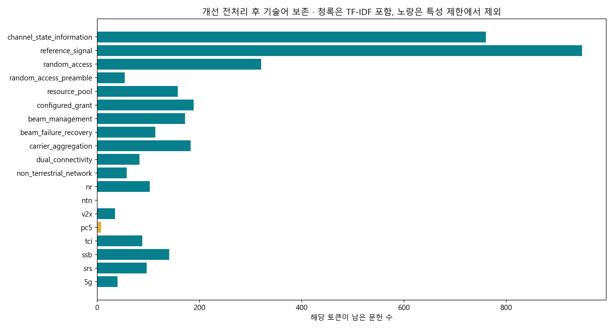
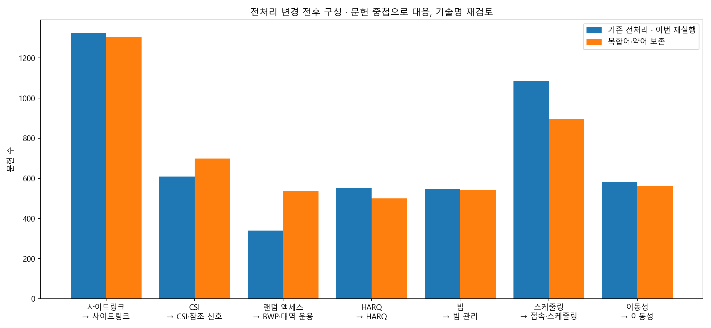
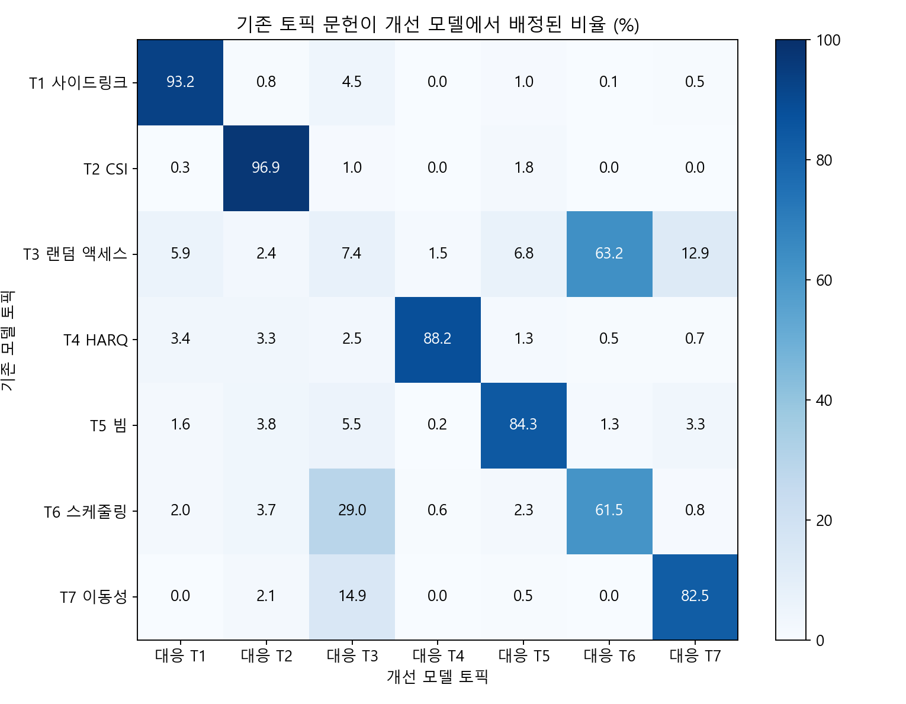
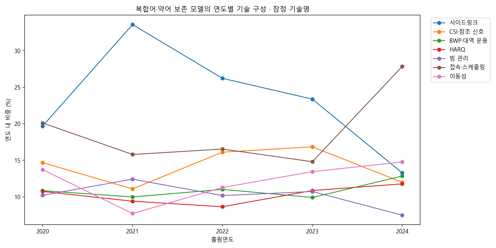

# 복합어와 약어 보존 전후 비교

퀄컴 무선통신 특허 5,044건에 복합어 통합과 약어 보존을 적용하고, 기존 전처리와 같은 로컬 환경에서 NMF를 다시 계산했다. 분석 기간은 출원일 2020~2024다.

| 항목 | 비교 조건과 결과 |
|---|---|
| TF-IDF | 최대 1,000특성, max_df=0.5, 기본 TF·IDF·L2 정규화 |
| NMF | 토픽 7개, random_state=42, max_iter=500 |
| 변경 사항 | 복합어 11개 패턴 통합, 숫자 포함 토큰과 짧은 기술 약어 보존 |
| 고정 사항 | 동일 데이터, 기존 불용어 목록, TF-IDF·NMF 설정 |
| 빈 문헌 | 기존·개선 모두 0건 |
| 토픽 대응 후 문헌 배정 일치율 | 78.29% |
| 조정 랜드 지수 ARI | 0.6925 |

일치율과 ARI는 두 분류 결과의 유사성을 나타낸다. 개선의 정확도나 성능 상승률을 측정한 값으로 해석하려면 별도의 정답·관련성 검증이 필요하다.

## 용어 보존 결과



| 토큰 | 개선 전처리 후 등장 문헌 수 | TF-IDF 포함 |
|---|---:|---|
| channel_state_information | 760 | 포함 |
| reference_signal | 948 | 포함 |
| resource_pool | 158 | 포함 |
| configured_grant | 189 | 포함 |
| beam_failure_recovery | 114 | 포함 |
| non_terrestrial_network | 58 | 포함 |
| nr | 103 | 포함 |
| v2x | 35 | 포함 |
| pc5 | 8 | 제외 |

NTN과 정식 명칭은 non_terrestrial_network로 통합했다. PC5는 전처리에서 보존됐지만 최대 1,000특성 제한에서 빠졌다. 구문별 문헌 수는 최종 토큰 기준이며, 긴 구문을 먼저 치환했으므로 random_access_preamble은 random_access와 별도로 집계된다. [전체 보존 집계](./집계표/term_preservation.csv)

## 토픽 구성의 변화



| 개선 모델 잠정 기술명 | 문헌 수 | 대표 용어 |
|---|---:|---|
| 사이드링크 | 1,306 | sidelink, positioning, resource_pool, relay |
| CSI·참조 신호 | 699 | channel_state_information, report, reference_signal |
| BWP·대역 운용 | 537 | bwp, bandwidth, frequency, switching |
| HARQ | 500 | harq, feedback, repeat, ack |
| 빔 관리 | 544 | beam, beam_failure_recovery, beam_management |
| 접속·스케줄링 | 895 | uplink, random_access, scheduling, configured_grant |
| 이동성 | 563 | cell, handover, serving, mobility |

토픽의 대응은 두 모델의 문헌 배정 중첩 합계를 최대화하는 매칭으로 계산했다. 기존 랜덤 액세스 토픽의 대응 열에는 BWP 중심 토픽이 배치됐다. 두 기술이 동일하다는 의미는 아니며, 새로운 모형에서 토픽 구조가 달라졌음을 보여준다. 새 기술명은 상위 용어로 잠정 부여했으며 대표 특허 검토가 필요하다. [대표 용어와 건수](./집계표/topics.csv)



각 행의 기존 토픽에 속한 문헌이 개선 모델의 어느 토픽으로 배정됐는지 나타낸다. 가로축의 대응 T번호는 위의 매칭 순서다. 랜덤 액세스 관련 용어는 개선 모형에서 접속·스케줄링 묶음에 함께 나타난다.

## 개선 모델의 연도별 구성



연도별 문헌 수는 2020년 940건, 2021년 1,722건, 2022년 1,179건, 2023년 736건, 2024년 467건이다. 한 문헌을 최대 가중치 토픽 하나에 배정하고 해당 연도 문헌 수를 분모로 비율을 계산했다.

사이드링크의 비율은 2021년 33.6%에서 2024년 13.3%로 감소했다. 접속·스케줄링은 2023년 14.8%에서 2024년 27.8%로 증가했다. 기존 보고서의 랜덤 액세스 단독 추세와는 토픽 정의가 달라 직접적인 증감 비교에 주의가 필요하다. [연도별 비율](./집계표/new_yearly_shares.csv)

## 비교 범위와 한계

로컬 기준 모델의 건수는 1,324·609·340·552·548·1,087·584건이다. Colab 저장 결과 1,324·609·341·552·548·1,066·604건과 일부 차이가 있다. 문헌 수와 연도별 건수는 일치하지만 원본 입력파일·라이브러리 환경이 완전히 동일하다고 확정할 수 없다. 이번 비교는 같은 로컬 환경에서 계산한 기존·개선 전처리 간 통제 비교다.

복합어 통합과 토큰 추출·약어 보존을 함께 바꿨으므로 각 변경의 단독 효과를 분리하려면 추가 실험이 필요하다. 기술어 보존은 확인됐고, 7개 토픽의 최종 채택은 토픽 수 비교와 대표 문헌 검토 이후 결정한다.

## 자료와 재현

- [집계표와 설정](./집계표/)
- [실행 코드](./코드/run_comparison.py)
- [기존 Colab 노트북 사본](../12_Colab코드_시각화/code/analysis.ipynb)

Python에서 numpy, pandas, scipy, scikit-learn, matplotlib을 사용했다. 영어 불용어는 NLTK 공식 데이터의 목록을 코드 폴더에 동봉했다. [불용어 원본](https://github.com/nltk/nltk_data/blob/gh-pages/packages/corpora/stopwords.zip)

저장소 루트에서 실행한다. 입력 폴더에는 사용자 제공 v2_Lens_퀄컴_무선통신_요약전수검토_2015-2024.csv가 필요하다. 출력 폴더는 새 실험용 경로를 지정한다.

```powershell
python "13_복합어_약어보존_비교/코드/run_comparison.py" --inputs "<원본 CSV 폴더>" --output "<실험 결과 폴더>"
```

코드는 수치 집계와 비교 그래프를 재생성한다. 게재된 연도별 선 그래프는 new_yearly_shares.csv의 수치로 작성했다.
